# Mermaid Implementation Playbook

Practical syntax reference and examples for each supported diagram type.

---

## Choosing the Right Diagram Type

| Need | Use |
|---|---|
| Process flow / decision tree | `flowchart` |
| System/API interactions over time | `sequenceDiagram` |
| Data structure / object model | `classDiagram` or `erDiagram` |
| State transitions | `stateDiagram-v2` |
| Scheduling / milestones | `gantt` |
| User experience flow | `journey` |
| Proportional data | `pie` |
| Git branching strategy | `gitGraph` |
| 2×2 comparison | `quadrantChart` |
| Chronological events | `timeline` |

---

## flowchart

Use for process flows, decision trees, and pipelines.

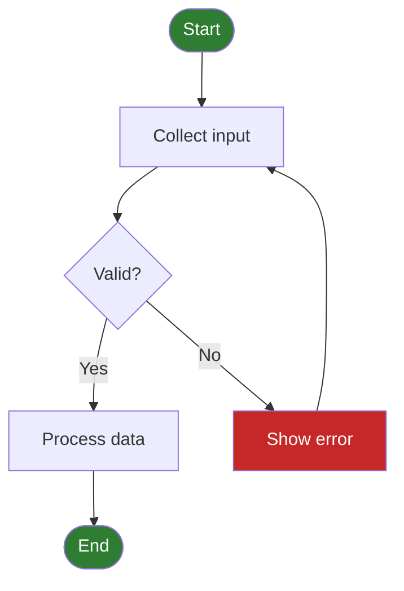

**Key syntax:**
- `TD` = top-down, `LR` = left-right
- `[]` rectangle, `{}` diamond, `()` rounded, `([])` stadium, `[/\]` trapezoid
- `-- label -->` labelled edge, `-.->` dashed, `==>` thick

---

## sequenceDiagram

Use for API calls, authentication flows, and service interactions.

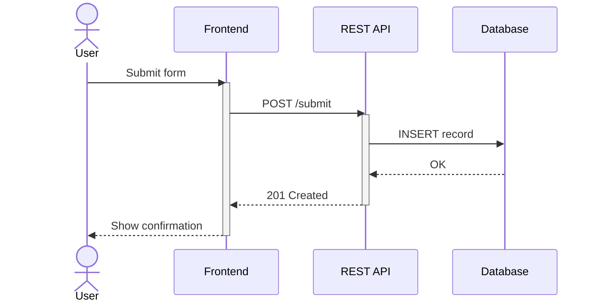

**Key syntax:**
- `->>` solid arrow, `-->>` dashed reply
- `activate` / `deactivate` for lifeline boxes
- `actor` for human participants
- `Note over A,B: text` for annotations
- `loop`, `alt`, `opt`, `par` for control blocks

---

## classDiagram

Use for object models, domain models, and interface contracts.

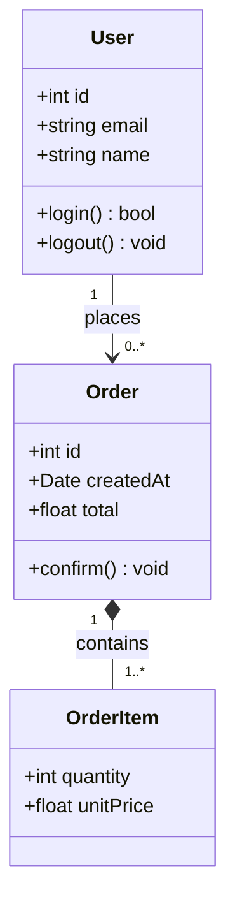

**Key syntax:**
- `+` public, `-` private, `#` protected
- `<|--` inheritance, `*--` composition, `o--` aggregation, `-->` association
- `<<interface>>`, `<<abstract>>` stereotypes

---

## erDiagram

Use for database schemas and entity relationships.

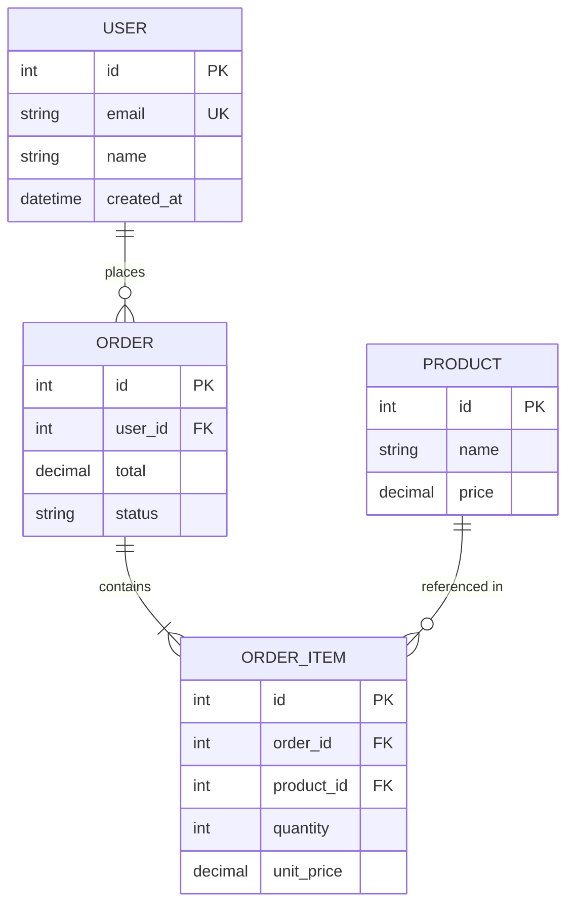

**Key syntax:**
- `||--||` one-to-one, `||--o{` one-to-many, `}o--o{` many-to-many
- `PK`, `FK`, `UK` column constraints

---

## stateDiagram-v2

Use for lifecycle states, workflow steps, and mode transitions.

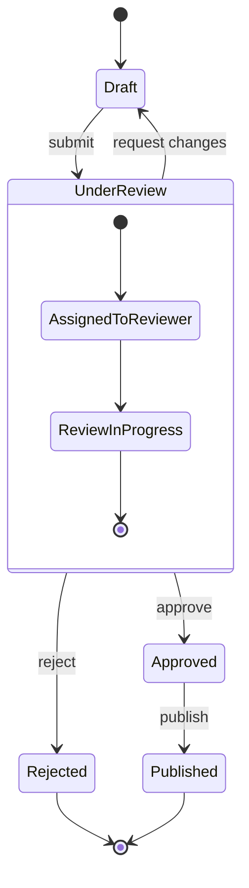

**Key syntax:**
- `[*]` entry/exit pseudo-state
- Nested states with `state Name { ... }`
- `--` for concurrent (fork) states

---

## gantt

Use for project timelines, sprints, and release schedules.

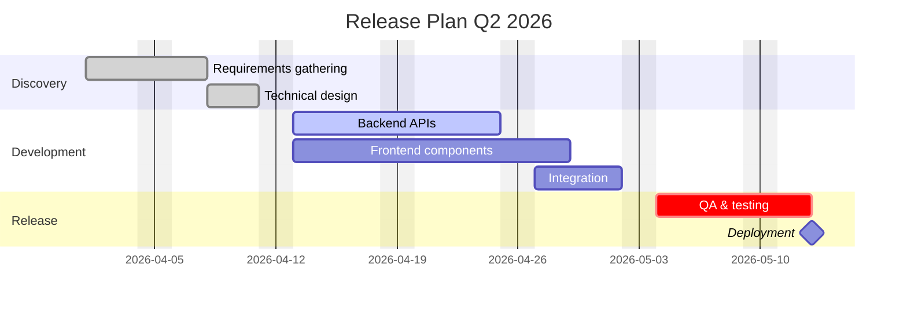

**Key syntax:**
- `done`, `active`, `crit` status modifiers
- `after <id>` for sequencing
- `milestone` for zero-duration milestone markers
- `dateFormat` controls input date parsing

---

## journey

Use for user experience flows and customer journeys.

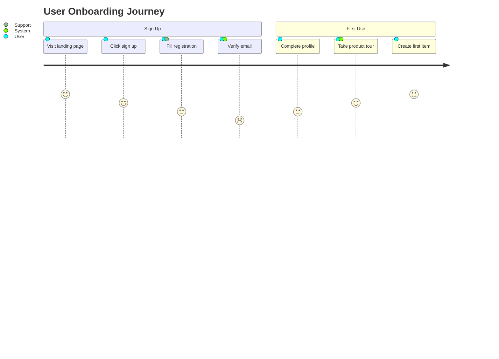

**Key syntax:**
- Score 1–5 (1 = worst, 5 = best)
- Multiple actors per step separated by `,`

---

## pie

Use for proportional data and distribution breakdowns.

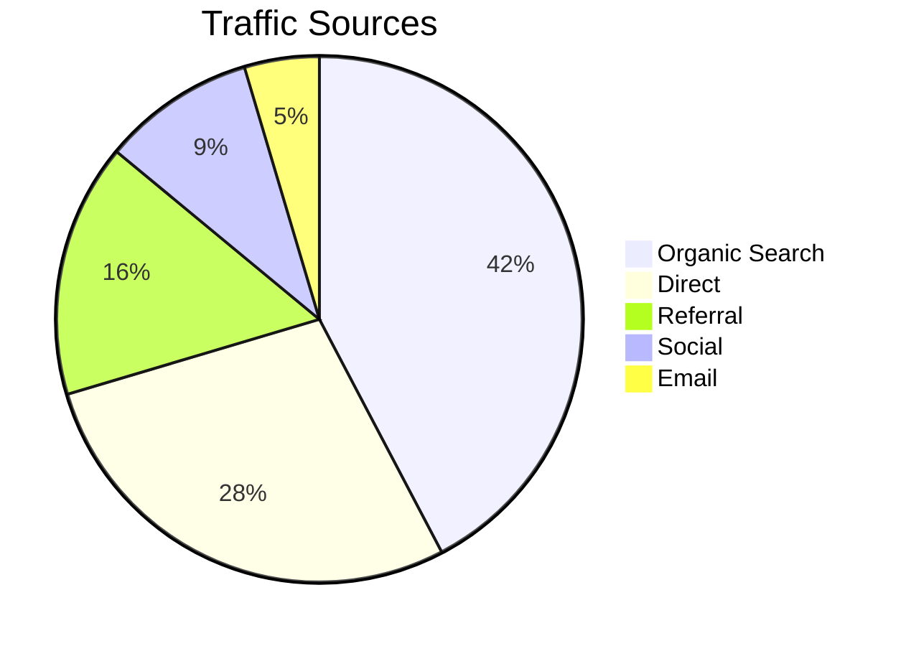

---

## gitGraph

Use for branching strategies and release models.

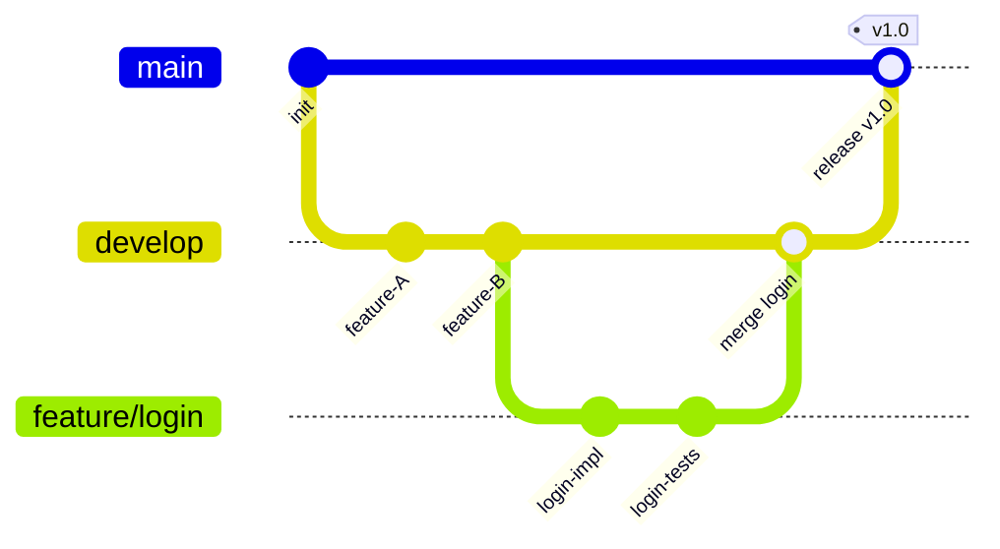

---

## quadrantChart

Use for 2×2 prioritization matrices (effort/value, risk/impact).

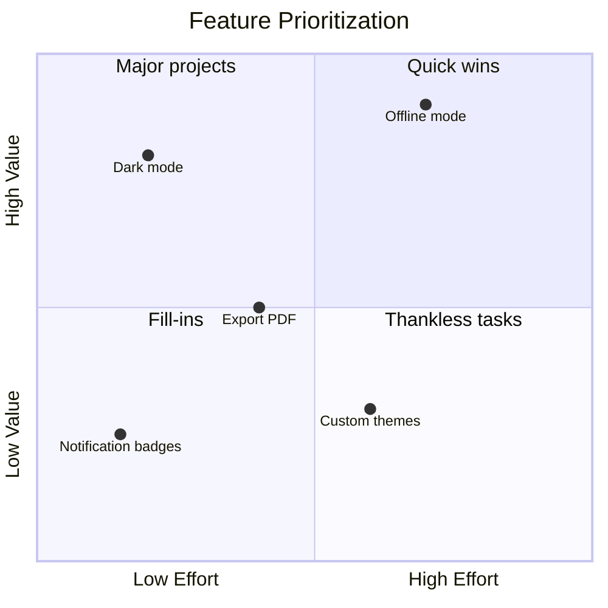

---

## timeline

Use for historical events, product history, and roadmaps.

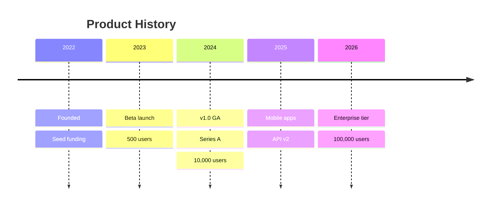

---

## Styling Reference

### Node colors (flowchart)
```
style NodeId fill:#hexcolor,stroke:#hexcolor,color:#hexcolor
```

### Class-based styling (flowchart)
```
classDef primary fill:#1976D2,stroke:#0D47A1,color:#fff
class A,B primary
```

### Theme variables (all diagrams)
```
%%{init: {'theme': 'base', 'themeVariables': {
    'primaryColor': '#1976D2',
    'primaryTextColor': '#fff',
    'primaryBorderColor': '#0D47A1',
    'lineColor': '#555',
    'background': '#fff'
}}}%%
```

### Available themes
- `default` — light, neutral
- `base` — minimal, fully customizable
- `dark` — dark background
- `forest` — green tones
- `neutral` — muted grays

---

## Contrast: colour it for both themes

A Mermaid SVG is transparent, and the reader's theme decides the page behind it. Only text sitting inside a filled shape carries its own contrast; message labels, edge labels and `rect` band text are drawn straight onto the page colour. Two rules keep one diagram readable in light and dark, without locking it to either:

- **A band or backdrop takes alpha, never an opaque colour.** In a `sequenceDiagram`, `rect rgb(220, 235, 255)` paints an opaque pastel over the page while the message labels on top keep the theme's own text colour, so a dark theme writes white on near-white. `rect rgba(74, 158, 255, 0.12)` tints what is behind it instead of replacing it, and the label keeps its contrast either way. The same holds for any `fill` under text whose colour you are not also setting.
- **A fill that carries `color:#fff` has to be dark enough to earn it.** Text inside a shape is the one case that does not depend on the page, so it is also the one place a fixed pair must genuinely pass 4.5:1. The cheerful mid-tones fail it: `#4a9eff` 2.75:1, `#51cf66` 2.01:1, `#ff6b6b` 2.78:1, `#4CAF50` 2.78:1 against white text. Their dark equivalents pass: `#1565c0` 5.75:1, `#c62828` 5.62:1, `#2e7d32` 5.13:1.

Check a pair rather than trusting it to look fine:

```bash
python -c "
def L(h):
    c=[int(h[i:i+2],16)/255 for i in (1,3,5)]
    c=[x/12.92 if x<=.03928 else ((x+.055)/1.055)**2.4 for x in c]
    return .2126*c[0]+.7152*c[1]+.0722*c[2]
a,b=L('#2e7d32'),L('#ffffff'); print(round((max(a,b)+.05)/(min(a,b)+.05),2))"
```

A render tool's PNG cannot show the defect: it is flattened onto white. Composite the raw SVG onto the reader's actual background in an HTML file and look at it.

---

## Common Pitfalls

| Problem | Fix |
|---|---|
| Diagram doesn't render | Check for unclosed brackets or missing `end` |
| Labels unreadable in the reader's dark theme | Opaque light `rect rgb(...)` or a light `fill` under theme-coloured text; see Contrast above |
| Labels with special chars break syntax | Wrap in `"quotes"` |
| Arrow labels not showing | Use `-- label -->` not `--label>` |
| ERD cardinality wrong side | Check `\|\|` vs `o\|` direction matches intent |
| Gantt dates not parsing | Verify `dateFormat` matches your date strings |
| Long node labels overflow | Shorten label or use `<br/>` for line break |
