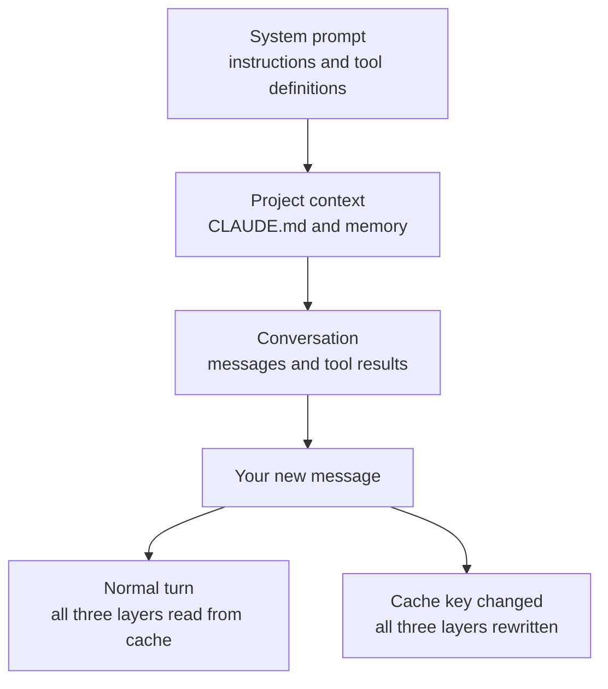

# Select the Right Model and Keep the Prompt Cache Warm

## Available Models

| Model | Best For |
|-------|----------|
| Fable 5.1 | Demanding reasoning and long-horizon agentic work, or when Opus 5.5 at higher effort still falls short |
| Opus 5.5 (Default) | Complex reasoning, multi-step planning, challenging architectural decisions, agentic coding |
| Opus 5.5 (1M context) | Same as Opus but with the extended context window selected explicitly: billed as extra usage |
| Sonnet 5.5 | Everyday tasks, general-purpose coding, standard workflows, best value |
| Haiku 5.5 | Fastest responses, quick answers, simple lookups, tight token budgets (200K context) |

Opus 5, Sonnet 5, Opus 4.8, Opus 4.7, and Sonnet 4.6 remain selectable for teams that pinned an older model, but new work should start on Fable 5.1, Opus 5.5 or Sonnet 5.5.

## Fast Mode

Fast mode runs Claude Opus with faster output rather than downgrading to a smaller model. Toggle it with `/fast`. It is available on Opus 5.5, Opus 5, and Opus 4.8, not on Fable 5.1, and it is priced above standard Opus usage, so reach for it when turnaround matters more than token spend.

## Token Usage & Cost Awareness

Defaulting to the strongest models (Fable or Opus) on every task wastes tokens and increases costs unnecessarily. Haiku handles most everyday coding tasks efficiently and costs a fraction of Opus, while Sonnet provides an excellent middle ground for moderately complex work. Save Opus for situations where the task genuinely requires its advanced reasoning capabilities, such as complex system design or intricate debugging. Fable goes one step further, for demanding long-horizon agentic work where Opus at higher effort still falls short. By matching model strength to task complexity, you optimize both spending and response latency without sacrificing quality.

## Working Past Your Plan Limit

Subscription plans meter usage against a per-seat allowance rather than a token balance. When you hit it, usage credits let you keep working, and `/usage-credits` opens the right place for your role: billing settings for a Pro or Max subscriber, the organization's usage settings for a Team or Enterprise member with billing access, and a request to your admins for everyone else. The command needs a claude.ai login through `/login` and is unavailable with API key authentication.

Run `/usage` to see where you stand. On a paid plan it also breaks recent usage down by skill, subagent, plugin, and MCP server, and flags any behaviour accounting for 10% or more of it.

## The Other Half of the Bill

Tier selection is one lever, and it is the smaller one in a long session. What you send every turn matters more than which model reads it, because the whole conversation ships with every message. [Keep the Prompt Cache Warm](#keep-the-prompt-cache-warm) covers the mechanism that makes that affordable and the actions that throw it away, including the `/model` switch this topic is about.

## What the Context Window Holds

The context window is everything the model can see while it writes one response: its instructions, the tools it may call, the conversation so far, and the response itself. It is measured in tokens, and its size depends on the model; Opus 5.5 in Claude Code reports a window of one million tokens. Anything outside the window does not exist for the model, whether that is a file Claude has not read yet or a decision from yesterday's session.

A Claude Code session fills the window in a fixed order. The first parts load at session start and stay the same from turn to turn, while the conversation grows with every message you send and every tool Claude runs.

| Part | What it contains | When it loads |
|---|---|---|
| System prompt | Claude Code's core instructions, the environment (working directory, platform, git status), the output style | Session start |
| System tools | Definitions of the built-in tools such as Read, Edit, Bash and Grep | Session start |
| MCP tools | Tool names and server instructions; a full tool definition loads once Claude uses that tool | Session start, then on first use |
| Custom agents and skills | One short description per agent and per skill; a skill's full body loads when it is invoked and stays | Session start, then on invocation |
| Memory files | CLAUDE.md files, unscoped rules, and the first 200 lines of auto memory | Session start, and again after `/compact` |
| Messages | Your prompts, Claude's responses and thinking, every tool call and every tool result | Every turn |
| Free space | Room for the next response and the next tool results | Shrinks every turn |

Messages are where the window fills. A file Claude reads stays in the conversation until the next compaction, and so does the output of every command it runs, so a session that has read twenty files carries all twenty into every later turn.


Run `/context` to see the breakdown for your own session. This is the category table from a fresh Opus 5.5 session in a repository with several MCP servers connected (model `claude-opus-5-5`, 34.4k of 1m tokens used, 3%):

| Category | Tokens | Percentage |
|----------|--------|------------|
| System prompt | 4.4k | 0.4% |
| System tools | 6k | 0.6% |
| MCP tools | 1.3k | 0.1% |
| MCP server instructions | 3.2k | 0.3% |
| MCP tools (deferred) | 230.7k | 23.1% |
| System tools (deferred) | 14.3k | 1.4% |
| Custom agents | 5.9k | 0.6% |
| Memory files | 3.8k | 0.4% |
| Skills | 9.9k | 1.0% |
| Messages | 10 | 0.0% |
| Free space | 932.6k | 93.3% |
| Autocompact buffer | 33k | 3.3% |

The two deferred rows are listed for information and stay out of the total: the 34.4k are the loaded rows added up, and the 230.7k of deferred MCP definitions cost nothing until Claude calls one of those tools. The autocompact buffer is space Claude Code holds back so that compaction can run before the window is full.

When the window fills, auto-compaction replaces the conversation with a structured summary, then reloads CLAUDE.md, auto memory and up to five recently touched files. `/compact` does the same on demand, and `/clear` starts over with an empty conversation. A subagent works in its own separate window and hands back only its summary, which keeps a large search out of yours.

## A Short Conversation History

A short history makes the window concrete. One prompt from you can produce several API requests: each tool call ends a request, Claude Code runs the tool on your machine, and the result goes back to the model at the end of the next request. This is the history Claude Code sends with your second prompt, after Claude answered the first one by reading a file:

```text
tools       Read, Edit, Bash, Grep, ... and the MCP tool names
system      Claude Code instructions, environment, output style
memory      CLAUDE.md, rules, auto memory
user        What does GET /todos return?
assistant   tool_use: Read Controllers/TodosController.cs
user        tool_result: the content of TodosController.cs
assistant   A list of todos, served by the HttpGet action of TodosController.
user        Add a filter that returns only open todos.          <- new
```

The tool result travels in a user message, because in the API only the client can supply it. Every row above the last two was already part of the previous request, and the last two are what this turn adds.

The prompt cache lives on Anthropic's servers, in the infrastructure that serves the model. Claude Code keeps no cache of its own: it re-sends the full text, and the server recognizes the prefix it processed for the previous request and skips that work. In the history above, everything up to the tool result is read from the cache, and the answer plus your new prompt are processed fresh and written to the cache for the next turn. The response reports both parts as `cache_read_input_tokens` and `cache_creation_input_tokens`, beside `input_tokens` for anything left uncached.


## Keep the Prompt Cache Warm

The model remembers nothing between requests. Every turn you send, Claude Code re-sends the whole context: the system prompt, your project context, every prior message and tool result, and your new message. Prompt caching is how the API avoids reprocessing the part that did not change, and it is the single largest cost and latency lever in a long session.

Claude Code manages the cache for you, so there is nothing to switch on. What is worth knowing is which of your own actions throw the cache away, because each one buys you a slower, more expensive turn while the prefix rebuilds. Most of them are avoidable once you know they cost something.

## How the Cache Is Organized

The API caches by matching the start of each request, called the prefix, against content it recently processed. The match is exact, so a change anywhere in the prefix recomputes everything after it. There is no per-file or per-segment caching. Claude Code therefore orders each request so the content that rarely changes comes first.

| Layer | Content | Changes when |
|---|---|---|
| System prompt | Core instructions, tool definitions, output style | The set of loaded tool definitions changes, or Claude Code is upgraded |
| Project context | CLAUDE.md, auto memory, unscoped rules | Session starts, or after `/clear` or `/compact` |
| Conversation | Your messages, Claude's responses, tool results | Every turn |

A change in the conversation layer leaves the two layers above it cached, which is the normal case: you append a message, everything before it is read from cache. A change in the system prompt invalidates all three, because every later token now sits behind a different prefix.



Two settings are part of the cache key without appearing in the prompt text at all. Each model has its own cache, so switching models recomputes the request even when every token is identical. Each effort level has its own cache for the same model, which is why Claude Code asks you to confirm an effort change once a conversation is under way.

## What a Cache Hit Is Worth

Every API response reports two token counts, and the ratio between them tells you whether caching is working.

| Field | Meaning |
|---|---|
| `cache_creation_input_tokens` | Tokens written to the cache this turn, billed at the cache write rate |
| `cache_read_input_tokens` | Tokens served from cache this turn, billed at roughly 10% of the standard input rate |

A high read-to-creation ratio is healthy. If creation stays high turn after turn, something in your prefix keeps changing, and the tables below are the list of usual suspects. Cache writes cost more than plain input tokens, which is why an avoidable invalidation is charged twice: once to re-read the history and once to write the new prefix.

## Actions That Break the Cache

Each of these costs one slower, more expensive turn, after which the new prefix is cached.

| Action | What happens |
|---|---|
| `/model` switch | Each model has its own cache. The next request reads the whole history with no hits. |
| `/effort` change | Effort level is part of the cache key. Claude Code confirms first once a conversation has started. |
| Turning on fast mode | Adds a request header that is part of the cache key. Costs once per conversation, so turning it on early is cheaper than deep into a long session. |
| Connecting or disconnecting an MCP server | Only when its tools load into the prefix. Deferred tools, the default on supported models, append and leave the cache intact. |
| Enabling or disabling a plugin | Only when the plugin provides MCP servers. Skills, commands, agents, hooks and themes are appended and are cache-safe. |
| Denying an entire tool | A bare deny rule such as `Bash` or `WebFetch` removes the tool from the system prompt. Scoped rules like `Bash(rm *)` do not. |
| `/compact` | Replaces the history with a summary, so the conversation layer no longer shares a prefix with the old one. |
| Upgrading Claude Code | A new version usually changes the system prompt or tool definitions. Resuming a long session after an upgrade is the most expensive request you can send. |

Plan mode is cache-safe on its own, because its instructions are appended as conversation messages. The exception is the `opusplan` setting, which resolves to Opus in plan mode and Sonnet during execution, so every plan-mode toggle is a model switch.

## Actions That Keep the Cache

| Action | Why it is safe |
|---|---|
| Editing files in your repository | Reads append to the conversation. Claude Code appends a note that the file changed rather than rewriting the earlier read. |
| Editing CLAUDE.md mid-session | Root and user CLAUDE.md are read once at session start and held in memory. The cache survives, but the edit does not apply either. |
| Changing output style | Same shape as CLAUDE.md: part of the system prompt, read at session start, so the change waits for the next `/clear` or restart. |
| Changing permission mode | Mode changes touch neither the system prompt nor the tool definitions. |
| Invoking a skill or command | Both inject their instructions as user messages at the point of invocation. |
| `/recap` | Appends the summary as command output instead of replacing the history, unlike `/compact`. |
| `/rewind` | Truncates back to a prefix the cache was already built from, so the next request hits an earlier entry. |
| Spawning a subagent | The subagent builds its own cache. From the parent's side the call and result are appended. |

The CLAUDE.md row is the one that surprises people. A mid-session edit is silently inert: Claude keeps working from the version loaded at session start, and the new content loads on the next `/clear`, `/compact` or restart. Nested CLAUDE.md files in subdirectories behave differently, because they load later, when Claude first reads a matching file.

## Cache Lifetime

Cached prefixes expire after a period of inactivity, and every request that hits the cache resets the timer. The cache stays warm as long as you keep working, which is why the first turn back after a long break is noticeably slower. The API offers a five-minute TTL and a one-hour TTL that bills cache writes at a higher rate.

Claude Code picks the TTL from how you authenticate. On a Claude subscription it requests the one-hour TTL automatically, since usage is included in the plan rather than billed per token; that drops to five minutes once you are drawing on usage credits. On an API key or a cloud provider you pay per token, so the cheaper five-minute TTL is the default and `ENABLE_PROMPT_CACHING_1H=1` opts in. Set `FORCE_PROMPT_CACHING_5M=1` to force the short TTL regardless, which is useful when comparing the two.

## Cache Scope

In Claude Code the cache is effectively scoped to one machine and one directory. The system prompt embeds the working directory, platform, shell, OS version and auto-memory paths, so two sessions in different directories build different prefixes and miss each other's cache. That includes worktrees of the same repository, which is a cost worth knowing before you read [04: Git Worktrees](../04-git-worktrees/readme.md).

Sessions you run in parallel in the same directory build matching prefixes and read each other's cache. Sequential sessions share a prefix only when the git status snapshot taken at startup matches, since the system prompt also captures branch and recent commits.

## Subagents and Forks

A subagent starts its own conversation with its own system prompt and tool set, so it builds its own cache from zero and warms up across its own turns. Subagents use the five-minute TTL even on a subscription, because the automatic one-hour TTL applies to the main conversation only. The parent's prefix is untouched: from its side, the call and the result are appended like any other tool result.

A fork is the opposite. It inherits the parent's system prompt, tools and conversation history exactly, so its first request reads the parent's cache instead of building a new one. Module 06 uses both, and this is the cost difference between them.

## Check Cache Performance

`/usage` reports the two token counts for the current session, broken out per model:

```text
Usage by model:
   claude-sonnet-4-6:  1.2k input, 5.3k output, 940.0k cache read, 50.0k cache write ($0.55)
```

On a Pro, Max, Team or Enterprise plan, `/usage` also flags behaviours that account for 10% or more of recent usage, cache misses among them. For a live reading rather than a session total, a statusline script can read `cache_creation_input_tokens` and `cache_read_input_tokens` straight off the `current_usage` object. Across an organization, the OpenTelemetry exporter reports both counts per user and per session.

## Helpful Claude Slash Commands

| Command | Usage |
|---------|-------|
| `/model` | Switch the active model mid-session without restarting |
| `/fast` | Toggle fast mode on an Opus model for higher output speed |
| `/usage` | Read `cache read` against `cache write` for the session; `/cost` is an alias for it |
| `/compact` | Rebuild the conversation layer deliberately, at a break between tasks |
| `/status` | Display current model, context usage, and session info |
| `/context` | See which layer is filling the window before deciding whether to compact |
| `/rewind` | Abandon a bad path by truncating to an already-cached prefix instead of compacting |
| `/effort` | Set effort once at the top of a session, since a mid-session change recomputes everything |

## Key Topics covered in this module

- [Anthropic model overview](https://platform.claude.com/docs/en/about-claude/models/overview)
- [Claude Code model configuration](https://code.claude.com/docs/en/settings)
- [Claude pricing](https://www.anthropic.com/pricing)
- [How Claude Code uses prompt caching](https://code.claude.com/docs/en/prompt-caching): the layer model, the full invalidation list, TTL and scope
- [Manage costs effectively](https://code.claude.com/docs/en/costs): `/usage` output, why usage climbs in a long session, and the token-reduction levers around caching
- [Prompt caching in the Claude API](https://platform.claude.com/docs/en/build-with-claude/prompt-caching): the underlying mechanism, cache breakpoints and pricing
- [Prompt caching is everything](https://claude.com/blog/lessons-from-building-claude-code-prompt-caching-is-everything): the design rationale behind plan mode, deferred tool loading and compaction
