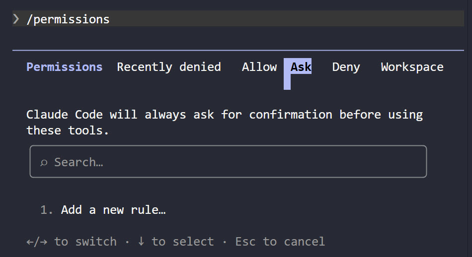

# Configure the Permission Model

Claude Code's permission system controls what Claude can access and execute in your development environment. Unlike a chat interface that only reads and writes text, Claude Code can invoke tools to read files, run shell commands, and interact with your system. Understanding how permissions work is essential for working safely and confidently.

The single most important fact comes first: permission rules are enforced by Claude Code, not by the model. Instructions in your prompt or in `CLAUDE.md` shape what Claude tries to do, but they never change what Claude Code allows. `CLAUDE.md` is guidance; `.claude/settings.json` is enforcement, and only one of the two survives a model that misreads you.

## The Three Permission Tiers

Claude Code sorts every tool call into one of three tiers, and each tier has a different default answer to "does this need my approval?".



| Tier | Example | Approval required | What "don't ask again" does |
|---|---|---|---|
| Read-only | File reads, Grep, Glob | No, inside the working directory | Not applicable |
| Bash commands | Shell execution | Yes, except a built-in read-only set | Saves permanently, per repository and command |
| File modification | Edit and Write | Yes | Lasts until the session ends |

The tiers explain the friction you feel in a fresh project. Reading is free, so Claude explores without interrupting you. Editing always asks, and the approval expires with the session. Bash sits in between: a built-in set of read-only commands runs silently, and everything else prompts until you write a rule.

## Read-Only Commands That Never Prompt

Claude Code recognises a fixed set of shell commands as read-only and runs them without a prompt in every mode: `ls`, `cat`, `echo`, `pwd`, `head`, `tail`, `grep`, `find`, `wc`, `which`, `diff`, `stat`, `du`, `cd`, and the read-only forms of `git`. The set is not configurable. To force a prompt for one of them, add an `ask` or `deny` rule.

This set is why `git status` runs silently in a fresh project while `dotnet build` does not, and it is worth knowing before you conclude that a rule is broken.

## Writing Permission Rules

Rules live in a `permissions` object in a settings file and take the form `Tool` or `Tool(specifier)`. There are three lists:

```json
{
  "permissions": {
    "allow": [
      "Bash(dotnet build)",
      "Bash(git diff *)"
    ],
    "ask": [
      "Bash(git push *)"
    ],
    "deny": [
      "Read(./.env)",
      "Bash(rm -rf *)"
    ]
  }
}
```

Rules are evaluated deny, then ask, then allow, and the first match in that order wins. Specificity never changes the order, which has one consequence worth internalising: a deny rule cannot carry exceptions. Denying `Bash(git push *)` while allowing `Bash(git push origin main)` blocks every push, including the one you meant to permit.

A bare tool name behaves differently from a scoped one. Denying `Bash` removes the tool from Claude's context entirely, so Claude never sees it and never proposes a command. Denying `Bash(rm *)` leaves the tool available and blocks matching calls as they are attempted.

### Bash patterns

Bash rules accept `*` at any position, and the space before it matters. `Bash(ls *)` enforces a word boundary and matches `ls -la` but not `lsof`, while `Bash(ls*)` matches both. The `:*` suffix is an equivalent way to write a trailing wildcard, recognised only at the end of a pattern.

Two behaviours catch people out. Compound commands are checked per subcommand, so `Bash(dotnet build)` does not permit `dotnet build && dotnet run`; the recognised separators are `&&`, `||`, `;`, `|`, `|&`, `&`, and newlines. And a wildcard spans arguments freely, so `Bash(dotnet *)` also allows `dotnet nuget push`. Grant the narrowest pattern that covers your real usage.

Claude Code strips a fixed set of wrappers before matching, so `Bash(dotnet test *)` also covers `timeout 30 dotnet test`. The stripped wrappers are `timeout`, `time`, `nice`, `nohup`, `stdbuf`, the builtins `command` and `builtin`, and zsh's `noglob`. Environment runners such as `npx` and `docker exec` are deliberately not stripped, because a rule like `Bash(docker exec *)` would otherwise permit whatever command follows it.

### File path patterns

`Read` and `Edit` rules use gitignore pattern syntax with four anchors, and confusing them is the most common way to write a rule that protects nothing:

| Pattern | Anchored at | Example |
|---|---|---|
| `//path` | Filesystem root | `Read(//Users/alice/secrets/**)` |
| `~/path` | Home directory | `Read(~/.aws/**)` |
| `/path` | The settings file's own location | `Read(/appsettings.Secrets.json)` |
| `path` or `./path` | Current directory | `Read(./*.env)` |

A single leading slash is not an absolute path: `/Users/alice/file` anchors at the project root. `Edit` rules cover every file-editing tool, and a `Read` deny also blocks editing the same path.

Path rules written for `Write`, `NotebookEdit`, or `Glob` are accepted by the parser but never matched by the file permission checks, so they look like protection and provide none. Claude Code warns at startup for each one, naming the replacement to use. Read the first lines of a session's output after changing a settings file.

Read and Edit deny rules also cover the file commands Claude Code recognises inside Bash, including `cat`, `head`, `tail`, and `sed`, so denying a path closes the obvious shell bypass at the same time. They do not cover arbitrary subprocesses: a Python or Node script that opens the file itself still reads it. For enforcement across every process, enable the sandbox.

## Permission Modes

A mode sets the default answer before any rule is consulted. Set one with `defaultMode` in a settings file, or switch mid-session.

| Mode | Behaviour |
|---|---|
| `default` | Prompts on first use of each tool. Shown as Manual in the CLI |
| `acceptEdits` | Auto-accepts file edits and common filesystem commands in the working directory |
| `plan` | Reads and explores but does not edit your source files |
| `auto` | Auto-approves with background safety checks against your stated request |
| `dontAsk` | Auto-denies anything not pre-approved by an allow rule |
| `bypassPermissions` | Skips prompts entirely. Only for containers and throwaway VMs |

`bypassPermissions` still honours explicit `ask` rules, and still prompts as a circuit breaker for removals targeting the filesystem root or your home directory. Organizations can block it outright with `permissions.disableBypassPermissionsMode`.

## Where Permissions Are Stored

Claude Code reads permission rules from several files and merges them by precedence, from highest to lowest:

| Precedence | Source | Committed to Git |
|---|---|---|
| 1 | Managed settings, deployed by an organization | Not applicable |
| 2 | Command line arguments, for the session only | No |
| 3 | `.claude/settings.local.json` | No |
| 4 | `.claude/settings.json` | Yes |
| 5 | `~/.claude/settings.json` | No |

That ordering decides which allow rule wins. It does not let a lower file weaken a deny: if any level denies a tool, no other level can allow it, because deny rules from every scope are evaluated before allow rules. A teammate cannot quietly re-enable `rm -rf` for themselves in a local file.

Use `.claude/settings.json` for policy the whole team should share and commit it. Use `.claude/settings.local.json` for personal convenience that stays off version control. This is also where Claude Code saves your own choices: selecting "Yes, don't ask again" on a Bash prompt writes the rule to `.claude/settings.local.json` at the repository root, resolved through worktrees to the main checkout, so it applies in subdirectories and parallel sessions too.

**Windows**

```powershell
$env:USERPROFILE\.claude\settings.json
```

**macOS / Linux**

```bash
~/.claude/settings.json
```

## Workspace Trust

Project allow rules only take effect in a workspace you have trusted. Run Claude Code interactively in a directory once and accept the trust dialog; until you do, every `permissions.allow` entry from that project is ignored and a startup line tells you so. Deny rules are unaffected, which is the safe way round, but it means a policy can look inert for a reason that has nothing to do with your patterns.

## Denials Are a Feature

When Claude requests something you want to refuse, refuse it. Claude finds another approach or explains why the operation is needed, and you stay in control. The judgement to build is which decisions belong in a prompt at all: an approval you click twenty times an hour is not a control, it is a reflex, and the prompt that finally matters gets the same reflex.

That is the real argument for writing rules. Pre-approve the narrow, non-destructive commands you run all day so the remaining prompts are few enough to read. Deny the handful whose worst case is unrecoverable so there is no prompt to approve by accident. Everything else keeps asking.

## Helpful Claude Slash Commands

| Command | Usage |
|---------|-------|
| `/permissions` | List every active rule and the settings file each one came from, and edit them |
| `/update-config` | Edit `settings.json` through guided prompts rather than by hand |
| `/status` | Show the active session's model, login, and working directories |
| `/doctor` | Health check the installation, including settings files that fail to parse |

## Key Topics covered in this module

- [Claude Code: configure permissions](https://code.claude.com/docs/en/permissions)
- [Claude Code: permission modes](https://code.claude.com/docs/en/permission-modes)
- [Claude Code: settings files and precedence](https://code.claude.com/docs/en/settings)
- [Claude Code: sandboxing](https://code.claude.com/docs/en/sandboxing)
- [Claude Code in Action course](https://anthropic.skilljar.com/claude-code-in-action/303241)
