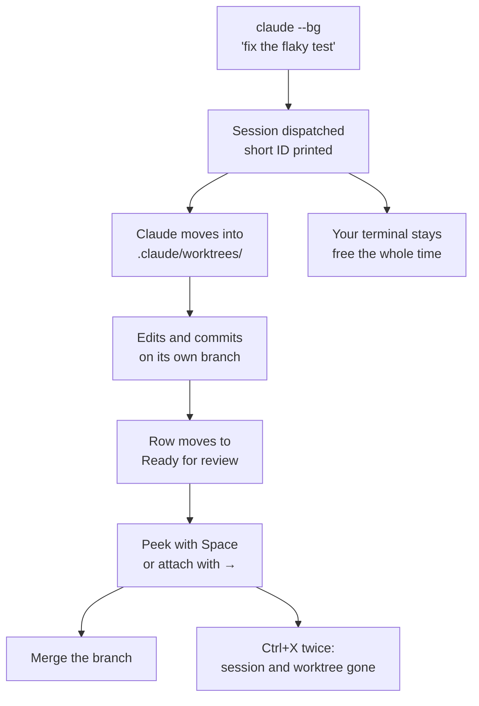

# Supervise Background Sessions with the Agents View

A single Claude session occupies your terminal and your attention. The agents view breaks that one-to-one link: sessions run in the background, and you move between them from one screen, checking on work rather than waiting for it. The shift is from operating a tool to supervising a small team, and the skill it demands is triage, not typing.

Open it with `claude agents`, or press `←` on an empty prompt inside any running session. It requires Claude Code v2.1.139 or later.

```bash
claude agents
```

## Dispatch Work to the Background

A background session starts, runs, and finishes without holding your terminal. Start one from the shell with `--bg`, or send the conversation you are already in to the background with `/background`.

```bash
claude --bg "fix the flaky SettingsChangeDetector test"
claude --bg --name "flaky-test-fix" "investigate the SettingsChangeDetector timeout"
claude --agent code-reviewer --bg "address the review comments on this branch"
```

The command returns immediately, printing a short session ID and the four commands that manage it:

```text
backgrounded · 7c5dcf5d
  claude agents             list sessions
  claude attach 7c5dcf5d    open in this terminal
  claude logs 7c5dcf5d      show recent output
  claude stop 7c5dcf5d      stop this session
```

Naming a session with `--name` is worth the extra words once you have more than three running, because the default label is the prompt itself and long prompts all look alike in a list.

## Read the Board

Sessions are grouped by state, and the ordering is the point: the group that needs you sits at the top.

| Group | Meaning |
|---|---|
| Pinned | Sessions you marked with `Ctrl+T` so they stay running while idle |
| Ready for review | Finished work waiting for you to look at it |
| Needs input | Blocked on a permission prompt or a question |
| Working | Actively running tools or generating |
| Completed | Finished and no longer holding anything |

A second mark shows whether the process itself is alive. An animated `✽` means the session replies immediately, a dim `∙` means the process exited but you can still peek, reply, or attach, and `✢` marks a `/loop` session sleeping between iterations.

When the list grows past a screen, filter it by typing in the dispatch input rather than scrolling:

```text
s:blocked        everything waiting on you
a:code-reviewer  sessions running that named agent
#1234            the session working on that pull request
```

## Work Without Leaving the Board

The view is a control surface, not a list. Most triage never requires attaching to a session at all.

| Key | Action |
|---|---|
| `Space` | Peek at the session's latest output in a panel |
| `Enter` | Attach, or dispatch a new session if you typed a prompt |
| `→` | Attach to the selected session |
| `Shift+Enter` | Dispatch and attach immediately |
| `Ctrl+T` | Pin or unpin, keeping the process running while idle |
| `Ctrl+R` | Rename the session |
| `Ctrl+S` | Switch grouping between state and directory |
| `Ctrl+X` | Stop the session; press again within two seconds to delete |
| `←` | Detach and return to the board |

Peeking is the habit worth building. From the peek panel you can type a reply and send it, press `Tab` to accept a suggested answer, or answer a multiple-choice question by pressing its number, all without losing your place in the list. Detaching never stops a session: `←`, `Ctrl+Z`, `/exit`, and a double `Ctrl+C` all leave it running.

## How File Edits Stay Isolated

Parallel sessions would be useless if they overwrote each other, so before a background session edits any file, Claude moves it into an isolated git worktree under `.claude/worktrees/`. Every session reads the same repository history and writes to its own branch. This is the same mechanism covered in [04: Git Worktrees](../04-git-worktrees/readme.md), applied automatically rather than on request.

Claude skips the worktree in three cases: the session is already inside a linked worktree, the working directory is not a git repository, or the write lands outside the working directory. You can turn the behaviour off with `worktree.bgIsolation`, though doing so puts parallel sessions back in each other's way.

```json
{
  "worktree": {
    "bgIsolation": "none"
  }
}
```

Deletion is where work gets lost. Pressing `Ctrl+X` twice in the agents view removes the session's worktree along with any uncommitted changes in it, while `claude rm` from the shell keeps a worktree that still holds uncommitted changes. Both keep a worktree with unpushed commits, and neither touches worktrees you created yourself. Commit or push anything you want before deleting.



## The Supervisor Behind It

Background sessions outlive the terminal that started them because a separate per-user supervisor process owns them. It keeps one pre-warmed worker ready so dispatch feels instant, restarts a session whose process dies unexpectedly, and reconnects after your machine wakes from sleep. Idle sessions that are not pinned stop after roughly an hour to free resources.

Sessions are local to your machine, so they survive sleep but not a shutdown. Its state lives under `~/.claude/`, which is where to look when something is stuck:

| Path | Holds |
|---|---|
| `~/.claude/daemon.log` | Supervisor log |
| `~/.claude/daemon/roster.json` | The list of running sessions |
| `~/.claude/jobs/<id>/state.json` | Per-session state |

Two commands cover the rest: `claude daemon status` reports the supervisor's state and version, and `claude daemon stop --any` stops it along with every background session, or leaves them running with `--keep-workers`.

## Know the Cost Before You Fan Out

Ten parallel agents consume roughly ten times the quota of one. The view makes dispatching cheap enough that this is easy to forget, and the bill arrives as rate limiting mid-afternoon rather than as an error at dispatch. Fan out when the work is genuinely parallel and each session has a clear finish line, not as a default.

To turn background sessions and the view off entirely, set `disableAgentView` to `true` in settings or set the `CLAUDE_CODE_DISABLE_AGENT_VIEW` environment variable.

## Helpful Claude Slash Commands

| Command | Usage |
|---------|-------|
| `/background` | Send the current conversation to the background and return to the board |
| `/bg` | Background the session with a follow-up instruction to carry on with |
| `/fork` | Copy the current conversation into a second session, optionally with a new task |
| `/model` | Set the model used for sessions dispatched from the agents view |

## Hands-On Demo

[Dispatch and Triage a Fleet of Background Sessions](demo-agents-view.md)

## Key Topics covered in this module

- [Claude Code: agent view](https://code.claude.com/docs/en/agent-view)
- [Claude Code: run agents in parallel](https://code.claude.com/docs/en/agents)
- [Claude Code: worktrees](https://code.claude.com/docs/en/worktrees)
- [Claude Code: manage sessions](https://code.claude.com/docs/en/sessions)
