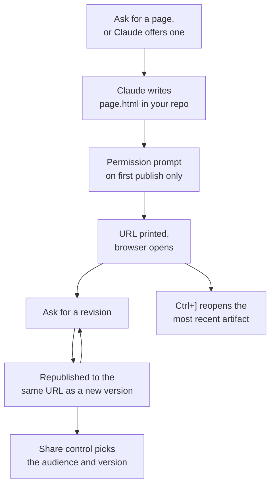

# Turn Session Output into a Shareable Page

Most of what Claude produces belongs in the terminal. Some of it does not: four layout options you want to see next to each other, a diff with reasoning written beside the lines, a migration checklist that fills in while a long task runs. An artifact is a live web page published from your session to a private URL on `claude.ai`, and it stays at that URL as the session keeps revising it.

The feature is on by default for a session signed in with `/login`, so you will meet it before you go looking for it. Claude may publish one on its own when the output suits a page, and `Ctrl+]` reopens the most recent one from the terminal at any time. It requires Claude Code v2.1.183 or later, or the desktop app v1.13576.0 or later.

## What an Artifact Is, and What It Is Not

An artifact is a capture of work, not an application. It is one self-contained page with no backend, so it cannot store what someone types into it, cannot serve a second route, and cannot call an API of its own. Its only path to outside data at view time is [calling MCP connectors](../../04-mcp/04-artifact-connectors/readme.md).

That boundary is the useful part rather than a limitation to work around. A page that is a snapshot can be published, versioned, shared, and thrown away without operating anything. For a hosted internal tool with a backend, deploy on your own infrastructure instead.

## Publish One

Ask for a page in plain language, or describe visual output and let Claude decide. Claude writes the page to an `.html` or `.md` file in your project, then publishes that file.

```text
Build a dashboard artifact of last week's deploy failures by service and keep it updated as you investigate.
```

The first publish of a new artifact asks for permission, naming both the title and the file it is about to publish:

```text
Claude wants to publish "Deploy failures by service" (deploy-failures.html) to a private page on claude.ai
```

Approve it and Claude prints the URL, your browser opens the page, and republishing that same artifact never asks again. Claude picks the title and a browser-tab emoji, both of which show up in your gallery at `claude.ai/code/artifacts` and in any link you share, so name them in the prompt when you care. Set `CLAUDE_CODE_ARTIFACT_AUTO_OPEN=0` to stop the browser from opening on each publish.



## Update It, and Choose What Viewers See

Ask for a revision and Claude edits the underlying file and publishes again to the same URL. Anyone with the page open sees the change in place, which is what makes an artifact worth keeping open during a long task.

```text
Add a per-region breakdown below the summary chart and republish.
```

Every publish becomes a version. The Share control in the page header holds a version picker and an option to always share the latest, so a page can keep moving while reviewers stay pinned to the version you sent them.

A different session does not know about your artifact. Give it the URL and it revises the existing page; leave the URL out and you get a second artifact instead of a new version of the first.

```text
Update https://claude.ai/code/artifact/5fbea6f3-... with today's numbers.
```

## Share It

A new artifact is visible only to you, and sharing is deliberate. The page header names you as the author and links to your gallery, so whoever opens it knows where it came from.

| Plan | Audience you can grant |
|---|---|
| Pro and Max | A public link that anyone on the internet can open, which is the only sharing path on these plans |
| Team and Enterprise | Named people in your organization or everyone in it, with public links off until an Owner enables them |

On Team and Enterprise plans a person you share with can be promoted from viewer to editor. An editor republishes the same way you update from another session: they paste the artifact URL into their own session, and Claude pulls the current content and publishes their changes as a new version.

## What Is Worth Building

The patterns below come up far more often than anything else, and each one is a prompt rather than a feature you enable.

| Pattern | Ask for |
|---|---|
| Walk through a change | A rendered diff with margin annotations and findings color-coded by severity |
| Compare alternatives | Four distinctly different variants in a grid with a one-line tradeoff under each |
| Tune with controls | Sliders and toggles bound to the values you are adjusting, with the result rendered live |
| Bring the result back | A control that emits text you paste into the terminal, so the decision returns to the session |
| Track work in progress | A checklist the session ticks off and annotates while a long task runs |

The fourth one is the one people miss. A triage board with a "Copy as prompt" button turns the page from a report into an input surface, because the ordering you dragged into place becomes the next prompt.

## Make the Page Look Like Your Product

Claude applies a built-in design skill when it builds an artifact, so pages arrive with a deliberate palette, typography, and layout without being asked (v2.1.182 or later). That skill looks for an existing design system in your project first. Record your tokens where Claude already reads, such as [`CLAUDE.md`](../../02-harness/01-intro-constitution/readme.md) or a theme file in the repository:

```markdown
## Design system

- Colors: primary #1a4d8f, accent #f59e0b, surface #f8fafc
- Typography: Inter for body, JetBrains Mono for code
- Spacing: 8px scale, 6px border radius
```

Precedence runs prompt, then your design system, then Claude's own choices. The heading above is an example rather than a required schema: any clear list of colors, fonts, and spacing works.

## Page Constraints

Claude Code wraps your file in an HTML shell and serves it under a strict Content Security Policy. The constraints below are what that policy and the single-page model produce.

| Constraint | Effect |
|---|---|
| No external requests | Scripts, stylesheets, fonts, and images from any other host are blocked, along with `fetch`, XHR, and WebSockets. Claude inlines CSS and JavaScript and embeds images as data URIs |
| No backend | The page cannot store form input or authenticate viewers itself |
| Single page | Relative links do not resolve, so multi-section content uses in-page anchors |
| Source file types | The published file must be `.html`, `.htm`, or `.md`, and Markdown renders as styled HTML |
| Rendered size | 16 MiB or smaller, and a large embedded raster image is the usual cause of a size failure |

A styled page costs more output tokens than the same content as terminal text, with data-URI images the dominant cost. Prefer SVG or plain HTML and CSS for diagrams, skip interactivity you do not need, and have the page summarize a large dataset rather than inline it.

## Availability and Turning It Off

Artifacts need every condition below at once. When one is missing, Claude writes a local HTML file or says it cannot publish, which is the symptom to recognise rather than debug blindly.

| Requirement | Available when |
|---|---|
| Plan | Pro, Max, Team, or Enterprise, with Enterprise requiring an Owner to enable it |
| Authentication | The session is signed in with `/login`, never an API key, gateway token, or cloud-provider credential |
| Model provider | The Anthropic API, not Amazon Bedrock, Google Vertex AI, or Microsoft Foundry |
| Organization policy | CMEK, HIPAA, and Zero Data Retention are not enabled |
| Surface | Claude Code v2.1.183 or the desktop app v1.13576.0, and off by default in the Agent SDK, GitHub Action, and MCP-server contexts |

To switch artifacts off for your own sessions regardless of the organization setting, use whichever layer you already manage:

```json
{
  "disableArtifact": true,
  "permissions": {
    "deny": ["Artifact"]
  }
}
```

The environment variable `CLAUDE_CODE_DISABLE_ARTIFACT=1` does the same thing for a single shell, and `CLAUDE_CODE_DISABLE_NONESSENTIAL_TRAFFIC` disables artifacts as a side effect.

## Helpful Claude Slash Commands

| Command | Usage |
|---|---|
| `/login` | Sign the session in to a claude.ai account, which is the requirement an API-key session cannot meet |
| `/memory` | Open the `CLAUDE.md` that holds your design tokens, so the next publish picks up your palette and typography |
| `/permissions` | Add `Artifact` to the deny list when a repository should never publish anything outward |
| `/usage` | Check what a styled, image-heavy page actually cost in output tokens before you make it a habit |

## Hands-On Demo

[Publish, Revise and Share a Decision as an Artifact](demo-artifact-publish-share.md)

## Key Topics covered in this module

- [Claude Code: share session output as artifacts](https://code.claude.com/docs/en/artifacts)
- [Claude Code: settings](https://code.claude.com/docs/en/settings)
- [Claude Code: environment variables](https://code.claude.com/docs/en/env-vars)
- [Claude Code: memory and CLAUDE.md](https://code.claude.com/docs/en/memory)
