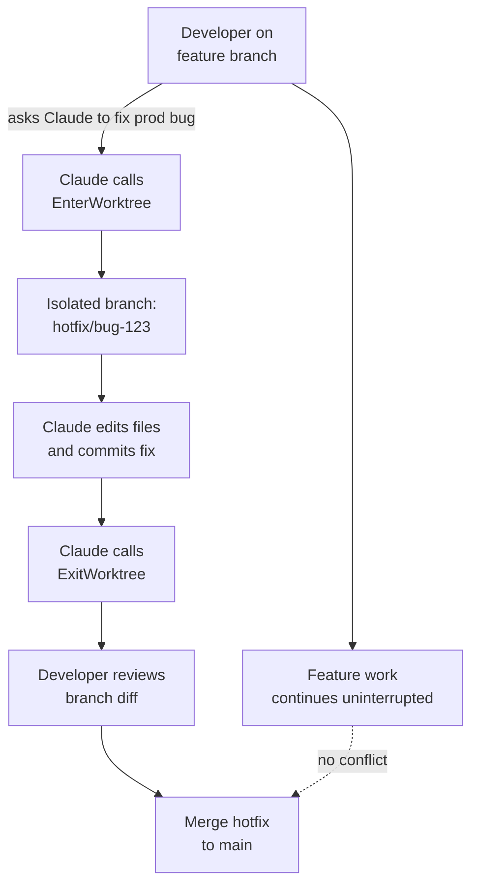

# Run Parallel Agents with Git Worktrees

Claude Code can manage worktrees for you: `--worktree`, `--bg` isolation, locking, and cleanup.

A git worktree lets you check out a separate branch of your repository into a completely independent directory while sharing the same underlying `.git` store. Unlike switching branches in your current checkout, each worktree has its own working tree: its own files, its own staged changes, and its own untracked file state. You can have a feature branch open in one directory and a hotfix branch open in another at the same time, without stashing or losing work.

The core command is `git worktree add <path> <branch>`, which creates a new directory at `<path>` and checks out `<branch>` there. Running `git worktree list` shows every active worktree linked to your repository. Each worktree is fully functional: you can build, test, and commit from any of them independently.

```bash
# Add a worktree for a feature branch
git worktree add ../my-feature feature/my-feature

# List all active worktrees
git worktree list

# Remove a worktree when done
git worktree remove ../my-feature
```

## Manual vs. Automatic Worktrees

There are three ways to work with worktrees in Claude Code. The manual approach uses `git worktree add` directly in a terminal: you create the worktree, run `claude` inside it, and remove the worktree yourself when finished. Use it when you need a specific existing branch or a path outside the repository.

The flag approach is the everyday one. Pass `--worktree <name>` (or `-w`) and Claude Code creates the worktree at `.claude/worktrees/<name>/` on a branch named `worktree-<name>`, then starts the session there:

```bash
claude --worktree feature-auth
```

The automatic approach needs no flag at all. Background sessions started with `--bg` move themselves into an isolated worktree before touching any file, and a subagent does the same when its frontmatter carries `isolation: worktree` or you ask Claude to use worktrees for its agents. In all three cases Claude can also enter or leave a worktree mid-session through the `EnterWorktree` and `ExitWorktree` tools. A plain interactive `claude` with no flag stays in your current checkout and creates nothing.

## How Claude Code Uses Worktrees

Claude Code creates temporary worktrees when running background or agentic tasks. Before making any code changes, Claude calls the `EnterWorktree` tool to check out a fresh branch into an isolated directory. This protects your working copy from interference while you continue editing in your own checkout.

When Claude finishes, the worktree is automatically removed if no files were changed. If changes were made, the worktree path and branch name are returned so you can review the diff or merge the work. This pattern makes it safe to run multiple Claude agents in parallel: each operates in its own worktree and cannot clobber files another agent or you are editing.

A typical agentic session looks like this: Claude receives a task, enters a new worktree on a dedicated branch, implements the changes, then exits the worktree and reports back. You review the branch when ready, on your own schedule, without any of Claude's intermediate work landing in your active checkout.

```text
EnterWorktree  →  edit files on isolated branch  →  ExitWorktree  →  report branch name
```

## Helpful Claude Slash Commands

| Command | Usage |
|---------|-------|
| `/review` | Review changes made in a worktree branch before merging |
| `/rewind` | Restore code, conversation, or both to an earlier prompt in the session |
| `/status` | Confirm which directory and branch the session is working in |
| `/update-config` | Configure worktree isolation and permission settings in `settings.json` |

## User Story

As a developer working on a feature branch, I want Claude to fix a production bug in parallel without touching my current work, so that I can keep building while the fix gets prepared for review.



## Cleaning Up

Removal refuses in two situations, and each prints a different error. A worktree Claude Code is actively using is locked, so `git worktree remove` reports the lock and names the session holding it; release it with `git worktree unlock` first. A worktree holding modified or untracked files refuses too, and only `--force` overrides that, because git will not silently discard work.

Removing a worktree leaves its branch behind, so a full cleanup is two commands. A periodic sweep also removes worktrees Claude created for subagents and background sessions once they pass your `cleanupPeriodDays` setting, skipping any that still hold changes or unpushed commits. It never touches worktrees you created with `--worktree`.

## Carrying Local Files Into a Worktree

A worktree is a fresh checkout, so gitignored files such as `.env` are absent and your app fails to start in it. List them in a `.worktreeinclude` at the repository root, using `.gitignore` syntax, and Claude Code copies them into every worktree it creates:

```text
.env
.env.local
config/secrets.json
```

Only files that match a pattern and are also gitignored are copied, so tracked files are never duplicated. Add `.claude/worktrees/` to your `.gitignore` as well, or every worktree shows up as untracked noise in your main checkout.

## Hands-On Demo

[Run Two Claude Sessions Without Them Colliding](demo-worktrees-intro.md)

## Key Topics covered in this module

- [git-worktree: official reference](https://git-scm.com/docs/git-worktree)
- [Claude Code: worktrees](https://code.claude.com/docs/en/worktrees)
- [Claude Code: settings and configuration](https://code.claude.com/docs/en/settings)
- [Claude Code: sub-agents and worktree isolation](https://code.claude.com/docs/en/sub-agents)
