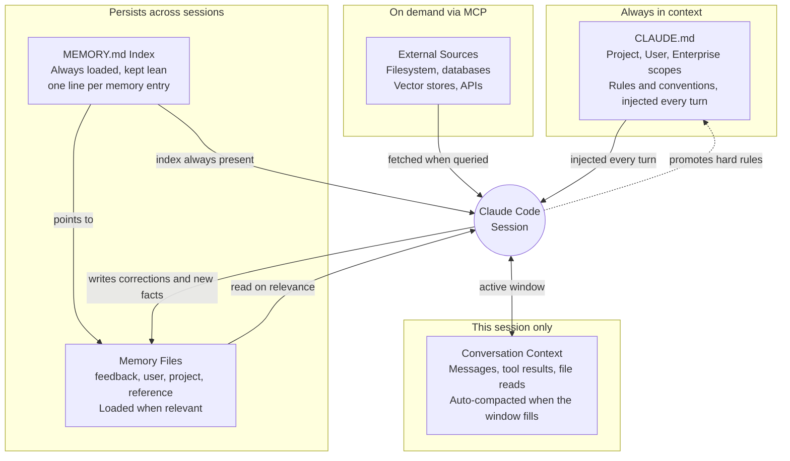

# Persist Corrections in Memory Files

A correction you give Claude today is gone tomorrow unless something writes it down. Memory is that something, and the price is one sentence at the moment the mistake happens:

```text
Remember: this API returns snake_case and the SPA maps it at the boundary.
Don't "fix" the casing in the components.
```

Tomorrow that correction is read back before the first edit instead of being re-explained, and the same applies to everything else the sessions have taught: who you are, what is currently in flight, which tracker holds the tickets. Ask what has accumulated at any time.

```text
/memory
```

Claude Code has no built-in long-term state; every session starts from a blank slate. Memory is the harness layer that compensates, persisting rules, corrections, and facts in forms the model can load or retrieve once they become relevant. Getting it right is the difference between a session that has to be re-briefed every morning and one that picks up where the last one stopped.

The auto-memory system is the `MEMORY.md` index and the four typed memory files it points at.

The split matters because the layers fail differently. `CLAUDE.md` is injected every turn and pays tokens whether or not it is relevant, so it holds only rules that are always true. A memory file is read on demand, which is what makes it the right home for a correction that must survive a restart without being paid for on every prompt.

## The Four Memory Types

Four memory types are in play in any Claude Code session. They differ in how long they persist, what triggers a read, and who pays for them, and the diagram below shows all four at once.



The solid arrows are reads into the session. The two return arrows are what make the harness compound: writing a correction back into a memory file, and promoting a rule that turned out to be unconditional up into `CLAUDE.md`.

### 1. In-Context Memory: CLAUDE.md Files

`CLAUDE.md` is the always-loaded layer, resolved from the user, project, and enterprise scopes and injected into every turn. Because it costs tokens on every prompt, it earns its place only with rules that are true regardless of what the session is doing. [01-fundamentals: 04 Constitution](../../01-fundamentals/04-constitution/readme.md) owns the hierarchy, the file locations, and what belongs in it.

### 2. Persistent File Memory: The Memory Index System

This is the type this topic teaches, and the rest of the page is about it. A lean index is always present, the detailed bodies are read only when the index line suggests one is relevant, and a `type` field says what kind of fact each body holds.

### 3. External Memory: MCP-Connected Data Sources

External memory is any data store Claude reaches through an MCP server: local files outside the project tree, databases, vector stores, or API-backed knowledge bases. Unlike in-context memory it is never loaded automatically; Claude fetches it when the workflow asks for it, which is what makes it viable for corpora far too large to inject every turn.

The filesystem MCP server is the simplest form, exposing directories as readable resources so Claude can consult documentation, log archives, or reference data without those files sitting open in the session. A vector-backed server goes further by letting Claude search a large knowledge base by semantic similarity and pull back only the matching chunks. That is the right shape for an internal wiki or a documentation set that changes faster than anyone will re-copy it into a repository. [02-harness: 04 MCP](../04-mcp/readme.md) covers how a server is configured, and [08-optimize: 04 Memory Architectures](../../08-optimize/04-memory-architectures/readme.md) measures what the retrieval actually costs per turn.

### 4. In-Session Memory: Conversation Context

In-session memory is the active window: every user message, tool result, file read, and prior assistant turn since the session started. It is the fastest memory to reach because there is no I/O involved, and the most expensive to hold because all of it is re-sent on every turn. When the window fills, Claude Code compacts the older turns into a summary rather than dropping them outright, so the thread survives but the detail does not.

That makes it the right place for intermediate state inside a single task: which files have been visited, which API shape was already agreed, which test already ran green. It is the wrong place for anything that has to outlive the session, so promote those facts into a memory file or `CLAUDE.md` before you close the terminal.

## The MEMORY.md Index

Claude Code's auto-memory system uses a directory at `~/.claude/projects/<project-id>/memory/` where each memory lives in its own Markdown file with frontmatter. A `MEMORY.md` index file acts as a table of contents: it is always loaded into context, while the individual memory files are read only when the index line suggests one is relevant.

That two-level shape is the whole design. The index stays lean because it carries one line per memory, and the bodies stay detailed because nothing pays for them until they are needed. Each memory file carries a `type`, a name, and a one-line description used to judge relevance before loading the full content.

```markdown
---
name: feedback_slash_commands
description: Don't add /init to every module's commands table; only when module is about project setup
type: feedback
---

Don't add /init to every module's commands table.

**Why:** /init is an authoring command for new projects. Including it in every module's
slash commands section is misleading; it implies you should run it every time.

**How to apply:** Only include /init in the commands table when the module is explicitly
about starting a new project or initializing a CLAUDE.md.
```

## The Four Memory File Types

The `type` field is not decoration: it declares what kind of fact the file holds and therefore how long it stays true. The four types map to distinct use cases.

| Type | What it holds | Example |
|------|---------------|---------|
| `user` | Who you are and how you prefer to work, so Claude does not re-ask | Seniority, preferred answer length, shell and editor |
| `feedback` | A correction that must not be repeated, recorded so the model does not drift back | "Never mock the database in integration tests" |
| `project` | Time-sensitive state: active incidents, deadlines, architectural decisions | "Auth migration in flight, do not touch UserController" |
| `reference` | Pointers to external systems rather than the facts themselves | Which Linear project tracks pipeline bugs |

A `feedback` memory is the one worth writing immediately, because its value expires the moment the same mistake happens again. The memory below captures a correction about test strategy.

```markdown
---
name: integration_tests_no_mocks
description: Integration tests must hit a real database, never mocks
type: feedback
---

Integration tests must hit a real database, not mocks.

**Why:** Prior incident where mock/prod divergence masked a broken migration that passed
all tests but failed in production after deployment.

**How to apply:** When writing or reviewing tests that touch persistence: reject mocked
database calls, ensure the test suite spins up a real DB container.
```

## The Self-Improving Loop

The index and the typed files together enable a loop that compounds across sessions. After any correction, write a `feedback` memory. At the start of each session Claude loads the `MEMORY.md` index and reads the entries whose descriptions match the work at hand. Over time the files accumulate patterns specific to your project and preferences, which is an onboarding document that writes itself.

```text
Remember never to mock the database in tests and always check the Linear project "INGEST"
for context before touching the pipeline code.
```

```text
Update my feedback memory: the single bundled PR was the right call for refactors here,
don't split them.
```

A rule that turns out to be true unconditionally has outgrown a memory file and should be promoted into `CLAUDE.md`, where it is injected every turn instead of waiting to be judged relevant.

## When to Use Each Type

The table below is the decision you actually make in practice: you have a fact, and you need to know where it goes.

| Situation | Memory type |
|-----------|-------------|
| Rules that should always apply (coding standards, commit policy) | In-context `CLAUDE.md` |
| Corrections that must not repeat across sessions | Persistent file memory, `feedback` type |
| User preferences, role, or expertise level | Persistent file memory, `user` type |
| Active project state, deadlines, or architectural decisions | Persistent file memory, `project` type |
| Pointers to external dashboards, issue trackers, or runbooks | Persistent file memory, `reference` type |
| Large codebases or docs queried by relevance | External memory via MCP |
| Intermediate task state within a single session | In-session conversation context |

## Helpful Claude Slash Commands

| Command | Usage |
|---------|-------|
| `/memory` | Open the memory file to read or edit what the auto-memory system has recorded. |
| `/context` | Show what the index and any loaded memory files are costing the current session. |
| `/mcp` | List the connected servers that back external memory, before relying on one for retrieval. |

## Key Topics covered in this module

- [Claude Code Memory](https://code.claude.com/docs/en/memory): the auto-memory system, memory file types, and the index
- [Model Context Protocol](https://modelcontextprotocol.io/): the specification behind MCP-connected external memory
- [04 Constitution](../../01-fundamentals/04-constitution/readme.md): the `CLAUDE.md` hierarchy and what belongs in it instead of a memory file
- [04 Memory Architectures](../../08-optimize/04-memory-architectures/readme.md): in-context loading, statefile, auto-memory, and knowledge graph benchmarked head to head, plus the write policy that decides what a memory file is allowed to hold
