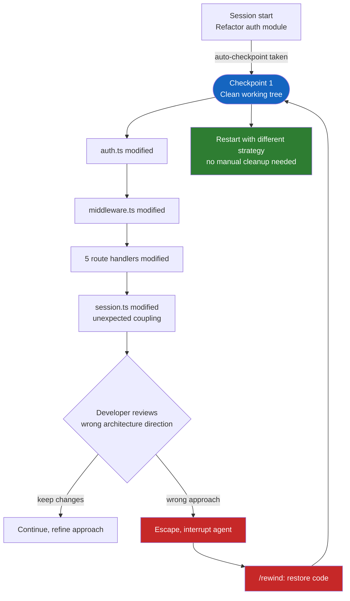
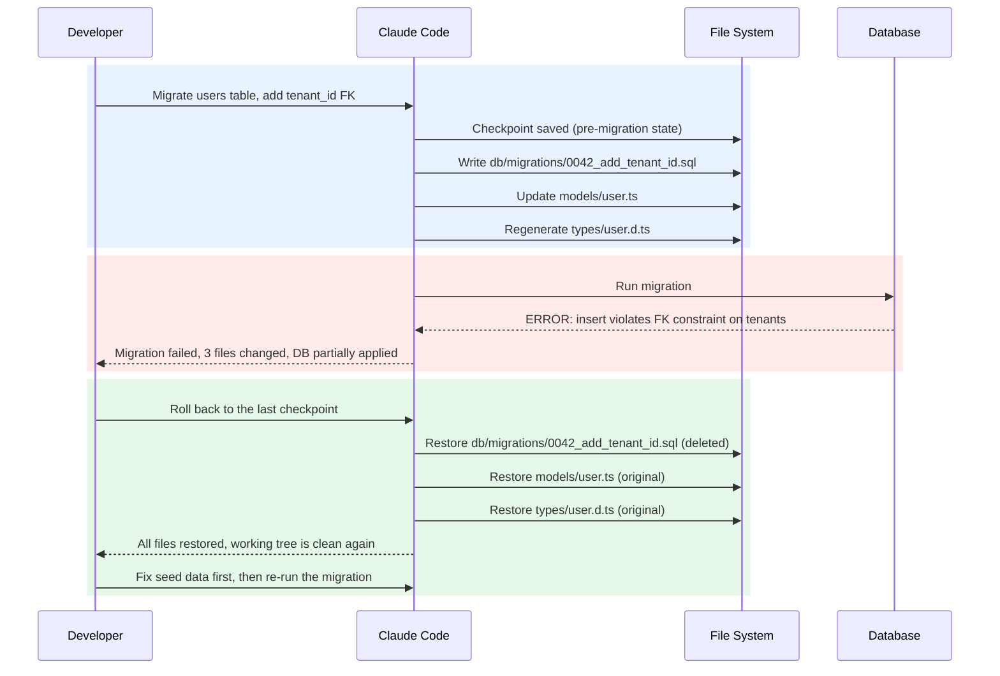

# Checkpoint and Resume Long Sessions

Every agentic session carries a built-in risk: Claude can make a lot of changes very quickly, and not all of them are the right ones. Checkpoints are session-level save points that capture the exact state of your working files at a specific moment. When a run goes sideways (wrong approach, unexpected coupling, or a migration that breaks constraints) you can restore any checkpoint and return the filesystem to the precise state it was in before things went wrong.

Checkpoints are not git commits. They capture only the files Claude edited through its own file editing tools, which means files changed by a bash command Claude ran, your own manual edits, and anything outside the session stay untouched by a restore. Claude Code creates a checkpoint automatically before each user prompt, and you can also ask it to anchor a state explicitly before any operation you consider risky. Restoring a checkpoint does not touch git history; it only reverts the files Claude modified during the session.

## How Checkpoints Work

Claude Code takes a snapshot before each prompt you send, whether or not that turn ends up writing files. If the turn modifies ten files, the checkpoint captures the original content of all ten. The session keeps snapshots for the 100 most recent checkpoints, letting you roll back not just the last turn but any earlier state in the session timeline.

## Noticing a Checkpoint and Rolling Back

After each turn that modifies files, Claude Code shows a file-change summary directly in the conversation. In the desktop and web UI, every such turn gets a restore icon in the conversation sidebar; clicking it reveals the full list of checkpoints in the session and lets you jump to any of them. In the terminal, the changed files are listed at the end of a turn and `/rewind` (or pressing `Esc` twice on an empty prompt input) opens the rewind menu, where you pick the prompt to return to and choose Restore code, Restore conversation, or both.

If Claude is still running and you want to stop it before it makes more changes, press `Esc`. The agent halts immediately and the changes made so far stay on disk, so you can inspect them and decide. To discard them, open the rewind menu with `/rewind` and restore the code from the prompt before that turn started. The checkpoint list is preserved either way, so you can stop, inspect, and still roll back further if needed.

Before starting anything risky, ask Claude to anchor the current state explicitly. This creates a named moment you can refer back to by description rather than hunting through the timeline.

```text
Before you start modifying anything, save a checkpoint: I want to be able to return to exactly this state.
```

If the session has already gone in the wrong direction, the most natural recovery is to name where things went wrong. Claude Code understands turn references and file references, so you can be as specific as you need.

```text
Roll back to the checkpoint before you touched the auth module, everything after that is wrong.
```

If Claude is mid-run and you catch a problem early, stop the agent immediately and tell it to undo in the same breath. This is faster than letting the turn complete and rolling back afterwards.

```text
Stop. Undo all changes from this turn and let me review the approach before you continue.
```

## Story 1: The Runaway Refactor

A developer asks Claude to refactor the authentication module to use a new token strategy. Claude starts confidently, updating `auth.ts`, then `middleware.ts`, then route handlers. After twelve files and forty minutes, the developer reviews the diff and realizes the new strategy couples session logic directly into the route layer, which makes the architecture worse, not better.

Without checkpoints, unwinding twelve interconnected changes manually would take as long as the original refactor. With a checkpoint, the whole thing is one command.



The checkpoint was taken automatically when the developer sent the refactor prompt. The developer interrupts, opens `/rewind` and restores the code, and the twelve changed files are all restored from the snapshot. The session continues from the same clean state, with no `git stash`, no manual revert, no digging through diffs.

## Story 2: The Migration That Breaks Constraints

A developer asks Claude to migrate the `users` table to add a `tenant_id` column with a foreign key to a new `tenants` table. Claude writes the migration file, updates the ORM model, regenerates the TypeScript types, and runs the migration. The migration fails with a foreign key violation: the seed data in `users` contains rows with no tenant. Three files are now inconsistent: the migration was applied partially, the model references a column that does not exist cleanly, and the generated types are out of sync.



The checkpoint captured the state before any file was written. Rolling back removes the migration file, restores the model and the types, and leaves the developer with a clean tree to fix the underlying seed data problem before trying again. The DB rollback is a separate concern: checkpoints cover the files Claude touched, not the database state.

## When to Request an Explicit Checkpoint

Claude Code takes automatic checkpoints, but you can ask for one at any moment before an operation you consider especially risky. The right moment is any time you want a guaranteed recovery point that is distinct from the most recent automatic one.

```text
Checkpoint here before you touch anything in the payments module.
```

```text
Save a checkpoint: I want to be able to compare the before and after state for this refactor.
```

```text
Take a checkpoint before running any scripts. I want to keep this state as a fallback.
```

## Hands-On Demo

[Anchor a Checkpoint and Roll Back a Runaway Refactor](demo-anchor-and-roll-back-a-session.md) anchors a green Node test suite, lets Claude run an over-reaching cross-cutting refactor, then rewinds and proves the recovery with `npm test` and a clean `git status`. The pristine starter is `checkpoint-drill/`; the finished reference is `checkpoint-drill-solution/`.

## Helpful Claude Slash Commands

| Command | Usage |
|---------|-------|
| `/rewind` | Open the rewind menu and restore code, conversation, or both to an earlier prompt in the session. |
| `/update-config` | Add `PreToolUse` hooks that create additional guardrails before risky operations run. |
| `/clear` | Reset the conversation context, useful after a checkpoint restore to start fresh. |

## Key Topics covered in this module

- [Claude Code Checkpointing](https://code.claude.com/docs/en/checkpointing): How session checkpoints are created, stored, and restored
- [Claude Code Hooks](https://code.claude.com/docs/en/hooks): `PreToolUse` hooks complement checkpoints by blocking dangerous commands before they run
- [Claude Code Settings](https://code.claude.com/docs/en/settings): Session safety configuration and permission model
- [03: Hooks](../03-hooks/readme.md): Event-driven guardrails that work alongside the checkpoint system
