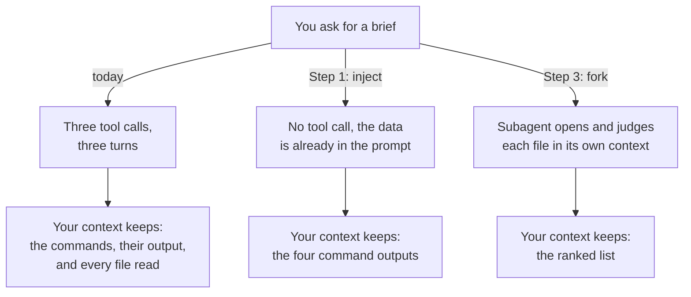

# Inject Live Project Data and Fork the Audit

A skill can arrive with real project data already inside it, so Claude answers without going to look first. It can also hand its work to a second Claude, whose reading you never have to see. You build one of each here, against a small order-pricing project.

------

## Where This Starts

Ask Claude what is in a project and it goes and looks: list the files, count the lines, search for open TODOs. That is three trips before you get an answer, and everything it opened stays in your session afterwards, taking up room you need later.

This demo fixes that twice over. First you put the answers into the skill up front, so there is nothing left to fetch. Then, for the harder job of judging what each TODO actually costs, you send the work to a second Claude that reads the files in its own workspace and hands back only its verdict.



## Setup

Open Claude Code at the **repository root**, because both skills live in this repo's harness at `.claude/skills/` and reach the demo project through `${CLAUDE_PROJECT_DIR}`. The project under audit is [order-api](order-api), which runs with `node src/index.js` and needs no install. The finished skills are already in the harness as `my-order-brief` and `my-order-audit`, which is what your own run produces; give yours a different name while you work if you want to keep both side by side.

Run it once before you audit anything, so the numbers the audit talks about are numbers you have seen:

```bash
node demos/03-skills/04-live-data-and-subagents/order-api/src/index.js
```

```text
A-1001  Northwind  net $116.85  total $140.22
A-1002  Contoso    net $524.45  total $629.34
A-1003  Fabrikam   net $22.50  total $27.00
```

Every `total` there is the `net` plus a tax rate that is hardcoded to one country. That is the `FIXME` at `pricing.js:17`, and it is the finding the forked audit ranks first in Step 3.

---

## Step 1: Inline the Evidence

**Overview:** Write a skill whose prompt already contains the project's file listing, line counts, and open markers, so Claude answers without a single tool call.

**Research / Planning / Discussion:**

```text
I want a skill that briefs me on a project's source layout and open TODO markers. Two ways to build it: the skill tells Claude which commands to run, or the skill injects the command output with !`command` before Claude sees the prompt.

Compare them on: number of round trips, what lands in my context, whether Claude can decide to skip a step, and what happens when a command fails. Do not write the skill yet.
```

**Finding:** Claude should name the decisive difference: injection is preprocessing, so the commands always run and their output is already in the prompt, while a tool-calling skill costs a round trip per command and lets Claude skip or reorder them. It should also flag the trade-off, that injected output enters context whether or not it turns out to be relevant. If the answer treats the two as equivalent, ask: "Which one can Claude decide not to do?"

**Recipe:**

```text
Create a skill at .claude/skills/my-order-brief/SKILL.md in this repository.

Frontmatter:
- name: my-order-brief
- description: names what it does and the phrases that should trigger it

Body: four sections that inject data with the !`command` syntax, each anchored with ${CLAUDE_PROJECT_DIR} so the commands work no matter which directory Claude Code started in. The project lives at demos/03-skills/04-live-data-and-subagents/order-api.

1. Source files: list the files in the project's src directory
2. Line counts: wc -l over the project's src/*.js
3. Open markers: grep -rn for TODO and FIXME under the project's src
4. Runtime: node --version

Then an Instructions section telling Claude to write the brief from the data above without reading any file: module count and total lines, one line per marker with file and line number, and one sentence naming the riskiest file. Cap it at 12 lines.

Write only SKILL.md.
```

**Run It:** invoke the skill yourself, so you see the slash command load it:

```text
/my-order-brief
```

**Expected Outcome:** Invoking `/my-order-brief` returns a brief naming all three markers by file and line: `orders.js:7`, `pricing.js:17`, and `pricing.js:22`, plus the 83-line total and your Node version. The verified reference output is in [order-api/readme.md](order-api/readme.md).

---

## Step 2: Prove It Is Preprocessing

**Overview:** Confirm that the commands ran before Claude saw the prompt rather than being executed as tools. This is the mechanic learners most often misread.

**Research / Planning / Discussion:**

```text
Look at the transcript of the /my-order-brief run you just did. Did you call the Bash tool? If not, how did the file listing get into your context, and at what point did it arrive relative to your first token?
```

**Finding:** Claude should confirm no `Bash` tool call appears in the transcript and that the data arrived already rendered in the skill content. If it claims it ran the commands, point at the transcript: there is no tool call to point to.

**Recipe:**

```text
Edit .claude/skills/my-order-brief/SKILL.md and add a fifth injected section that runs a command guaranteed to fail, such as listing a directory that does not exist. Invoke /my-order-brief again and tell me what appeared in place of that section, and whether the rest of the brief still worked.
```

**Expected Outcome:** The failing command's stderr is inlined where its placeholder was, and the other four sections are unaffected. Nothing prompts you for permission, because no tool was called. Remove the failing section before moving on.

---

## Step 3: Fork the Same Evidence into a Subagent

**Overview:** Take the same injected evidence, hand it to an Explore subagent with `context: fork`, and compare what returns to your main context.

**Research / Planning / Discussion:**

```text
The brief skill judges the markers from the grep output alone. A real audit has to open each file and weigh what the marker actually costs.

If I add that reading to the inline skill, what happens to my main context? What changes if the skill runs with context: fork and agent: Explore instead? Name what the fork gives up as well as what it saves.
```

**Finding:** Claude should say the inline version leaves every file it read in your context for the rest of the session, while the fork returns only its final text. It should also name the cost: the subagent has no access to your conversation history, so everything it needs must be in the skill body. If it presents the fork as strictly better, ask what the subagent knows about the conversation so far.

**Recipe:**

```text
Create a skill at .claude/skills/my-order-audit/SKILL.md in this repository.

Frontmatter:
- name: my-order-audit
- description: names what it does and its trigger phrases
- context: fork
- agent: Explore
- background: false

Body: inject the same TODO and FIXME grep and the same wc -l line counts, anchored with ${CLAUDE_PROJECT_DIR}. Then a task section telling the subagent to read each file named in the markers and judge what the marker costs, returning a list ranked by risk, one line per marker as <file>:<line> | <impact if left unfixed> | <effort>, closing with one sentence naming what to fix first and nothing else.

Write only SKILL.md.
```

**Run It:** invoke the skill yourself, so you see the slash command load it:

```text
/my-order-audit
```

**Expected Outcome:** `/my-order-audit` returns a ranked list and nothing else. The ranking cites details that appear nowhere in the injected text, such as the `taxFor` and `applyPricing` function names or the tier thresholds, which proves the subagent opened the files in its own context. `pricing.js:17` should rank first, because a hardcoded tax rate produces wrong money on orders the system already accepts.

Run `/context` after each skill to see the difference the fork makes. The inline brief keeps its injected output in your session; the audit keeps only its summary.

> `background: false` matters here. Without it the fork runs in the background and its result arrives later, which is the right default for a long audit but makes the comparison in this step harder to watch.
