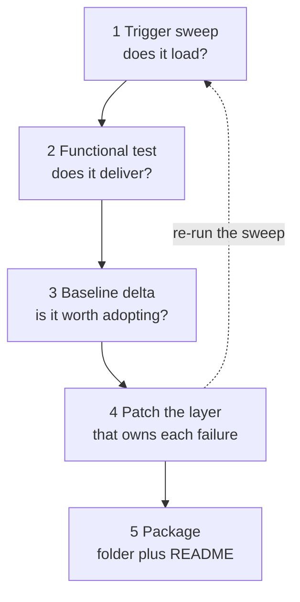

# Test and Package a Skill for Distribution

You wrote a skill and you have no idea whether it works. It may never load when someone phrases the request their own way, and once loaded it may quietly skip half of what it promised. You measure both here for this repository's `code-reviewer`, patch what the tests catch, and leave with a folder another team can install.

------



```bash
cd demos/03-skills/05-test-and-package/test-and-package-a-skill
claude
```

Everything happens in that folder, except the skill itself: it has to sit in the repository harness at [`.claude/skills/code-reviewer/SKILL.md`](../../../.claude/skills/code-reviewer/SKILL.md) to load at all, and Cleanup restores it at the end.

| File | What it is |
|------|------------|
| `src/cart.ts`, `src/pricing.ts` | The pricing service under review |
| `trigger-prompts.tsv` | 6 prompts, each tagged `fire` or `no-fire`: the trigger specification |
| `trigger-test.sh` / `.ps1` | Runs every prompt as its own headless session and counts how often the skill loaded |

---

## Step 1: Measure the Trigger Surface

**Overview:** A skill that never loads is worse than no skill, and one that loads on every message burns context on irrelevant instructions. Trigger behavior comes entirely from the `description` frontmatter field, so this first test is about when the skill fires, not what it does. Reading the description and predicting is not a test: the runs decide, and because loading is not deterministic every row runs three times and the table records a count rather than a verdict.

**Research / Planning / Discussion:**

```text
Read .claude/skills/code-reviewer/SKILL.md and quote its description field verbatim.

Then answer, using only the description text (not the body):

1. Which words in the description are the load-bearing trigger keywords?
2. Which realistic developer requests about reviewing code would this description likely miss?
3. Which requests that are NOT code review might this description wrongly attract?

Do not edit any files.
```

**Finding:** A strong response quotes the description exactly and separates the trigger surface ("review code", "Pull Requests", "staged or working tree") from the body content. Keep the predictions: the script is about to contradict some of them, and that gap is the lesson.

**Recipe:**

```text
Read tests/trigger-cases.md, the recorded sweep for this skill, and answer:

1. Which row failed, and which words in the description it fails to share with the prompt
2. Why row 1 is recorded as 2/3 rather than as a pass, and what that says about testing a trigger
   with a single run
3. Which rows carry too little evidence to quote

Then add two rows of your own phrasing to trigger-prompts.tsv, one fire and one no-fire, and say
which you expect to fail.
```

The sweep that produced that file is a background job, not a live step: every row is one headless session per repeat, around a minute each. Run it when you have the time.

```bash
REPEATS=3 bash trigger-test.sh
```

```powershell
pwsh -File trigger-test.ps1 -Repeats 3
```

**Expected Outcome:** [`tests/trigger-cases.md`](test-and-package-a-skill-solution/tests/trigger-cases.md) holding one measured row per prompt:

```text
| # | Expected | Fires | Observed | Verdict | Prompt |
|---|---|---|---|---|---|
| 1 | fire | 2/3 | fire | pass | Review my changes in ... |
| 2 | fire | 1/2 | unstable | **FAIL** | Can you go through my diff in ... before I push? ... |
| 3 | fire | 1/1 | fire | pass | Anything risky in what I just added under ...? |
| 4 | no-fire | 0/1 | no-fire | pass | Write a helper in ... that formats currency ... |
```

Row 1 is the one to stop on, and it is not the failure. Three identical sessions, two loads: the skill fires on the exact phrasing its description was written for, and still not every time. Row 2 is the miss Step 4 patches, where the developer says "diff" and "push" and the description offers "staged or working tree".

---

## Step 2: Run the Functional Tests Against Real Changes

**Overview:** Loading correctly says nothing about output quality. Functional testing asks whether the skill, once loaded, produces what it promises: the Critical, Improvements, and Nitpicks split, `file_path:line_number` references, and an Approved or Request Changes verdict. Test it against a planted defect, because a skill that only says "looks good" passes every test on clean code.

**Recipe:**

```text
Create a functional test fixture and run it.

1. Add src/discount.ts with a function applyDiscount(price, percent) that divides by percent without
   guarding against zero, reads an API token from a hardcoded string constant, and has no test file.
2. Leave it uncommitted: once committed, git status is clean and both diffs return nothing, so the
   skill's Local Changes workflow has no change left to look at.
3. Invoke the skill by typing row 1 of trigger-prompts.tsv verbatim, instead of naming the skill.
4. Expect the review to miss the file, because a brand-new file shows only as ?? in git status and
   never appears in git diff.
5. Save the gather commands and the review verbatim to tests/review-run-01.md, then grade that record
   against SKILL.md section "4. Provide Feedback" in tests/functional-results.md:
   Property | Present (yes/no) | Evidence quoted from the review.

Report which properties failed, including anything the skill could not even gather. Do not fix the
skill yet.
```

**Expected Outcome:** An uncommitted `src/discount.ts`, a [`review-run-01.md`](test-and-package-a-skill-solution/tests/review-run-01.md) recording both diff commands returning zero lines, and a [`functional-results.md`](test-and-package-a-skill-solution/tests/functional-results.md) where every row quotes that record. At least one property is marked no: most often the missing-test-coverage finding, a citation without a line number, or the untracked file the gather step never sees.

---

## Step 3: Measure the Baseline Delta

**Overview:** Adoption arguments are won with numbers. The comparison that matters is the same task twice: once with the skill loaded, once with the learner supplying the same guidance by hand.

**Research / Planning / Discussion:**

```text
I want to prove the code-reviewer skill is worth adopting, using the planted fixture as the task.

Propose a fair comparison protocol. Address what the no-skill run is allowed to receive as
instructions so the comparison is honest rather than rigged, which metrics are noisy across runs,
how many runs are needed before the difference means anything, and what result would prove the skill
is NOT worth adopting.

Do not run anything yet.
```

**Finding:** A credible protocol gives the no-skill run a realistic ad-hoc instruction, not an empty prompt and not the full skill text pasted in. If Claude proposes a protocol where the baseline is guaranteed to lose, push back: "That is rigged. What would a developer without this skill actually type?"

**Recipe:**

```text
Run the comparison on the planted fixture and record it.

Run A (no skill): in a second terminal at the repository root, start `claude --disallowedTools Skill`.
That flag removes the Skill tool for the session, so no skill can load and nothing on disk has to
move. Prompt "Review my changes and flag anything risky before I push."

Run B (skill): start a plain `claude` session and prompt "Review my changes."

For each run record: defects found out of 3 planted (unguarded division, hardcoded token, missing
tests), user messages needed to reach a verdict, whether a Critical/Improvements split appeared, and
the token total from /cost. /cost prints to the terminal and writes nothing to disk, so copy the two
totals across by hand.

Write tests/baseline-comparison.md with a Without skill / With skill table and one paragraph on
whether the delta justifies distribution. Report measured numbers only; write "not measured" in any
cell you could not capture.
```

**Expected Outcome:** A [`baseline-comparison.md`](test-and-package-a-skill-solution/tests/baseline-comparison.md) holding your own two sessions' figures. The shipped copy reads `not measured` in every cell, because `/cost` prints to the terminal and the run that produced the solution could not open two interactive sessions; that is the honest form when the capture did not happen, and Step 5 then forbids quoting a number.

---

## Step 4: Patch the Failures the Tests Exposed

**Overview:** Each failure type belongs to a different layer. Trigger misses are fixed in the `description`, gather gaps in the workflow steps, missed findings in the analysis pillars, and reporting gaps in the feedback structure. Editing the wrong layer is the classic mistake: adding trigger keywords to the body changes nothing, because the body is not read until the skill has already loaded.

**Research / Planning / Discussion:**

```text
Read .claude/skills/code-reviewer/SKILL.md plus every file under tests/.

For every failing row, map it to exactly one layer: description frontmatter (controls loading),
workflow steps (controls what gets gathered), analysis pillars (controls what gets noticed), or
feedback structure (controls how it is reported).

Present the mapping as a table: Failure | Layer | One-line justification. Flag any failure you cannot
confidently assign.
```

**Finding:** Phrasing misses belong to the description and missed defect classes to the pillars; a missing line number is the feedback structure, not the pillars. If a failure is assigned to the description but the skill did load during that run, challenge it: it fired, so the description is not the problem.

**Recipe:**

```text
Edit .claude/skills/code-reviewer/SKILL.md in place to close only the recorded failures.

- Extend the description with the phrasings the sweep showed as missed, and add one clause narrowing
  it away from the no-fire rows that fired. Keep it under the 1024 character frontmatter budget.
- Sharpen the minimum wording in the pillar or feedback section for each missed property.
- Change nothing that no test flagged. Preserve section numbering and heading text.

Then re-run the trigger test and append the new table to trigger-cases.md under a "After the patch"
heading, leaving the first table in place so the delta is readable.
```

**Expected Outcome:** A `SKILL.md` diff limited to the description and the sections tied to a recorded failure, provable with `git diff .claude/skills/code-reviewer/SKILL.md`. In the [solution's copy](test-and-package-a-skill-solution/code-reviewer/SKILL.md) that is three hunks: the description gains "checking a diff before pushing", section 2 gains `git ls-files --others --exclude-standard` for the untracked file, and section 4 gains a Test Coverage line. Nothing else moved, because nothing else failed a test.

Re-running the sweep is what proves the description hunk worked, and it is a background job rather than a demo step: budget a minute per session and read the new counts, not a new set of booleans.

---

## Step 5: Package the Skill for Another Team

**Overview:** A skill becomes a product the moment someone else has to install it: a folder another person can drop into their own `.claude/skills/` or upload through Settings, plus install documentation for a human who has never seen your repo. Everything the tests produced stays behind, and so does the README, which sits one level up.

**Research / Planning / Discussion:**

```text
I want to distribute the code-reviewer skill to other teams.

Compare three delivery routes for this specific skill: a zipped folder uploaded through Claude
settings, a GitHub repository cloned into .claude/skills/, and the skills API via container.skills.
For each, state who it fits and what breaks if the recipient is on a different repo layout. Then
recommend one route for a five-person team and one for organization-wide rollout.
```

**Finding:** The comparison should note that this skill shells out to `git` and `gh`, which makes the API sandbox the most constrained route. If Claude presents all three as equivalent, ask which one still works when the recipient has no GitHub CLI installed.

**Recipe:**

```text
Package the code-reviewer skill for external distribution.

1. Create dist/code-reviewer/ holding the patched SKILL.md and nothing else. A skill that had grown
   references/ or scripts/ would carry those too; its tests/ folder still would not.
2. Verify SKILL.md contains no absolute paths and no assumptions about this repository's folder
   names. List every replacement you made.
3. Write dist/README.md for a human installing it: what the skill does in two outcome sentences,
   install steps for Claude Code and for Claude.ai, one worked example prompt, and the measured
   figures from tests/baseline-comparison.md.
4. Zip it so the archive is rooted at code-reviewer/, which means running the command from inside
   dist/, then verify every entry starts with code-reviewer/.
```

```bash
cd dist && zip -r code-reviewer.zip code-reviewer && unzip -l code-reviewer.zip
```

```powershell
cd dist; Compress-Archive -Path code-reviewer -DestinationPath code-reviewer.zip
[IO.Compression.ZipFile]::OpenRead((Resolve-Path code-reviewer.zip)).Entries.FullName
```

**Expected Outcome:** A `dist/code-reviewer/` folder holding `SKILL.md` and nothing test-related, an archive whose every entry starts with `code-reviewer/`, and a [`dist/README.md`](test-and-package-a-skill-solution/dist/README.md) whose opening lines describe what a reviewer gets rather than what YAML frontmatter is. If the two baseline sessions were never captured, the README says so in one line instead of quoting a figure.

The worked-out result of all five steps lives in [test-and-package-a-skill-solution](test-and-package-a-skill-solution/dist/README.md).

