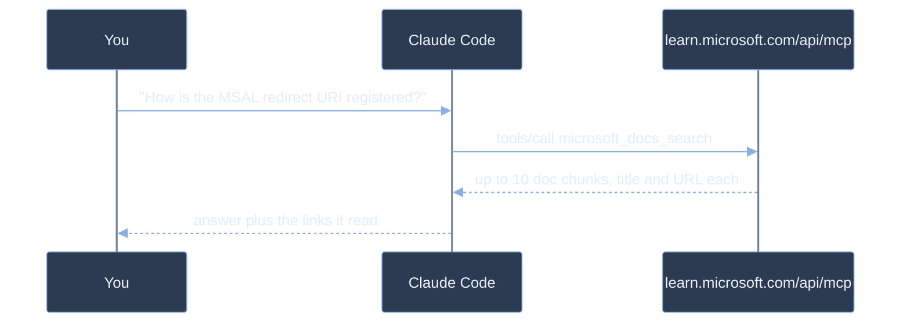
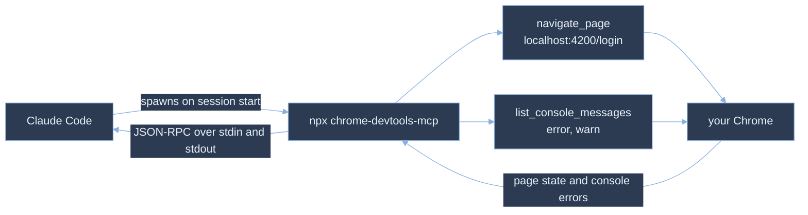
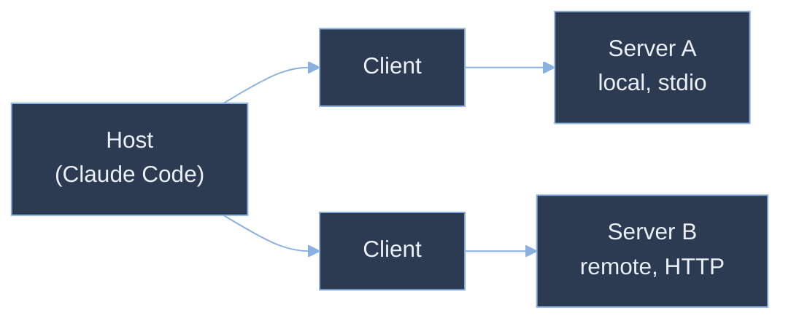
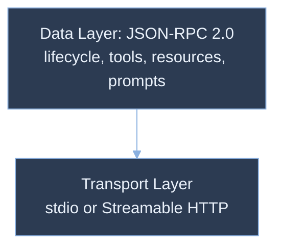
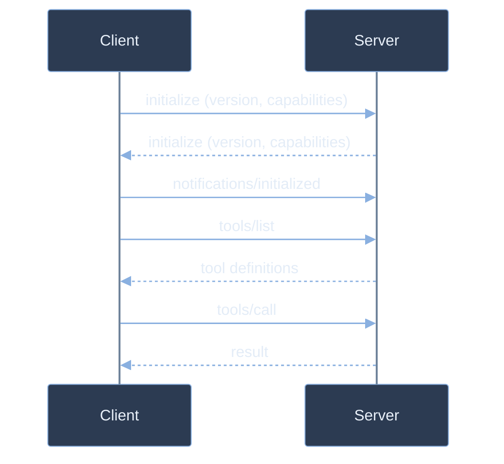
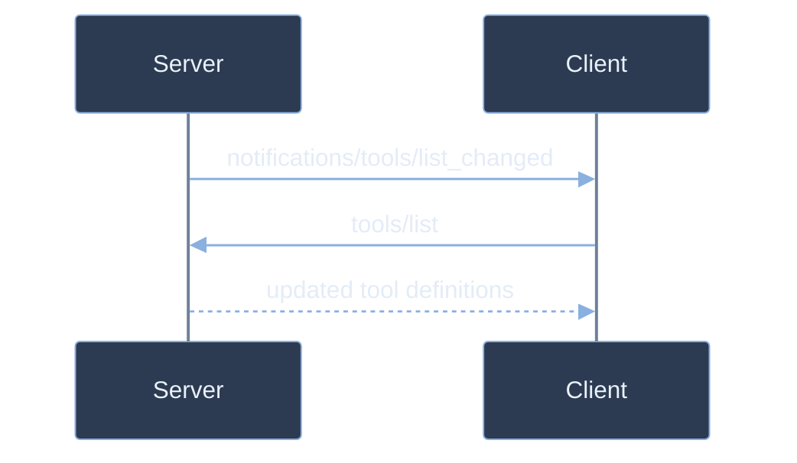

# Master the Model Context Protocol

MCP is an open protocol that standardizes how AI applications connect to external tools, data sources, and services. It separates context provisioning from language model interaction, letting any compliant host connect to any compliant server without bespoke integration code.

## Two Entries From This Repo

### microsoft-learn, a remote HTTP endpoint

You ask Claude Code how the MSAL redirect URI has to be registered, and without a server it answers from training data that predates the current portal. One entry in this repo's `.mcp.json` points it at `https://learn.microsoft.com/api/mcp`, an endpoint Microsoft operates, so nothing is installed and no credentials are stored. Claude calls `microsoft_docs_search` with your question as `query` and gets back up to ten chunks of first-party documentation, each carrying its title and URL. The answer arrives with links you can open, and the confident wrong version never reaches the file. This is the reading half of MCP: current context, no side effects.

```json
{
  "microsoft-learn": {
    "type": "http",
    "url": "https://learn.microsoft.com/api/mcp"
  }
}
```



### chrome-devtools, a local stdio process

The fix compiles, but nobody has looked at the page, and "it should work now" is not evidence. The `chrome-devtools` entry is `stdio`, so Claude Code runs `npx -y chrome-devtools-mcp@latest` as a child process and speaks JSON-RPC to it over pipes, with no port and no network hop. It calls `navigate_page` with `{ "type": "url", "url": "http://localhost:4200/login" }`, then `list_console_messages` filtered to `error` and `warn`. What comes back is the real browser's state: the rendered page, the failed requests, the exact console line. This is the acting half of MCP: the agent verifies its own work instead of asking you to.

```json
{
  "chrome-devtools": {
    "type": "stdio",
    "command": "npx",
    "args": ["-y", "chrome-devtools-mcp@latest"]
  }
}
```



## Available MCP Servers

The `.mcp.json` configuration file in your workspace registers eight MCP servers that extend Claude Code's capabilities:

| Server | Type | Purpose |
|--------|------|---------|
| qr-code | HTTP (localhost:3002) | Generate QR code PNG images from text or URLs |
| ssh-mcp | stdio | Hold an SSH connection to the Ubuntu host configured in `.mcp.json`, run commands with sudo, and return structured results |
| context7 | HTTP | Retrieve documentation and code examples from programming libraries and frameworks |
| playwright | stdio | Browser automation for testing, scraping, and visual interactions |
| angular-cli | stdio | Analyze, refactor, and run Angular projects with version-specific best practices |
| azure-deploy | stdio | Azure resource management, deployment planning, and IaC generation (Bicep/Terraform) |
| github | HTTP | Repository management, pull requests, issues, and code review automation |
| microsoft-learn | HTTP | Search and fetch official Microsoft documentation and code samples |

## Architecture

MCP follows a client-server model. The host creates one client per server; each client holds a single dedicated connection. Local servers run as child processes; remote servers run anywhere network-reachable.



- Host: the AI application that owns the user session (Claude Code, Claude Desktop, VS Code)
- Client: instantiated by the host per server; negotiates capabilities and routes messages
- Server: exposes tools, resources, and prompts; runs independently of the host

## Protocol Layers

MCP consists of two stacked layers. The data layer defines message semantics via JSON-RPC 2.0 and is identical regardless of transport. The transport layer handles byte delivery and authentication underneath.



### Data Layer

The data layer implements JSON-RPC 2.0. Every message (request, response, or notification) shares the same format across all transports. This is where capabilities are declared, tools are discovered and called, and resources are read.

### Transport Layer

#### Stdio

Stdio pipes JSON-RPC messages over standard input/output streams between the host and a child server process. Zero network overhead; the host spawns and owns the process.

```json
{
  "mcpServers": {
    "my-server": {
      "type": "stdio",
      "command": "npx",
      "args": ["@myorg/mcp-server"]
    }
  }
}
```

#### Streamable HTTP

Streamable HTTP uses HTTP POST for client-to-server messages with optional Server-Sent Events for streaming responses. Required for remote or multi-tenant deployments; supports bearer tokens, API keys, and OAuth 2.0.

```json
{
  "mcpServers": {
    "remote-server": {
      "type": "http",
      "url": "https://api.example.com/mcp",
      "headers": { "Authorization": "Bearer ${API_KEY}" }
    }
  }
}
```

SSE transport is supported for backward compatibility but deprecated for new implementations.

## Session Lifecycle

MCP is stateful. Every session opens with a capability handshake: both sides declare what they support before any tools or resources are exchanged.



The `initialize` exchange negotiates a shared protocol version and records which features each side supports. If versions are incompatible, the connection must be terminated before any other messages are sent.

```json
{
  "jsonrpc": "2.0",
  "id": 1,
  "method": "initialize",
  "params": {
    "protocolVersion": "2025-06-18",
    "capabilities": { "elicitation": {} },
    "clientInfo": { "name": "claude-code", "version": "1.0.0" }
  }
}
```

```json
{
  "jsonrpc": "2.0",
  "id": 1,
  "result": {
    "protocolVersion": "2025-06-18",
    "capabilities": {
      "tools": { "listChanged": true },
      "resources": {}
    },
    "serverInfo": { "name": "my-server", "version": "1.0.0" }
  }
}
```

## What Servers Expose

Servers can expose three types of capability to the host. Each type has a `list` method for discovery and a `get` or `call` method for use.

### Tools

Tools are functions the LLM can call: file operations, API requests, database queries, anything with side effects or real-time data. The server advertises them via `tools/list` with a JSON Schema for each; the host invokes them via `tools/call`. Claude Code namespaces them as `mcp__<server>__<tool>`, which is how `microsoft_docs_search` reaches your session as `mcp__microsoft-learn__microsoft_docs_search`.

```json
{
  "jsonrpc": "2.0",
  "id": 2,
  "method": "tools/list"
}
```

`microsoft-learn` answers with a read-only search tool over the live documentation:

```json
{
  "jsonrpc": "2.0",
  "id": 2,
  "result": {
    "tools": [{
      "name": "microsoft_docs_search",
      "description": "Search official Microsoft/Azure documentation and return up to 10 content chunks",
      "inputSchema": {
        "type": "object",
        "properties": {
          "query": {
            "type": "string",
            "description": "a query or topic about Microsoft/Azure products, services, platforms, developer tools, frameworks, or APIs"
          }
        }
      }
    }]
  }
}
```

```json
{
  "jsonrpc": "2.0",
  "id": 3,
  "method": "tools/call",
  "params": {
    "name": "microsoft_docs_search",
    "arguments": { "query": "MSAL Angular redirect URI configuration" }
  }
}
```

`chrome-devtools` exposes tools with side effects instead: the call moves a real browser, so the schema carries the operational detail the model has to get right.

```json
{
  "jsonrpc": "2.0",
  "id": 4,
  "method": "tools/call",
  "params": {
    "name": "navigate_page",
    "arguments": { "type": "url", "url": "http://localhost:4200/login", "timeout": 10000 }
  }
}
```

```json
{
  "jsonrpc": "2.0",
  "id": 5,
  "method": "tools/call",
  "params": {
    "name": "list_console_messages",
    "arguments": { "types": ["error", "warn"], "pageSize": 20 }
  }
}
```

### Resources

Resources are read-only data the server makes available for the host to include in context: file contents, database records, API responses. Clients discover them via `resources/list` and fetch them via `resources/read`. Each resource has a URI, a MIME type, and either text or base64-encoded binary content.

### Prompts

Prompts are reusable message templates (system prompts, few-shot examples, workflow starters) that the server defines and the host surfaces to users. Discovered via `prompts/list`; available in Claude Code as slash commands using the pattern `/mcp__<server>__<prompt>`.

## What Clients Expose

Servers can also make requests back to the client during a session. This enables more sophisticated interactions where the server needs LLM access or user input without owning those concerns itself.

### Sampling

A server calls `sampling/createMessage` to ask the host LLM to generate a completion. The server provides the conversation context; the host handles the model call and returns the result. Servers stay model-independent, so no LLM SDK is required.

### Elicitation

A server calls `elicitation/create` to pause mid-workflow and ask the user a structured question: a confirmation, a required field, a selection from a list. The host renders the prompt and passes the response back to the server before continuing.

## Notifications

Notifications are JSON-RPC 2.0 messages without an `id`, so no response is expected. Either side can send them at any time. The most common use: a server notifies the client that its tool list changed, and the client refreshes without interrupting the conversation.



A server must declare `"tools": { "listChanged": true }` during `initialize` to send this notification. The same pattern applies to resources and prompts.

## MCP Inspector

The MCP Inspector is the standard tool for exercising a server outside any host. It connects to a running server, lists the tools, resources, and prompts it exposes, and invokes them interactively while showing the raw JSON-RPC request and response for each call. It ships as a browser UI, a CLI, and a TUI. Use it to verify an implementation locally and again after a remote deployment, before wiring the server into Claude Code.

```powershell
npx @modelcontextprotocol/inspector --cli --config inspector.config.json --server my-server --method tools/list
```

The config file uses the same `mcpServers` shape as a host config. Valid `type` values are `stdio`, `http` for Streamable HTTP, and `sse`:

```json
{
  "mcpServers": {
    "my-server": {
      "type": "http",
      "url": "http://localhost:3000"
    },
    "my-server-prod": {
      "type": "http",
      "url": "https://my-server.azurewebsites.net",
      "headers": { "Authorization": "Bearer ${API_KEY}" }
    }
  }
}
```

`--server` picks one named entry, but only under `--cli`: the browser UI ignores it with a warning and the TUI rejects it as an unknown option, so in the browser you select the target in the UI instead. `--config` is read-only and errors if the file is absent. Use `--catalog` instead when you want the Inspector to write entries back to the file.

## Discovering MCP Servers

The MCP ecosystem includes several public registries for discovering pre-built servers:

- **MCP.so**: One of the largest community-driven directories; searchable by category and use case. Hundreds of servers for databases, APIs, productivity tools, and custom integrations.
- **Anthropic's MCP GitHub Repository**: The official reference list of MCP servers maintained by Anthropic. Includes implementation examples, best practices, and community contributions. Start here for well-tested servers and architectural patterns.
- **Claude.ai MCP Connector Directory**: The curated list of what's actually available to connect within Claude.ai itself. Updated as Anthropic and partners release new integrations.
- **[GitHub MCP Registry](https://github.com/mcp)**: GitHub's own catalog of over 200 servers that connect models to files, APIs and databases. Each listing carries install options and download counts, so popularity is visible before you commit to a server.
- **[Smithery](https://smithery.ai)**: The largest hosted registry, with more than 13,900 servers. It hosts servers for you and handles OAuth, credentials and sessions, so `npx smithery mcp add <name>` is usually the whole setup.
- **[Official MCP Registry](https://registry.modelcontextprotocol.io)**: Maintained by the MCP contributors themselves. Searchable by name and version, and exposed as an API, which makes it the right source when you want to script discovery rather than browse it.

## Developer Use Cases

### Playwright for Test Automation

Playwright MCP lets you automate browser interactions without writing Selenium or Puppeteer code yourself. You describe what you want tested ("visit the login page, fill the form with test credentials, verify the dashboard loaded") and Claude handles the script generation and execution. This cuts testing setup time from hours to minutes and catches layout regressions before they reach production.

### Azure Deploy for Infrastructure Planning

Azure Deploy MCP translates your infrastructure requirements into production-ready Bicep templates, Terraform modules, or ARM deployments. Describe your application architecture ("Node.js API with Azure SQL, static web frontend, scheduled background jobs") and get cost estimates, security recommendations, and deployment pipelines. You avoid boilerplate, stay aligned with Azure best practices, and deploy with confidence.

### GitHub MCP for Code Review Automation

GitHub MCP streamlines PR workflows. Claude can list pending reviews, read PR diffs, comment on specific lines, and even suggest fixes. Instead of manually reviewing each PR in the interface, you can ask Claude to "review all open pull requests and flag security issues", and watch it add targeted comments. This lets your team focus on architecture decisions while routine reviews happen automatically.

### Microsoft Learn MCP for Project Analysis & Upgrade Guidance

The Microsoft Agent Framework (MAF) is a Python/TypeScript framework for building AI agents that run on Azure. MAF agents orchestrate tool calls, maintain state, and execute complex multi-step workflows using Claude or other supported models. Unlike simple chatbots, MAF agents can plan sequences of actions, recover from errors, and integrate deeply with Azure services, making them ideal for production automation, data pipelines, and business logic. This module covers how to wrap MAF agents and other services as MCP servers so Claude Code can invoke them directly, and how to keep your MAF implementations current as the framework evolves.

Microsoft Learn MCP connects you to official Microsoft documentation and code samples in real time. Instead of manual doc searches, you ask Claude directly and get answers grounded in current best practices. Try this workflow with the MAF starter in `demos/04-mcp/01-intro/maf-migration`:

```text
Read the project structure in demos/04-mcp/01-intro/maf-migration.
Search Microsoft Learn for the latest Microsoft Agent Framework patterns and best practices.
Compare my code against those standards and flag anything outdated or deprecated.
Show me the breaking changes between my current version and what's recommended.
Generate a migration plan with code examples.
```

Claude queries live documentation, analyzes your codebase, identifies gaps, and generates a step-by-step upgrade guide with examples. Since MAF is pre-release software, breaking changes happen frequently, and this prompt-driven approach keeps you synchronized with what's current so you can upgrade confidently and catch deprecations before they break your build.

## Hands-On Demo

[Upgrade Microsoft Agent Framework Starter using the Microsoft Learn MCP](demo-maf-foundry-migration.md): point Claude at the Microsoft Learn MCP server, compare a deliberately outdated starter against the current API, and migrate it to run against a Microsoft Foundry project.

## Helpful Claude Slash Commands

| Command | Usage |
| --- | --- |
| `/mcp` | Open the server panel: connection status and tool count per server, plus the per-server actions below |
| `/mcp` → Authenticate | Run the OAuth browser flow for a remote server that answered `401 Unauthorized` or `403 Forbidden` |
| `/mcp` → Re-authenticate | Sign in again after the server rejected the stored refresh token |
| `/mcp` → Clear authentication | Revoke the credentials Claude Code stored for that server |
| `/mcp` → toggle off | Stop connecting to a server without deleting its configuration; it stays listed as disabled |
| `/mcp__<server>__<prompt>` | Run a prompt the server exposes, with arguments passed space separated |
| `/update-config` | Register, disable, or configure MCP servers in `.mcp.json` and `settings.json`. |
| `/doctor` | Diagnose MCP server connectivity issues and verify which servers are active. |
| `/find-skills` | Discover skills that wrap MCP servers with domain-specific instructions. |


## Key Topics covered in this module

- [MCP Architecture Overview](https://modelcontextprotocol.io/docs/learn/architecture)
- [MCP Specification (latest)](https://modelcontextprotocol.io/specification/latest)
- [MCP Inspector](https://github.com/modelcontextprotocol/inspector)
- [MCP Reference Server Implementations](https://github.com/modelcontextprotocol/servers)
- [JSON-RPC 2.0 Specification](https://www.jsonrpc.org/specification)
