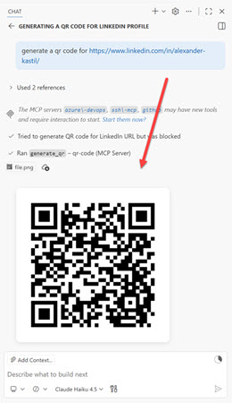

# Implement and Use MCP Applications

## What are MCP Apps?

MCP Apps extend the Model Context Protocol (MCP) by providing a standardized way to deliver interactive user interfaces directly from MCP servers. While MCP tools typically return text and structured data, MCP Apps enable rich, interactive experiences like charts, forms, dashboards, design canvases, and video players to render inline in chat clients such as Claude, ChatGPT, VS Code, and other compliant hosts.

This solves a critical gap: MCP provides the tools and data access, while MCP Apps provide the visual interface. Your UI renders in context, in the conversation, without requiring users to navigate away from their chat client.

Hands-on demo: [Serve QR Codes from a C# MCP Server](./demo-qr-code-mcp-app.md).

## MCP Server Implementations

| Server | Description |
| --- | --- |
| **[QR Code MCP Server (C#)](./qr-mcp-app-cs/readme.md)** | .NET 10 server exposing one tool, `generate_qr`, over Streamable HTTP on port 3002 or over stdio. Returns the QR code as a base64 PNG image block. |
| **[QR Code MCP App (Python)](../../../src/qr-mcp-app-py/readme.md)** | FastMCP reference that adds the MCP Apps layer: a `ui://qr-server/view.html` view resource rendered inline by the host. |

## How MCP Apps Work

MCP Apps are built on standardized specifications and SDKs maintained at the official Model Context Protocol repository. The protocol works through a clean separation of concerns:

1. Tool definition: Your MCP server tool declares a `ui://` resource containing its HTML interface
2. Tool call: The LLM calls the tool on your server
3. Host renders: The host fetches the resource and displays it in a sandboxed iframe
4. Bidirectional communication: The host passes tool data to the UI via notifications, and the UI can call other tools through the host

The MCP Apps specification (stable as of 2026-01-26) is maintained at the official repository and provides SDKs for multiple roles. App developers build interactive Views while host developers embed those Views in chat clients, and MCP server authors register tools with UI metadata. Supported frameworks include React, Vue, Svelte, and vanilla JavaScript.

## QR Code MCP Server Example

The [qr-mcp-app-cs](./qr-mcp-app-cs/readme.md) demonstration shows a practical MCP server that generates QR codes from URLs and text. It is written in C# on .NET 10 with the `ModelContextProtocol` SDK and QRCoder, and it starts either as an ASP.NET Core app speaking Streamable HTTP on port 3002 or as a stdio server with the `--stdio` flag.

When invoked through Claude Code, GitHub Copilot or any other MCP client, the tool returns a base64-encoded PNG image content block that the host displays inline. Parameters like box size, border dimensions, error correction level, and colors can be customized, giving users full control over the generated output. The stdio transport makes it simple to configure in `.vscode/mcp.json` or other MCP client configuration files.

### How it works

The C# server uses attribute-based registration: `[McpServerToolType]` on `QrTools` and `[McpServerTool(Name = "generate_qr")]` on the method, discovered by `WithToolsFromAssembly()`. It registers a tool only, not a view, so hosts show the returned PNG rather than an interactive App surface.

The Python reference in `src/qr-mcp-app-py/server.py` shows the missing half: `@mcp.tool(meta={"ui/resourceUri": VIEW_URI})` paired with `@mcp.resource(VIEW_URI)`, where `VIEW_URI = "ui://qr-server/view.html"`. Its UI layer is a single HTML resource that loads the MCP Apps SDK from a CDN (`@modelcontextprotocol/ext-apps`). The JavaScript App class receives tool results via the `ontoolresult` handler, extracts the image data, and renders it in an img element.

## Helpful Claude Slash Commands

| Command | Usage |
|---|---|
| `/mcp` | Check that `generate_qr` is discoverable after you start the server on port 3002 |
| `/permissions` | Allow the `generate_qr` tool so the QR call runs without a prompt every time |
| `/find-skills` | Look for a skill that already wraps an MCP server before writing your own view layer |

## Key Topics covered in this module

- [MCP Apps Specification](https://github.com/modelcontextprotocol/ext-apps)
- [MCP Introduction](https://modelcontextprotocol.io/docs/getting-started/intro)
- [MCP C# SDK](https://github.com/modelcontextprotocol/csharp-sdk)
