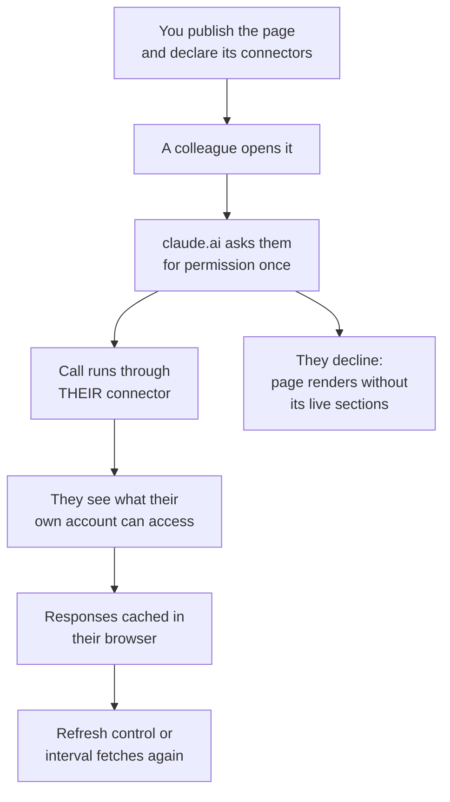

# Serve Live MCP Data to Artifact Pages

An [artifact](../../01-fundamentals/10-artifacts/readme.md) is a static page with no backend, which normally means it shows whatever the session knew when it was published. Connector calls are the single exception to that rule. A page can call MCP connectors each time someone opens it, so a status board that was published in July still shows today's numbers in September.

Hands-on demo: [Publish Your Last Two Emails as a Self-Refreshing Page](demo-last-two-emails.md).

This turns a capture of work into a small read-only client for your tools, without deploying anything. It requires Claude Code v2.1.209 or later on a Pro, Max, Team, or Enterprise plan. On earlier versions the same prompt still produces a page, just with the data frozen at publish time.

```text
Build a dashboard artifact of our open pull requests that pulls the live list through my GitHub connector when the page loads.
```

## Two Kinds of MCP Server, Only One of Which the Page Can Call

The distinction that decides whether the pattern works at all is which MCP servers are reachable from a published page. Servers in your project's `.mcp.json` run on your machine and belong to your session, so they can supply data while Claude builds the page and cannot be called once it is published. Connectors attached to your claude.ai account are the ones a page may call, because the call is made by claude.ai rather than by the page.

| Source | Can feed the build | Can be called at view time |
|---|---|---|
| Local stdio server in `.mcp.json` | Yes | No |
| Remote HTTP server registered locally | Yes | No |
| Connector on your claude.ai account | Yes | Yes |

Claude declares which connectors the page may call as part of publishing, and the page cannot call anything outside that declaration. That declaration is the security boundary: it is fixed at publish time and visible in what you approved, rather than being whatever the page's JavaScript decides to ask for.

## The Call Runs as the Viewer, Not as You

This is the part that surprises people, and it is the reason connector-backed pages are safe to share inside an organization. When the page calls a connector, the call goes through the account of whoever is looking at the page.



Two people opening the same dashboard can legitimately see different rows, because their accounts reach different repositories or projects. The page never sees anyone's credentials, since claude.ai makes the call on its behalf. Any control that writes, posting a message or updating an issue, writes as the person who clicked it.

Caching is per viewer as well. A reopened page renders from cached responses immediately and then updates with fresh results, so the first paint is never blocked on a connector round trip.

## Sharing Is More Restricted Than for a Plain Artifact

A connector-backed artifact can never be shared to a public link, on any plan. The reason is the same viewer-identity model: a public link has no signed-in viewer to run the calls as.

| Plan | What you can do with it |
|---|---|
| Pro and Max | Keep it private to yourself, since a public link is the only sharing path on these plans |
| Team and Enterprise | Keep it private or share it inside the organization, with public links unavailable for this page |

Design for the viewer who is missing a connection. Ask Claude to put a fallback message in each live section naming the connector it needs, so a colleague without that connector sees what to connect instead of an empty panel.

```text
Add a fallback to each live section that names the connector it needs and links to Settings > Connectors, so a viewer without the connection sees what to add.
```

## When the Page Shows No Live Data

Three causes account for nearly every empty live section, and they are worth checking in this order before suspecting the page itself.

| Symptom | Likely cause | Fix |
|---|---|---|
| One viewer sees data, another sees nothing | Connectors are per account and the second viewer has not added it | They add it under Settings > Connectors on claude.ai, then reload |
| Sections empty for the whole page load, no prompt visible | The viewer declined the permission ask, which lasts for that page load | Reload the page to bring the ask back |
| Every viewer in the organization sees nothing | An Owner has turned off the artifact connectors toggle | Enable it in admin Settings > Capabilities, which is separate from the artifacts toggle |

## Helpful Claude Slash Commands

| Command | Usage |
|---|---|
| `/mcp` | List connected servers and separate the local ones, which cannot be reached from a published page, from the account connectors that can |
| `/login` | Sign the session in to the claude.ai account whose connectors the page will declare at publish time |
| `/doctor` | Check that a server answers before you publish a page whose live sections depend on it |

## Key Topics covered in this module

- [Claude Code: pull live data with MCP connectors](https://code.claude.com/docs/en/artifacts#pull-live-data-with-mcp-connectors)
- [Claude Code: use MCP servers from claude.ai](https://code.claude.com/docs/en/mcp#use-mcp-servers-from-claude-ai)
- [MCP Architecture Overview](https://modelcontextprotocol.io/docs/learn/architecture)
