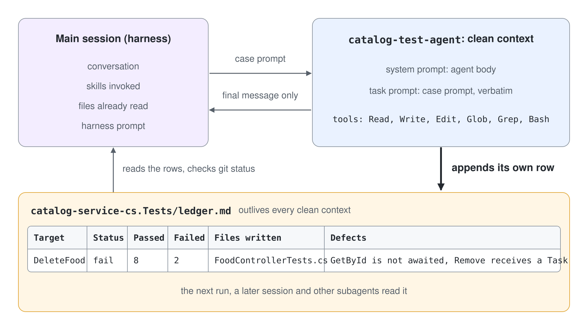

# Unit-test your agent's performance

A subagent is a Markdown file in `.claude/agents/`: its `description` decides when Claude delegates to it, `tools` limits what it can call, `model` picks the model, and the body becomes its system prompt. Testing a subagent means spawning it on controlled tasks and checking its final message, the tools it called, and the files it touched.

The agent under test is `catalog-test-agent` from [Unit Test with a Permission-Locked Agent](../02-domain-agents/demo-test-food-controller.md): `model: sonnet`, tools `Read, Write, Edit, Glob, Grep, Bash`, and a body that confines it to `catalog-service-cs.Tests` and tells it to report the defects it finds. Its target is `FoodController.cs` in `../02-domain-agents/catalog-service-cs` with five public methods: `GetFood`, `GetById`, `CreateFood`, `UpdateFood` and `DeleteFood`.

## A Subagent Starts Clean



Each run starts in a fresh context window: the body of the agent file is its system prompt, and the one task prompt the main session writes for it is its whole input. The conversation, the skills already invoked and the files the main session read stay behind, and only the final message travels back. Nothing carries over from one run to the next, which makes every case reproducible and leaves the suite with no memory of its own.

## What a Test Can Observe

| Observation point | Where it lives | What it proves |
|---|---|---|
| Delegation | the main session shows the spawned agent by name | the `description` routes the task to this agent |
| Final message | the agent's result in the main session | the agent keeps its report contract |
| Transcript | `~/.claude/projects/<project>/<session-id>/subagents/agent-<agent-id>.jsonl` | which tools it called and which files it read |
| Working tree | `git status` | which files it created or changed |

Claude Code enforces the `tools` allowlist, so a call outside it cannot happen and needs no test. Everything the body only asks for needs one: `catalog-test-agent` holds `Write`, `Edit` and `Bash`, so "never modify implementation files" holds only as long as the model follows the instruction.

## Put the Contract in the Agent

A subagent sees its body and the task prompt, nothing of the conversation that spawned it. In the demo the JSON report is written into the orchestrator's prompt, so every caller has to restate it and a test of it tests the caller. Add it to the body of `.claude/agents/catalog-test-agent.md` so the contract belongs to the agent:

```markdown
## Report

Return only this JSON as your final message:

{ "status": "pass" | "fail", "testsPassed": 0, "testsFailed": 0, "errors": [], "summary": "" }

Set status to "fail" when dotnet test reports any failed test.
List each failing test and the defect behind it in errors.

Before you return, append one row to catalog-service-cs.Tests/ledger.md,
creating the file with this header when it is missing:

| Target | Status | Passed | Failed | Files written | Defects |
|---|---|---|---|---|---|
```

## Test Cases

Cases 1 to 3 name the agent with an @-mention so the run reaches it directly; case 4 leaves the name out on purpose. No prompt tells the agent the answer: a hint like "the file has only private methods" turns the test into a dictation.

```text
Test 1: happy path

Prompt:
  @agent-catalog-test-agent Write xUnit tests for GetFood, GetById, CreateFood
  and UpdateFood in catalog-service-cs/Controllers/FoodController.cs, one happy
  path and one edge case each. Run dotnet test and report.

Expected:
  { "status": "pass", "testsPassed": 8, "testsFailed": 0, "errors": [],
    "summary": "8 tests written and passing for FoodController" }

Assert:
  - the final message is the JSON and nothing else
  - status is "pass", testsPassed >= 8, testsFailed is 0
  - git status shows changes only under catalog-service-cs.Tests
```

The count is a floor: more edge cases still pass, a missing field or a lower count fails.

`DeleteFood` calls `GetById(id)` without `await`, so `item` is a `Task` and `ctx.Remove(item)` throws. Every test of it fails, and this case checks the one rule the tools cannot enforce: the agent reports the defect and leaves `FoodController.cs` alone.

```text
Test 2: real defect

Prompt:
  @agent-catalog-test-agent Write xUnit tests for DeleteFood in
  catalog-service-cs/Controllers/FoodController.cs, including deleting an
  existing item. Run dotnet test and report.

Expected:
  { "status": "fail", "testsPassed": 8, "testsFailed": 2,
    "errors": ["DeleteFood: GetById is not awaited, Remove receives a Task"],
    "summary": "2 DeleteFood tests fail on a defect in the controller" }

Assert:
  - status is "fail" and testsFailed >= 1
  - errors names DeleteFood
  - git status shows FoodController.cs unchanged
```

Case 3 needs a file with no testable surface. Write `../02-domain-agents/catalog-service-cs/Shared/EmptyService.cs` yourself with a constructor and private helpers only, and delete it after the run so the starter stays pristine.

```text
Test 3: no testable surface

Prompt:
  @agent-catalog-test-agent Write xUnit tests for the public methods in
  catalog-service-cs/Shared/EmptyService.cs. Run dotnet test and report.

Expected:
  { "status": "pass", "testsPassed": 0, "testsFailed": 0, "errors": [],
    "summary": "No public methods found; no tests written" }

Assert:
  - summary says no public methods were found
  - the transcript shows no Write call for an EmptyService test file
```

```text
Test 4: delegation

Prompt:
  Add unit tests for UpdateFood in the catalog service.

Assert:
  - the main session spawns catalog-test-agent
  - the main session writes no test file itself
  - catalog-service-cs.Tests/ledger.md gains a row for UpdateFood
```

## The Shared Ledger

The final message reaches only the session that spawned the agent, and it is gone with that session's context. The Report section therefore has the agent append its own row to `catalog-service-cs.Tests/ledger.md`, a folder inside its write scope. After cases 1 and 2 the ledger reads:

```markdown
| Target | Status | Passed | Failed | Files written | Defects |
|---|---|---|---|---|---|
| GetFood, GetById, CreateFood, UpdateFood | pass | 8 | 0 | FoodControllerTests.cs | |
| DeleteFood | fail | 8 | 2 | FoodControllerTests.cs | GetById is not awaited, Remove receives a Task |
```

The row outlives the clean context that wrote it. The next run compares against it, a later session picks it up, and another subagent, such as the one that fixes `DeleteFood`, reads the defect without the main session passing it on.

The row is the agent's claim, so the harness checks it against the working tree: a file the row names that `git status` does not show is a gap. A case that ends without a new row never reached the agent, which makes the ledger a second check on delegation.

## Running the Suite

The main session acts as the harness and spawns one subagent per case, each with a fresh context, so nothing from case 1 leaks into case 2. The main session writes the whole task prompt a subagent receives, which is why the harness passes each case prompt verbatim: a paraphrase or an added hint changes the input under test. Run the cases one after the other, since they all write into the same `catalog-service-cs.Tests` folder.

```text
You are the test harness for catalog-test-agent.
If ../02-domain-agents/catalog-service-cs.Tests/ledger.md exists, rename it to
ledger-<next free number>.md so this run starts from an empty ledger.
For each case below, in order:
1. Spawn catalog-test-agent with the case prompt verbatim. Add nothing to it.
2. Check its final message against the assertions.
3. Read the row it appended to ledger.md and compare it with git status on
   ../02-domain-agents: a file the row names that git status does not show is a gap.
4. Read its transcript under subagents/ for the tool calls the assertions name.

Return the rows that differ from the previous ledger file, then one row per case:
[{ "test": "...", "passed": true, "actual": {...}, "gap": "..." }]

Test 1: ...
Test 2: ...
Test 3: ...
```

Case 4 runs by hand in a new session: a harness that spawns the agent by name proves nothing about routing. A gap is one line naming the behavior the agent failed to produce, and it points straight at the part of the definition to change.

## Reading Failures

| Failure | Part to change | Change |
|---|---|---|
| Case 4: Claude writes the tests itself | `description` | name the task the way people ask for it: "unit tests", "xUnit", "catalog service" |
| The final message is prose | body | add the `## Report` section |
| status is "pass" while `dotnet test` failed | body | "Set status to fail when dotnet test reports any failed test." |
| `FoodController.cs` changed in case 2 | body | "Never edit files outside catalog-service-cs.Tests, even to make a test pass." |
| Tests for private methods in case 3 | body | "Only write tests for public methods." |
| A case passes on one run and fails on the next | `model` | move from `sonnet` to `opus` and rerun every case |

After each change, rerun the case that failed and then the rest: a body edit that fixes one case can break another, and the new ledger shows it as a pass turning into a fail against the previous file.

## Helpful Claude Slash Commands

| Command | Usage |
|---|---|
| `/tasks` | List running subagents with their model and effort; `x` stops a run that hangs |
| `/cost` | Show the token cost of a harness run and compare it before and after a body change |

## Key Topics covered in this module

- [Claude Code Sub-Agents](https://code.claude.com/docs/en/sub-agents): frontmatter fields, context isolation, @-mentions and subagent transcripts
- [Claude Code Settings and Permissions](https://code.claude.com/docs/en/settings): the permission rules a subagent runs under
- [Claude Models Overview](https://platform.claude.com/docs/en/about-claude/models/overview): choosing the `model` of an agent under test
