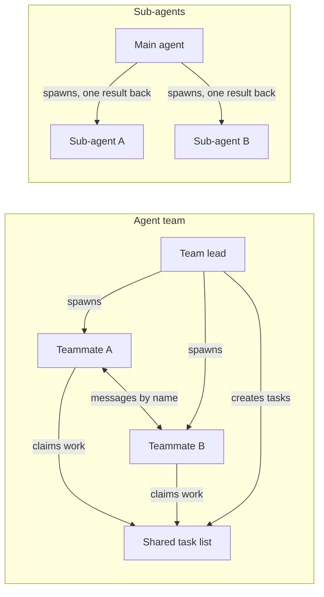
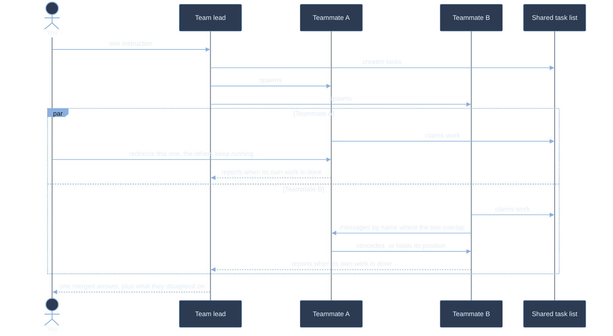

# Coordinate independent Claude Code sessions as a team

A sub-agent is a worker your session owns. It runs in its own context window, it answers the prompt you gave it, and the only thing that comes back is a result. It never hears what another worker found, and you never talk to it directly.

An agent team removes that constraint. The session you are typing in becomes the team lead, and each teammate it spawns is a full, independent Claude Code session that can claim work off a shared list, message any other teammate by name, and take instructions from you without the lead relaying them. The cost of that freedom is tokens, because every teammate is a separate Claude instance with its own context window.

## The Four Parts of a Team

| Component | Role |
|---|---|
| Team lead | The main session you started. It spawns teammates, creates tasks, and synthesizes what comes back |
| Teammates | Separate Claude Code instances, each working its own assigned or self-claimed tasks |
| Task list | The shared work items every agent can see, claim, and complete |
| Mailbox | The message store each agent reads from, so agents can address each other by name |

A team forms the moment the first teammate is spawned, and the main session is the lead for its whole lifetime. There is no promotion: you cannot hand leadership to a teammate, and a teammate cannot spawn teammates of its own.

## Where Teams Differ From Sub-Agents

Both give you parallelism and a clean context window per worker. The difference is whether the workers can reach each other.



| | Sub-agents | Agent teams |
|---|---|---|
| Context | Own window, results return to the caller | Own window, fully independent |
| Communication | Report back to the main agent only | Teammates message each other directly |
| Coordination | The main agent manages all work | Shared task list with self-coordination |
| Best for | Focused tasks where only the result matters | Work that needs discussion and challenge |
| Token cost | Lower, results are summarized back | Higher, each teammate is a separate instance |

The practical rule: reach for sub-agents when the answer is all you want, and for a team when the workers need to disagree with each other before you get an answer. Sequential work, same-file edits, and long dependency chains are worse in a team, not better, because coordination overhead buys you nothing there.

## How a Team Run Flows

Teammates start together and land separately, and neither the lead nor you have to wait on the slowest one to keep working.



## Enabling Agent Teams

Agent teams are experimental and off by default. With the flag unset, no team is created at session start, no team directories are written, and Claude will neither spawn nor propose teammates.

The flag belongs in your global harness at `~/.claude/settings.json`, because it is a property of how you work rather than of any one project:

```json
{
  "env": {
    "CLAUDE_CODE_EXPERIMENTAL_AGENT_TEAMS": "1"
  }
}
```

The same variable works as a plain environment variable when you want it for one session only. Either way the session has to be restarted, because the setting is read at startup.

```bash
export CLAUDE_CODE_EXPERIMENTAL_AGENT_TEAMS=1
claude
```

```powershell
$env:CLAUDE_CODE_EXPERIMENTAL_AGENT_TEAMS = "1"
claude
```

## What the Session Writes to Disk

Teams and tasks are stored locally under a name derived from the session: the literal `session-` followed by the first eight characters of the session id. Claude Code creates both directories at startup and updates them as teammates join, go idle, or leave.

| Path | Contents | Lifetime |
|---|---|---|
| `~/.claude/teams/{team-name}/config.json` | Runtime state: the `members` array of names and agent ids, session ids, tmux pane ids | Removed when the session ends |
| `~/.claude/teams/{team-name}/inboxes/{agent-name}.json` | One mailbox file per agent | Removed with the team config |
| `~/.claude/tasks/{team-name}/` | The shared task list | Persists locally, so a resumed session keeps its tasks |

The lead's entry in `members` always carries the agent type `team-lead`; a teammate carries whichever agent type the lead named when spawning it, and omits the field when the lead named none. Teammates can read this file to discover who else is on the team. Do not hand-edit or pre-author it, because the next state update overwrites your changes.

Two things that look like configuration and are not. There is no project-level equivalent of the team config, so a `.claude/teams/teams.json` in your repository is treated as an ordinary file. And the task directory retention follows the same `cleanupPeriodDays` setting as your session transcripts, so it is not a separate knob.

## Limits Worth Knowing Before You Build On It

- One team per session, scoped to that session. You cannot create additional named teams or share a team across sessions.
- No nested teams. Only the lead manages the team, and a teammate cannot spawn its own teammates.
- `/resume` and `/rewind` do not restore in-process teammates. After resuming, the lead may try to message teammates that no longer exist, and the fix is to tell it to spawn new ones.
- Task status can lag. A teammate that forgets to mark a task complete blocks every task that depends on it.
- Permissions are set at spawn. Every teammate starts with the lead's permission mode, and per-teammate modes can only be changed afterwards.
- Shutdown is not instant, because a teammate finishes its current request or tool call first.
- A finished teammate reports itself idle, not done. Its findings stay in its own transcript unless the spawn prompt tells it to send them, so ask for the report on a named channel rather than assuming the lead is handed a result.

## Helpful Claude Slash Commands

| Command | Usage |
|---|---|
| `/config` | Set the default teammate model, which teammates do not inherit from the lead's `/model` |
| `/context` | See what the lead is actually carrying before you decide what to hand to a teammate |
| `/doctor` | Health-check the installation after adding the flag, before blaming the prompt |
| `/permissions` | Review the allow and deny rules every teammate inherits from the lead at spawn |

## Key Topics covered in this module

- [Orchestrate teams of Claude Code sessions](https://code.claude.com/docs/en/agent-teams): the reference for enabling teams, the task list, the mailbox, display modes, and the current limitations
- [Claude Code Sub-Agents](https://code.claude.com/docs/en/sub-agents): the delegation model teams build on, and the definitions a teammate can be spawned from
- [Claude Code Settings](https://code.claude.com/docs/en/settings): where `env` and `teammateMode` live, and the `cleanupPeriodDays` that governs task retention
- [Agent team token costs](https://code.claude.com/docs/en/costs#agent-team-token-costs): what a team actually bills compared with a single session
