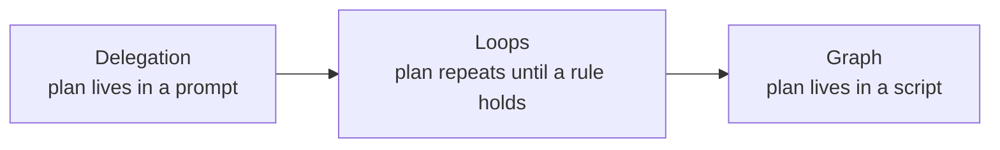
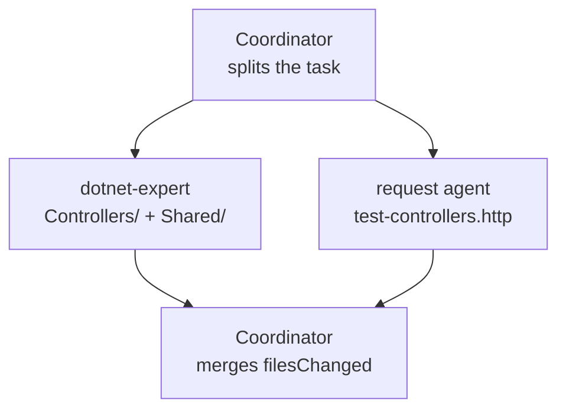
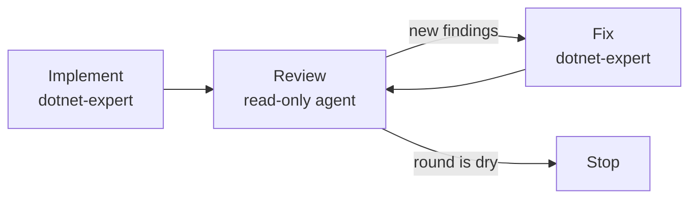
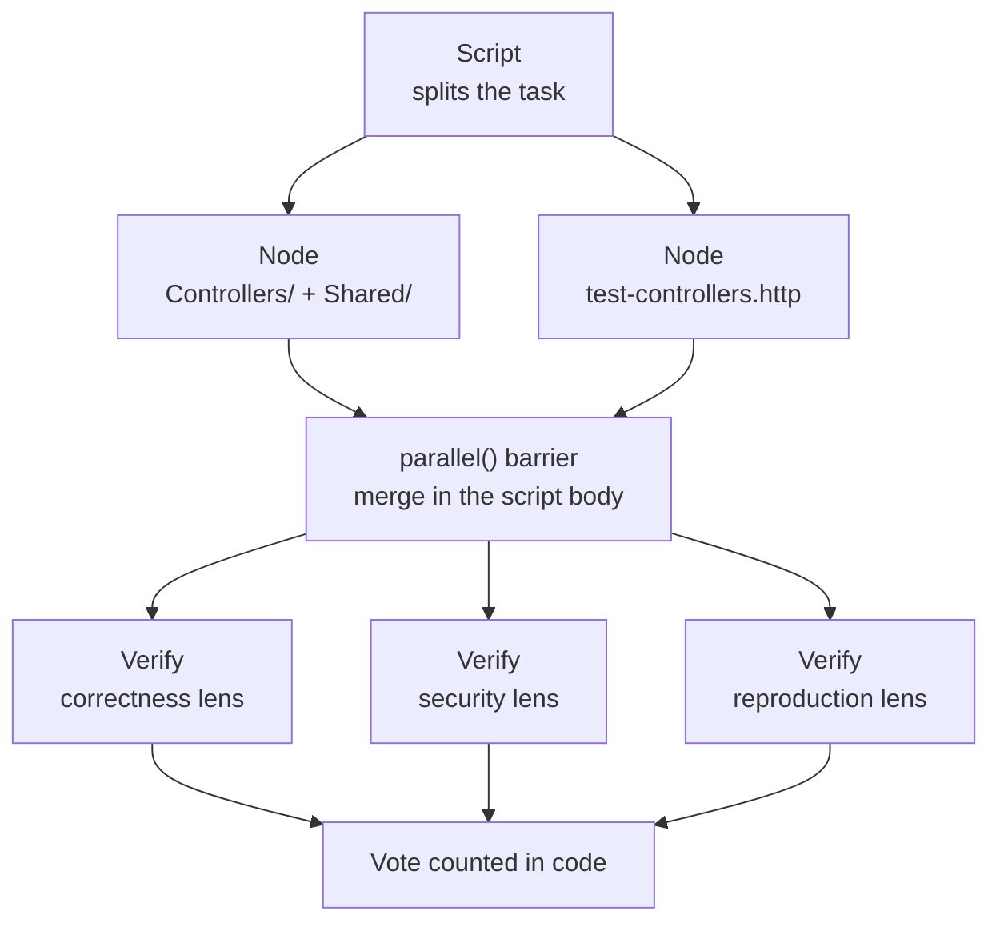

# Orchestrate sub-agents with delegation, loops, and graphs

## Three Shapes of Orchestration

An orchestrator does one job: it decides who does what, in which order, and what has to come back before the next thing starts. That decision has three shapes, and they differ in where the control flow lives.

Delegation keeps the control flow in a prompt. The coordinator splits the task, spawns agents, and merges what they return. Loops keep it in a repetition rule: the same agents run again until a condition holds. A graph moves it into a script, where nodes are agent calls and edges are the data between them, so the plan is code rather than a sentence the model re-derives each run.



The three are not alternatives to pick between once. A real orchestration usually delegates, loops on the parts that need convergence, and moves to a graph when the same decomposition is worth running more than once.

---

## Delegation

The coordinator understands the full scope, splits it into sub-tasks, and gives each one agent with a single responsibility, constrained tools, and an isolated slice. Three decomposition patterns cover most work.

Fan-out spawns several agents at once for independent workstreams, waits for all of them, then merges. Pipeline chains them, so the structured output of one is the input of the next. Domain decomposition assigns one agent per product boundary (backend, frontend, QA, deployment), each in its own worktree so nothing bleeds across.



### Choosing the Pattern from the Dependency Shape

The three patterns above are not stylistic preferences. The dependency structure of the work picks one, and overriding it produces a predictable failure.

| Dependency shape | Pattern | Failure mode of the wrong choice |
|---|---|---|
| Step B needs A's output, C needs B's | Prompt chaining (a pipeline) | Running them in parallel gives B an empty input, so it fabricates one |
| Subtasks share no data | Fan-out | Chaining them serialises work that had no reason to be serial |
| Any stage can fail and the failure must be handled | Hub-and-spoke through a coordinator | Direct agent-to-agent handoff hangs, or the downstream agent hallucinates on empty input |
| The work is open-ended and its shape is unknown up front | Map first, prioritise, then decompose adaptively | A fixed alphabetical chain wastes effort on low-impact areas and misses the dependencies |
| Most inputs are routine, a minority need deep work | Fixed pipeline with a conditional escalation | Running the deep path on everything is expensive; running the shallow path on everything misses the cases that mattered |

**Prompt chaining** is the name for the sequential case: the output of one call becomes the input of the next, one dedicated agent or prompt per step. Q3 usage feeds a Q2 comparison, which feeds a Q4 forecast. Clearing context between steps to save tokens defeats the whole point, and a single agent asked to do all three in one generation loses the intermediate results you wanted to inspect.

**Hub-and-spoke** is the name for routing everything through a coordinator instead of letting agents hand off to each other directly. A chain where `LogAgent` calls `MetricsAgent` calls `DiagnosisAgent` has nowhere to put error handling: when the middle agent fails, the last one either waits forever or invents its input. With a coordinator in the middle, each invocation is separate, failures are caught and logged in one place, and fallback logic (pass the logs straight through when metrics are unavailable) has somewhere to live.

### Decomposition Cuts More Than One Way

Splitting a research task purely by time period is the most common decomposition mistake. Three agents covering childhood, early career, and late career produce three disconnected essays and miss everything that evolved across all three. Themes that cut across the partitions need their own agent.

Partition temporally **and** thematically when the deliverable has a through-line. The same applies to code: splitting a migration by directory misses the cross-cutting concern that lives in every directory.

### The Coordinator Owns the Interface and the Context

Sub-agents are stateless and context-isolated by design, which is what keeps them cheap and focused. The consequence is that anything a sub-agent needs to know, the coordinator must put in the invocation prompt.

Three symptoms all trace back to the same omission:

- A retention agent offers a generic discount because it received only the user's last message, not the history of the dispute
- A summarizer hallucinates case details because its prompt carried the user's query but not the documents the searcher retrieved
- Two parallel agents disagree because each fetched the shared data separately and got different snapshots

The fixes are the same shape. Project the relevant state into the prompt, pass upstream output explicitly rather than assuming inheritance, and fetch shared data **once** at the orchestration layer before fanning out so every agent works from an identical snapshot.

Where several agents build against one interface, the coordinator writes that interface before the fan-out, never alongside it. Two agents each inferring their own version of a shared route or payload shape is an integration failure no build catches.

### Writing the Delegation Prompt

The prompt has two jobs: describe what each sub-agent must do and specify exactly what it must return. For a fan-out it partitions the context into slices so each agent receives only what its role requires:

```text
You are an orchestrator. Run the following agents in parallel:

1. dotnet-expert
   Allowed paths: catalog-service-cs/Controllers/, catalog-service-cs/Shared/
   Task: POST /food returns 400 on an invalid CatalogItem, 201 otherwise.
   Return: { status, filesChanged, summary, errors }

2. request agent
   Allowed paths: catalog-service-cs/test-controllers.http
   Task: append one request per status code in the contract above.
   Return: { status, filesChanged, summary, errors }

Wait for both, then report the merged list of changed files.
```

For a pipeline, each prompt names the upstream stage and references its structured output, making the data dependency visible and enabling targeted retries per stage:

```text
Pipeline step 2 of 3: dotnet-expert
Input: typed spec from the research stage (attached below).
Task: Implement the endpoint. Do not deviate from the input spec.
Return: { status, filesChanged, summary }

{{ research_agent_output }}
```

Having the Task tool in `allowedTools` is necessary but not sufficient. A coordinator that answers "I will transfer you to billing" without spawning anything usually has the tool available and no instruction telling it when to use it. Availability is permission; the system prompt is the trigger.

### Contracts and Schema Validation

A communication contract is a JSON schema that specifies the exact structure an agent must produce before the orchestrator proceeds. Without contracts, one agent's structural drift causes silent failures in the next stage: the orchestrator receives partial data, makes wrong assumptions, and continues with a corrupted state.

Each contract defines three things: the input the agent receives (task spec and context), the output structure it must return (typed fields, required versus optional), and the success criteria that mark the task complete.

```json
{
  "agentOutputSchema": {
    "type": "object",
    "required": ["status", "filesChanged", "summary"],
    "properties": {
      "status": { "type": "string", "enum": ["success", "failure", "partial"] },
      "filesChanged": {
        "type": "array",
        "items": { "type": "string" }
      },
      "summary": { "type": "string" },
      "errors": {
        "type": "array",
        "items": { "type": "string" }
      }
    }
  }
}
```

In delegation the contract is enforced through the prompt, which means it is an instruction to a model and not a guarantee. The orchestrator checks required fields, confirms the status value is in the allowed enum, and verifies that every path in `filesChanged` falls within the agent's declared allowed paths. A validation failure triggers an explicit retry rather than silent continuation, which is where the next shape starts.

---

## Loops

A loop is orchestration with a stopping rule instead of a fixed step count. Two kinds matter, and they stop on different things.

A retry loop runs when a response violates its contract. The correction carries the original task by reference plus the specific validation error, so the agent fixes one field instead of redoing work it already got right:

```text
Your previous response failed schema validation:
  - "filesChanged" must be an array of strings, not a plain string.

Repeat your task from the previous turn (harden the DELETE branch).
Return the corrected JSON object only. No prose, no markdown fences.
```

A convergent loop runs when the size of the work is unknown. Implement, review, fix, review again, and stop when a round surfaces nothing new. A fixed count is the wrong stopping rule for discovery: `while (found < 10)` always misses the tail, and stopping after one review round ships whatever the first reviewer happened to look at.



The cycle needs one detail to converge: dedupe against everything **seen**, not against everything **confirmed**. Deduping against confirmed results lets each rejected finding reappear in the next round forever, and the loop never goes dry.

Two guards keep a loop honest. Give the reviewer no write tools, so a round cannot quietly fix what it was supposed to report. And cap the rounds, because a model that keeps finding smaller and smaller things will keep the loop alive past the point where the findings are worth the tokens.

---

## Graphs

Delegation and loops both keep the plan in prose, so the model re-derives it on every run and the control flow is a suggestion rather than a guarantee. A workflow graph moves that plan into a script: nodes are units of work performed by agents, edges are the data that flows between them, and the orchestration layer itself is plain JavaScript that costs zero tokens because it is not another turn of a model thinking.

The shift is small in code and large in reliability. The same agents run, but the fan-out is a loop over an array instead of a sentence the model has to interpret correctly. Anything deterministic (filtering, deduping, branching, retrying, counting) becomes code, and the agents are left to do only the part that needs judgement.

### Nodes, Edges, and the Edges That Are Not Real

A node is a bounded unit of work with one job and one return value. If you cannot say what a node returns, it is not a node yet; it is still a paragraph of intent.

An edge exists only where one node needs another node's output. This is the distinction that widens most graphs: "B happens after A" is an ordering habit, not a data dependency. When you delete the edges that carry no data, work that looked sequential turns out to be independent, and independent work can run at the same time.

Name each edge by the data crossing it (`findings`, `candidates`, `verdicts`), never by ordering (`then`, `next`). An edge named by its data is swappable, because any node producing that shape can feed the consumer. This also exposes the edges that are not agent work at all: filtering a list, deduping by file and line, sorting by severity. Those are single lines of JavaScript in the script body, and spending a model turn on them is pure waste.

### Node Contracts Make Parallelism Safe

A node without a contract cannot be safely parallelized, because the consumer has no guarantee about the shape of what comes back. The `schema` option on an agent call solves this: the sub-agent is forced through a structured-output tool, validation happens at the tool-call layer, and the model retries on mismatch. The call then returns a validated object rather than a string you have to parse. This is the same contract delegation writes into a prompt, moved to where it is checked instead of requested.

```javascript
const NODE_SCHEMA = {
  type: 'object',
  properties: {
    status: { type: 'string', enum: ['success', 'failure', 'partial'] },
    filesChanged: { type: 'array', items: { type: 'string' } },
    summary: { type: 'string' },
  },
  required: ['status', 'filesChanged', 'summary'],
}

const result = await agent('Harden the write path in Controllers/.', { schema: NODE_SCHEMA })
```

Schema every node whose output another node reads. Free-form prose is acceptable only at the terminal synthesis node, where a human is the consumer.

### Barriers and Pipelines

Two calls do the fanning out, and choosing between them is the single biggest lever on wall-clock time.

`parallel(thunks)` runs jobs concurrently and waits for all of them. It is a barrier: nothing downstream starts until the slowest job lands. `pipeline(items, stage1, stage2)` sends each item through every stage independently, with no barrier between stages, so item A can be in stage three while item B is still in stage one.

Default to `pipeline()`. A barrier is justified only when a stage genuinely needs the whole upstream set at once: deduping across all results, exiting early when the total count is zero, or a prompt that literally references the other findings. A barrier is not justified by needing to flatten or map first (do that inside a stage) or by the stages feeling conceptually separate, because separate is not the same as synchronized.

The smell test is a middle transform with no cross-item dependency:

```javascript
const a = await parallel(...)
const b = a.flat().filter(Boolean)
const c = await parallel(b.map(...))
```

That is a pipeline wearing a barrier. If five finders run and the slowest takes three times the fastest, the barrier throws away two thirds of the fast finders' head start.



### Verification on the Edge

A finding produced by one agent and passed straight to the user is an unverified claim. Put a verifier on the outbound edge of any node whose output will reach a human, and pick the pattern by how the claim could be wrong.

Adversarial verification spawns several skeptics with the same lens, each prompted to refute rather than confirm, defaulting to refuted when uncertain, and kills the finding on a majority. It is the right answer against confident hallucination.

Perspective-diverse verification gives each verifier a different lens (correctness, security, does it reproduce). Use it when a claim can fail in several unrelated ways, because redundancy cannot catch what a single lens is blind to.

A judge panel generates several independent attempts from different angles, scores them with parallel judges, and synthesizes from the winner while grafting the best ideas from the runners-up. It beats one attempt iterated when the solution space is wide, which is why it suits design and approach selection rather than bug hunting.

Scale the pass to the request. "Find any bugs" earns a single-vote check; "audit this thoroughly" earns a three to five vote adversarial pass plus a synthesis node.

### Topology Is the Cost and Latency Bill

The shape of the graph, not the quality of the prompts, decides what a run costs and how long it takes. Three levers matter.

Barriers cost wall-clock time, so prefer pipelines wherever a stage does not need the full set. Model and effort tiering costs tokens, so route bounded mechanical nodes to a cheaper model or a lower effort and leave judgement nodes on the session default. Concurrency is capped per workflow, so passing a hundred items is safe (they queue) but does not make a hundred agents run at once.

When a graph deliberately bounds coverage (a top-N cut, sampling, no retry), log what was dropped. Silent truncation reads to a user as full coverage, which is a correctness problem disguised as a performance decision.

### When Not to Draw a Graph

A workflow can spawn dozens of agents and spend a large amount of tokens, so it is opt-in work, not an optimization to apply on your own initiative. Start one only when the request asks for it, when a skill or command instructs it, or when the session has been put in an orchestration mode. A task that would merely benefit from parallelism does not qualify; describe the workflow and its rough cost, then let the person decide.

---

## Agents and Skills

The orchestrator prompt stays lean because domain knowledge lives in skills, not in the orchestrator itself. Each agent loads its conventions at startup: `dotnet-expert` reads the `dotnet-conventions` skill before writing any code; `angular-expert` calls `mcp__angular-cli__get_best_practices` as its first step. The orchestrator does not need to know that .NET controllers require primary constructor injection or that Angular components require OnPush change detection: those rules are already encoded in the skill each agent carries.

This separation keeps the three layers distinct: the orchestrator owns decomposition and output contracts; skills own domain conventions; agents are the bridge that applies conventions within the contract boundary the orchestrator enforces. When a convention changes, you update the skill once and every agent that loads it picks up the change without touching the orchestrator or the schema.

## Helpful Claude Slash Commands

| Command | Usage |
|---|---|
| `/compact` | Summarize the coordinator conversation between fan-out rounds so the merged agent results still fit |
| `/workflows` | Watch a running graph's live progress tree, phase by phase, while its nodes are still working |
| `/cost` | Read the token spend a fan-out actually incurred, so topology choices can be judged against a number |
| `/loop` | Re-run an orchestration on an interval, or let the model pace its own iterations when the work is open-ended |
| `/context` | Inspect how much context the coordinator holds before deciding what to push into agents |

## Key Topics covered in this module

- [Claude Code: create custom subagents](https://code.claude.com/docs/en/sub-agents)
- [Claude Code: run agents in parallel](https://code.claude.com/docs/en/agents)
- [Claude Code: run parallel sessions with worktrees](https://code.claude.com/docs/en/worktrees)
- [JSON Schema: specification and validation](https://json-schema.org/specification)
- [Anthropic model overview](https://platform.claude.com/docs/en/about-claude/models/overview)
