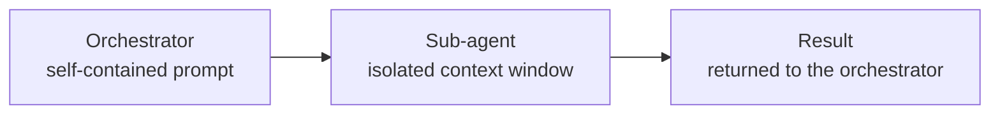

# Explore sub-agent architecture and context isolation

A single Claude Code session executes tasks sequentially inside a shared context window. As a task grows in scope (a full-stack feature, a data migration, a documentation suite), the window fills with intermediate artifacts from earlier steps that push out space for later ones. The serial execution model also means that independent work, such as writing tests while writing code, cannot run at the same time.

Sub-agents solve these problems by letting an orchestrator agent delegate focused sub-tasks to parallel workers, each running in its own isolated context window. Every sub-agent receives a clean prompt with only the information it needs, preventing context bleed between domains. The result is a network of focused specialists that together finish larger work faster than one agent could alone.

## Why Single-Agent Sequential Hits a Ceiling

Three compounding problems emerge as task scope grows:

- Context exhaustion: each new reasoning step adds tokens, and older steps cannot be safely dropped without losing state.
- Serial bottleneck: independent tasks (backend and frontend, implementation and tests) wait in line for no reason.
- Role confusion: one agent switching between architect, coder, tester, and writer produces less precise output than a specialist would.

Context exhaustion is the hardest ceiling to raise. You can increase the model's context window, but relevance degrades as irrelevant earlier steps compete with the active task. Splitting work across sub-agents sidesteps the problem: each agent gets only what it needs, and nothing it does not.

## What Is a Sub-Agent?

A sub-agent is a Claude Code agent launched from a Markdown file stored in `.claude/agents/`. The orchestrator spawns sub-agents using the built-in `Agent` tool, passing a self-contained prompt and collecting the result when the sub-agent finishes. Sub-agents can themselves spawn further sub-agents, forming a delegation tree.



The orchestrator defines the contract: what the sub-agent receives and what it must return. Nothing else from the orchestrator's session crosses that boundary, which is exactly what keeps the sub-agent's context clean and its output focused.

## Sub-Agent Frontmatter

Each agent file opens with a YAML frontmatter block that controls its identity, model, and tool access.

```yaml
---
name: dotnet-expert
description: >-
  Implements REST API endpoints and data models for the application.
  Use for writing controllers, services, repositories, and migration scripts.
  Trigger: "implement the API", "add an endpoint", "write the backend".
model: opus
tools: [Read, Write, Edit, Bash, Glob, Grep, mcp__microsoft-learn__microsoft_docs_search]
mcpServers:
  microsoft-learn:
    type: http
    url: https://learn.microsoft.com/api/mcp
---
```

| Field | Required | Purpose |
|---|---|---|
| `name` | Yes | Unique slug; the orchestrator references this when spawning the agent |
| `description` | Yes | Routing text; include realistic user phrasings so the orchestrator routes correctly |
| `model` | No | Model override for this agent; omit to inherit the session model |
| `tools` | No | Allowlist of permitted tools; omit to inherit every tool from the main conversation |
| `disallowedTools` | No | Denylist applied before `tools`; use it to inherit everything except a few tools |
| `permissionMode` | No | How the agent handles permission prompts: `default`, `acceptEdits`, `auto`, `dontAsk`, `bypassPermissions`, or `plan` |
| `mcpServers` | No | MCP servers scoped to this agent; inline entries use the same schema as `.mcp.json` server entries; when `tools` is present, tools from these servers must be listed there too |

> **Note:** a sub-agent's prompt cache expires after 5 minutes idle, so one that waits on tests or builds rebuilds its whole context on the next step. Give that agent `experimental:` with `cacheTtl: 1h` nested under it (v2.1.248+, values `5m` or `1h`); leave agents that run straight through on the default, because 1-hour cache writes cost more. The `subagentPromptCacheTtl` setting and the `CLAUDE_CODE_SUBAGENT_PROMPT_CACHE_TTL` variable override it. See [Choose the TTL yourself](https://code.claude.com/docs/en/prompt-caching#choose-the-ttl-yourself).

## Proactive Delegation Is a Hint

Writing "use proactively" in `description` makes the orchestrator more likely to pick the agent without being asked:

```yaml
---
name: fact-gatherer
description: >-
  Proactively read-only fact gatherer. Use at the start of any task to collect
  the facts it depends on. Apply when the task is "find out", "what does",
  "where is", or before any implementation.
tools: [Read, Glob, Grep, WebFetch, WebSearch]
---
```

The orchestrator still decides. It weighs the description against every other instruction in its context, and Claude Code's own system prompt tells it to search directly when a lookup looks small. Ask "does this module cover X?" and the orchestrator often runs three greps itself, because a quick search seemed cheaper than spawning an agent. Nothing in the harness forces the agent to be picked.

When the delegation must happen every time, a `UserPromptSubmit` hook ([Module 2: Hooks](../../02-harness/06-hooks-mods/readme.md)) injects the routing rule on every turn. The hook's stdout becomes context for that turn:

```json
{
  "hooks": {
    "UserPromptSubmit": [
      {
        "hooks": [
          {
            "type": "command",
            "command": "echo Route investigation questions to the fact-gatherer agent before reading files yourself."
          }
        ]
      }
    ]
  }
}
```

## Restricting Tools and Permissions

A docs agent that never receives `Bash` cannot run `git` or `rm` at all, even if its prompt is misconfigured.

```yaml
---
name: docs-agent
description: Writes and updates API reference documentation.
model: haiku
tools: [Read, Write, Edit, Glob, Grep]
permissionMode: dontAsk
---
```

`permissionMode` decides how the remaining tool calls are approved: `plan` keeps an agent read-only, `dontAsk` auto-denies anything not explicitly allowed, and `acceptEdits` lets an implementation agent write without prompting. Agent frontmatter has no `permissions:` block of its own; command-level allow and deny rules such as `Bash(rm:*)` live in `settings.json` and apply to the whole session, sub-agents included.

## Helpful Claude Slash Commands

| Command | Usage |
|---|---|
| `/agents` | Since 2.1.198 it no longer opens a wizard: it prints where sub-agent definitions live, and you create or edit them as files under `.claude/agents/` or `~/.claude/agents/` |
| `/permissions` | Inspect and tune the session allow and deny rules that every sub-agent inherits |
| `/context` | Visualize context distribution across the session before deciding which work to split into sub-agents |
| `/model` | Assign different models to orchestrator and sub-agents to balance quality against cost |

## Key Topics Covered in This Module

- [Claude Code Sub-Agents](https://code.claude.com/docs/en/sub-agents): official reference for agent frontmatter fields, the Agent tool, and orchestration patterns
- [Claude Code Settings and Permissions](https://code.claude.com/docs/en/settings): configuring session `permissions` rules that sub-agents inherit
- [Claude Models Overview](https://platform.claude.com/docs/en/about-claude/models/overview): model IDs, capabilities, and cost comparison for matching models to agent roles
