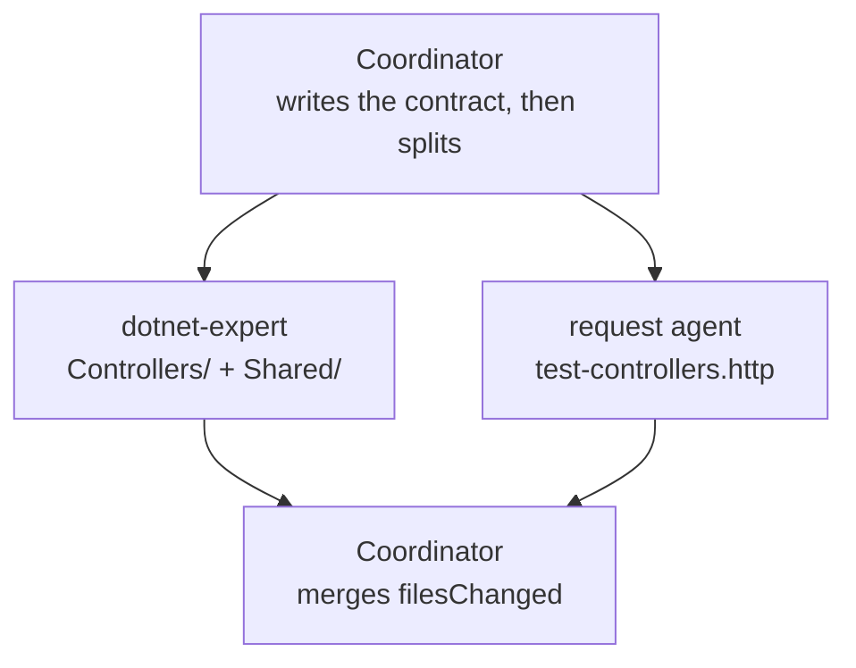

# Fan One Task Out to Two Contracted Agents

Handing a whole feature to one agent serialises work that had no reason to be serial, and handing it to two without file boundaries lets both write the same file. You split the write-path hardening of `FoodController` into two disjoint slices, fix the interface yourself before either agent starts, and merge two JSON responses instead of reading two paragraphs. You end up with a hardened controller and a matching request file produced concurrently.

------

Work in `catalog-service-cs/`; the finished result is beside it in `catalog-service-cs-delegation-solution/`.

```bash
cd demos/06-subagents/06-orchestration/catalog-service-cs
claude
```

## The Pattern

The coordinator holds the plan in its own prompt. It splits, spawns, waits, and merges.



The two nodes never talk. They agree because the coordinator fixed the HTTP contract before spawning either of them, which is what makes the edge between them unnecessary rather than merely inconvenient.

---

## Step 1: Cut the Slices

Overview: The unit of disjointness is the file, not the task description. Two agents handed overlapping ownership both report success, and the damage surfaces only after both have written.

Research / Planning / Discussion:

```text
Read Controllers/FoodController.cs and Domain/CatalogItem.cs in this folder.

The write path returns no error status codes at all. List every place a caller
could send something invalid or missing and get a 200 or a crash instead.

Then propose two non-overlapping slices for a fan-out: which files each agent
owns exclusively, and what data would have to cross between them. If nothing
has to cross, say so.
```

Finding: A good response names the DELETE branch as the one that crashes rather than 404s, because `var item = GetById(id)` binds a `Task`, which is never null, so `ctx.Remove(item)` reaches EF Core with the wrong type. It should also conclude that nothing crosses between the two slices once the status codes are fixed in advance. If it draws an edge from the controller slice to the request-file slice because the requests "need the endpoints first", push back and ask what data would actually cross it.

Expected Outcome: Two slices with one file owner each, and a stated reason why no data edge exists between them.

---

## Step 2: Write the Contract, Then Fan Out

Overview: The coordinator writes anything whose value is exactness before the fan-out, never alongside it. Here that is the status-code contract: both agents build against it, and neither is allowed to invent its own version.

Recipe:

```text
You are an orchestrator. Spawn these two agents in parallel and wait for both.

Both build against this fixed contract. Neither may change it or add endpoints beyond it:
  1. POST /food returns 400 with a ProblemDetails body when the CatalogItem is invalid
     (Name null/empty/whitespace, Price negative, InStock negative), 201 with a
     Location header otherwise.
  2. PUT /food returns 400 on the same rules, 404 when the ID does not exist, 200 otherwise.
  3. DELETE /food/{id} returns 404 when the ID does not exist, 204 otherwise.
  4. GET /food/{id} returns 404 when the ID does not exist.

Agent 1: dotnet-expert
Allowed paths: Controllers/, Shared/
Task: implement the contract in FoodController. Keep GET /food untouched. Follow the
  existing style: primary-constructor injection, EF Core through the injected
  FoodDBContext, async/await. Run dotnet build and confirm zero errors.
  Do not touch test-controllers.http.

Agent 2: general-purpose
Allowed paths: test-controllers.http
Task: keep every existing request and append one ###-separated request per status code
  in the contract, each with a comment line naming the expected status. Use the existing
  @baseUrl variable and 9999 as the ID that does not exist. Do not open FoodController.cs.

Both return ONLY:
{ "status": "success" | "failure" | "partial", "filesChanged": ["<path>"], "summary": "<one sentence>", "errors": [] }

After both complete, merge the filesChanged arrays and verify every path falls inside
that agent's allowed paths. If either returns "failure", list its errors and do not
mark the task complete.
```

Expected Outcome: Two JSON responses whose `filesChanged` arrays are disjoint, merging to three paths. The backend slice returned `Controllers/FoodController.cs` plus a new `Shared/CatalogItemValidator.cs`, and the DELETE branch it produced loads the entity before deciding:

```diff
-            var item = GetById(id);
-            if (item != null)
+            var item = await ctx.Food.FirstOrDefaultAsync(v => v.ID == id);
+            if (item is null)
             {
-                ctx.Remove(item);
-                await ctx.SaveChangesAsync();
+                return NotFound();
             }
-            return Ok();
+
+            ctx.Remove(item);
+            await ctx.SaveChangesAsync();
+            return NoContent();
```

The request slice returned only `test-controllers.http`, written from the contract alone while the controller was still being edited:

```text
### Create Food Item - negative price (expect 400 Bad Request)
POST {{baseUrl}}/food
Content-Type: application/json

{
  "id": 0,
  "name": "Lasagne",
  "price": -16.50,
  "inStock": 25,
  "pictureUrl": "https://example.com/images/lasagne.jpg",
  "description": "Layered pasta with beef ragu"
}
```

---

## Step 3: Read What the Contract Did Not Buy You

Overview: A contract enforced through a prompt is an instruction to a model, not a guarantee. Checking the merged result against the instructions is the coordinator's last job, and it is where prompt-enforced contracts show their limit.

Recipe:

```text
Compare what came back against what I asked for.

1. Does every path in the merged filesChanged fall inside that agent's allowed paths?
2. The dotnet-expert prompt said "no inline comments in the code". Read
   Shared/CatalogItemValidator.cs and report whether that instruction held.
3. Name every status code in the contract that the merged result does not produce.

Report each as held or violated. Do not fix anything.
```

Expected Outcome: The path check passes and the comment instruction does not: the validator came back carrying XML documentation comments the prompt asked it to omit.

```csharp
        /// <summary>
        /// Validates the supplied <see cref="CatalogItem"/> against the catalog write-path rules:
        /// <see cref="CatalogItem.Name"/> must not be null, empty or whitespace, and
        /// <see cref="CatalogItem.Price"/> and <see cref="CatalogItem.InStock"/> must not be negative.
        /// </summary>
```

That gap is the reason the next demo puts the check in a loop rather than in a sentence. Which instruction a given run drops is model-dependent, so read your own merged result rather than looking for this exact one.

---

The finished fan-out is in [`catalog-service-cs-delegation-solution/`](catalog-service-cs-delegation-solution/readme.md). The same task run as a loop is in [`demo-review-loop.md`](demo-review-loop.md), and as a script in [`demo-workflow-graph.md`](demo-workflow-graph.md).
