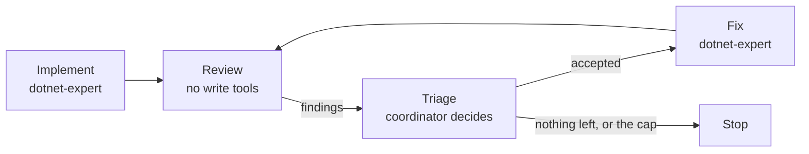

# Converge a Fix Through Review Rounds

One implementation round ships whatever the first agent happened to think of, and one review round catches whatever the first reviewer happened to look at. You run the same write-path hardening as implement, review, triage, fix, review again, deciding in the coordinator which findings the project's real configuration supports. You end up with a converged controller and a stopping rule you chose rather than a round count you guessed.

------

Work in `catalog-service-cs/`; the finished result is beside it in `catalog-service-cs-delegation-loops/`.

```bash
cd demos/06-subagents/06-orchestration/catalog-service-cs
claude
```

## The Pattern

The plan is a repetition rule. The same two roles alternate, and the coordinator decides after every review whether another round is worth its tokens.



---

## Step 1: Implement, Then Review With No Write Tools

Overview: The reviewer must not be able to fix what it finds, or a round quietly repairs things instead of reporting them and you lose the record. Splitting the two roles is what makes the loop observable.

Recipe:

```text
Round 1. Spawn dotnet-expert against this contract, in this folder only:
  1. POST /food returns 400 with a ProblemDetails body when the CatalogItem is invalid
     (Name null/empty/whitespace, Price negative, InStock negative), 201 with a
     Location header otherwise.
  2. PUT /food returns 400 on the same rules, 404 when the ID does not exist, 200 otherwise.
  3. DELETE /food/{id} returns 404 when the ID does not exist, 204 otherwise.
  4. GET /food/{id} returns 404 when the ID does not exist.
Keep GET /food untouched. Run dotnet build and confirm zero errors.

Round 2. Then spawn a read-only reviewer with no write tools. Give it
Controllers/FoodController.cs, Domain/CatalogItem.cs, Infrastructure/FoodDBContext.cs
and test-controllers.http, and the same contract as the claim under test.

Tell it to REFUTE the claim rather than confirm it, to default to reporting when
uncertain, and to ignore style. It returns:
{ "findings": [ { "id", "file", "symbol", "claim", "severity" } ], "summary" }
```

Expected Outcome: Round 1 returns one changed file, because a single agent implementing a contract implements exactly the contract. `test-controllers.http` is untouched, so nothing exercises the branches it just wrote.

```csharp
        private static ProblemDetails ValidateCatalogItem(CatalogItem item)
        {
            if (item == null || string.IsNullOrWhiteSpace(item.Name) || item.Price < 0 || item.InStock < 0)
```

Round 2 returns 12 findings against that one file, ranging from a real partial-update overwrite to a claim that the injected `AILogger` is not registered anywhere.

---

## Step 2: Triage Before You Fix

Overview: A reviewer refutes as hard as its read-set allows, so an under-briefed one inflates the round with findings that the project's configuration already answers. Triage is the coordinator's job and it is what keeps the loop convergent.

Research / Planning / Discussion:

```text
Here are the 12 findings from the review round.

For each one, check it against the project rather than against the claim:
read catalog-service.csproj and Common/AppBuilder.cs before deciding.

Sort them into accept, reject, and defer. For every reject, name the file that
settles it. Do not fix anything yet.
```

Finding: A good response rejects everything that depends on nullable reference types, because the csproj sets no `<Nullable>` property, and rejects the `AILogger` finding outright by pointing at its registration. If it accepts a finding on the strength of the reviewer's confidence rather than a file, push back and ask which file settles it.

Expected Outcome: Twelve findings become five accepted, six rejected, and one deferred. Four of the six rejects trace to two files the reviewer was never given:

```csharp
        builder.Services.AddSingleton<AILogger>();
```

```xml
        <TargetFramework>net10.0</TargetFramework>
        <TreatWarningsAsErrors>false</TreatWarningsAsErrors>
```

The reviewer's read-set is a coordinator decision, so half a noisy round is a briefing defect rather than a model defect.

---

## Step 3: Fix, Review Again, and Stop on a Rule

Overview: The second review round is the one that pays, because a fix creates surface the first reviewer never saw. It is also where the loop needs a stopping rule, since a model asked to refute will keep finding smaller things indefinitely.

Recipe:

```text
Round 3. Spawn dotnet-expert to fix exactly the five accepted findings and nothing else.
Pass it the project facts already settled, so it does not re-litigate them: the csproj
does not enable Nullable, TreatWarningsAsErrors is false, AILogger is a registered
singleton, and the database is SQLite. Run dotnet build and confirm zero errors.

Round 4. Spawn the reviewer again with the same contract, plus the list of finding ids
already SEEN: the five that were fixed AND the six that were rejected. Tell it to report
only findings that are new, not a rewording of a seen one, and to return
{ "findings": [...], "dry": true | false, "summary" }.

Dedupe against everything seen, never against everything fixed: a rejected finding that
is not on the seen list comes back every round and the loop never converges.

Stop when a round comes back dry, or after this second review round either way.
```

Expected Outcome: Round 4 came back `"dry": false` with three new findings, and two of them exist only because round 3 fixed something:

| Finding | Created by |
|---|---|
| The new 409 branch serializes as `application/json` while the 400 path sets `application/problem+json` | round 3's duplicate-ID fix |
| The `AnyAsync` pre-check and the save are not atomic, so a race still surfaces a 500 | round 3's duplicate-ID fix |
| The file's own `DELETE /food/1` runs before the `PUT` labelled 200 on `"id": 1`, so that request returns 404 | round 1's untouched request file |

The loop stopped here on the cap, not on dryness, which is the honest outcome for a reviewer prompted to refute. Round 5 fixed those three, and the demo ends because the coordinator said two review rounds, not because the model ran out of opinions.

---

The converged result is in [`catalog-service-cs-delegation-loops/`](catalog-service-cs-delegation-loops/readme.md). The same task delegated once is in [`demo-delegation-fan-out.md`](demo-delegation-fan-out.md), and as a script in [`demo-workflow-graph.md`](demo-workflow-graph.md), whose reproduction lens found the ordering defect above in a single pass.
