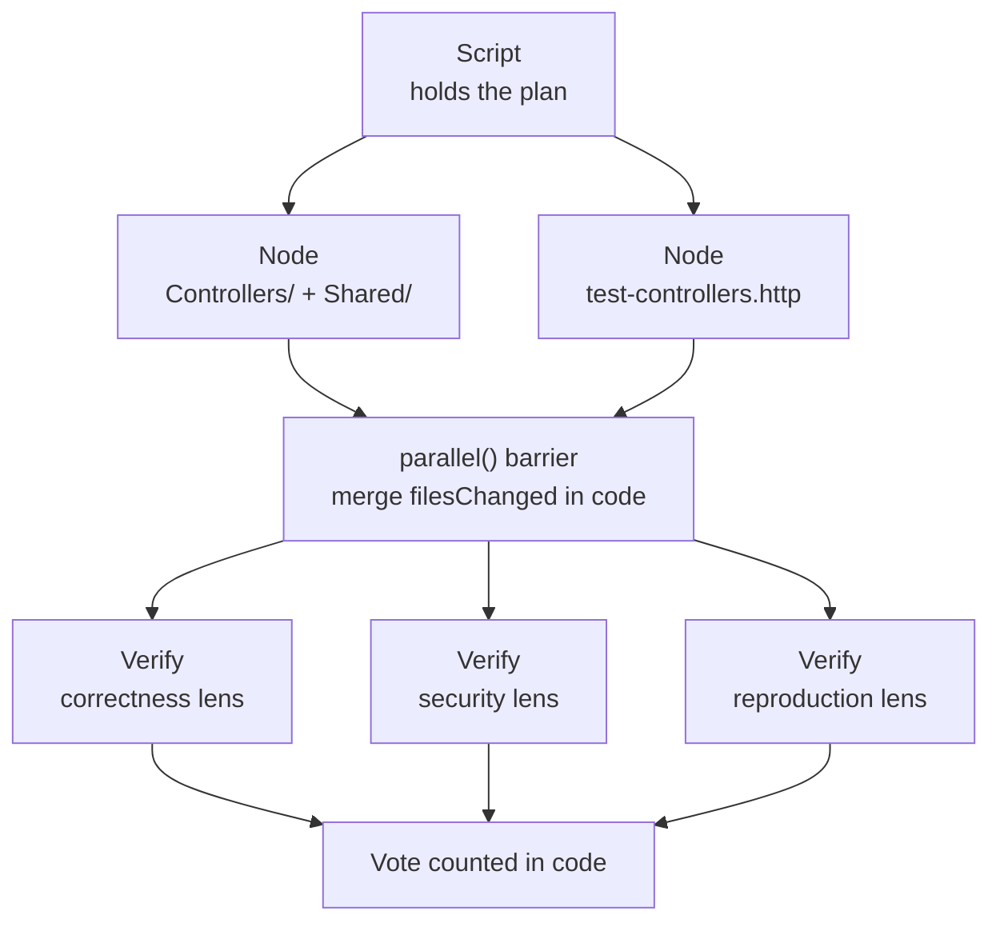

# Run the Same Split as a Workflow Graph

A prompt-driven fan-out re-derives its plan on every run, and its contract is a sentence the model may or may not honour. You re-express the same two-slice split as a script where the fan-out is a `parallel()` call, the contract is a schema the harness validates, and the single verification opinion becomes three lenses whose vote is counted in JavaScript. You end up with a run whose verdict names its dissenters instead of averaging them away.

------

Work in `catalog-service-cs/`; the finished result is beside it in `catalog-service-cs-delegation-graph/`.

```bash
cd demos/06-subagents/06-orchestration/catalog-service-cs
claude
```

A workflow is opt-in: Claude will not start one on its own initiative, because a single run can spawn many agents and spend a lot of tokens. The word "workflow" in your prompt is the opt-in, which is why every recipe below carries it.

## The Pattern

Nodes are agent calls, edges are the data between them, and everything deterministic is script body rather than a model turn.



---

## Step 1: Find the Edges That Are Real

Overview: Every edge you delete is work that can run at the same time, so the map is written before the script. An edge exists only where one node needs another node's output.

Research / Planning / Discussion:

```text
Two units of work harden the write path of this API:

  A  implements the contract in Controllers/ and Shared/
  B  appends one request per status code to test-controllers.http

Both build against a status-code contract fixed before either starts. A third unit
checks that the result is correct.

Model this as a directed graph. For each pair, state whether an edge exists and name
the specific data that crosses it. Where the only justification is "this has to happen
after that", say so and mark the edge as ordering, not data.

Then list every step above that is not agent work at all, but plain code.
```

Finding: A good response finds no data edge between A and B (they share a contract fixed in advance, not a handoff), a genuine edge from both into the verification unit, and puts the merge of changed-file lists in the script body as array concatenation. If it draws an edge from A to B because the requests need the endpoints first, ask what data would actually cross it.

Expected Outcome: Two data edges, both inbound to verification, and a code-only list that includes the merge and the vote count.

---

## Step 2: Write the Graph as a Script

Overview: The map becomes a script, so the decomposition is identical on every run. The schema is the part that changes character: in a prompt it is a request, here the harness forces the node through a structured-output tool and retries on mismatch.

Recipe:

```text
Write and run a workflow for hardening the write path of this API.

Structure:
  - meta with name, description, and two phases: Implement and Verify
  - a shared schema requiring status, filesChanged (array of strings) and summary
  - parallel() over two nodes in Implement, both returning that schema:
      node 1, agentType dotnet-expert, owns Controllers/ and Shared/, implements the contract
      node 2 owns test-controllers.http only and must not open FoodController.cs
  - merge the filesChanged arrays in the script body, not in an agent
  - three Verify nodes over the lenses correctness, security and reproduction, each
    prompted to REFUTE the claim that the contract is correctly implemented and to
    default to refuted when uncertain, each returning { lens, refuted, why, evidence }
  - the feature passes only if at least two of three fail to refute; count that in the
    script body and log every dissenting lens

The contract both implement nodes build against:
  1. POST /food returns 400 with a ProblemDetails body when the CatalogItem is invalid
     (Name null/empty/whitespace, Price negative, InStock negative), 201 with a
     Location header otherwise.
  2. PUT /food returns 400 on the same rules, 404 when the ID does not exist, 200 otherwise.
  3. DELETE /food/{id} returns 404 when the ID does not exist, 204 otherwise.
  4. GET /food/{id} returns 404 when the ID does not exist.

Filter out null results before merging, since a failed node resolves to null.
```

Expected Outcome: The workflow returns a run id immediately and `/workflows` shows two node boxes running together under Implement, then three under Verify. The vote is arithmetic in the script body, not a judgement:

```javascript
const survived = verdicts.filter(v => !v.refuted).length
const passes = survived >= 2
verdicts.filter(v => v.refuted).forEach(v => log(`dissent (${v.lens}): ${v.why}`))
```

The Implement phase merged three paths from two nodes, and the validator it produced records one model error per broken rule rather than one message covering all three:

```csharp
            if (string.IsNullOrWhiteSpace(item.Name))
                modelState.AddModelError(nameof(CatalogItem.Name), "Name is required.");

            if (item.Price < 0)
                modelState.AddModelError(nameof(CatalogItem.Price), "Price cannot be negative.");

            if (item.InStock < 0)
                modelState.AddModelError(nameof(CatalogItem.InStock), "InStock cannot be negative.");
```

Node results are model-dependent: a failed node resolves to `null`, so the merge must survive it rather than crash.

---

## Step 3: Read the Split Vote

Overview: A single verifier produces a single opinion, and a confident wrong opinion passes straight to you. Three lenses disagree in public, which is the outcome worth reading.

Recipe:

```text
Report the workflow's verdict field by field:
  - the vote, as survived over total
  - for each lens, refuted true or false, its why, and its evidence line
  - which of the two implement nodes could have caught each dissent on its own

Do not fix anything yet.
```

Expected Outcome: A split verdict, not a pass. This run returned `1/3 lenses failed to refute`, so `passes` came back `false`:

| Lens | Refuted | What it found |
|---|---|---|
| correctness | no | Every branch the contract names is reachable and returns the specified status |
| security | yes | `Attach` plus `EntityState.Modified` marks every column dirty, so a PUT that omits a field overwrites the stored value and still returns 200 |
| reproduction | yes | The file's own pre-existing `DELETE {{baseUrl}}/food/1` runs before the new `PUT` labelled 200 and sends `"id": 1`, so that request returns 404 |

The reproduction finding is the one neither implement node could have reached. Node 1 never opened the request file and node 2 never opened the controller, so the defect exists only in the merged result, which is exactly where a verification edge sits.

Read a split vote as three named opinions. A majority is a model judgement, not a test result, so the dissenting lens is the part worth acting on.

---

The finished graph run is in [`catalog-service-cs-delegation-graph/`](catalog-service-cs-delegation-graph/readme.md), still carrying both defects its panel named. The same task delegated is in [`demo-delegation-fan-out.md`](demo-delegation-fan-out.md), and looped in [`demo-review-loop.md`](demo-review-loop.md).
