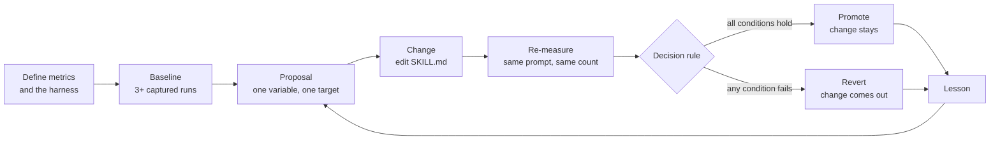

# Build an Autoresearch Loop with Plugin Eval

Skills are instructions, not code. When one produces inconsistent output there is no stack trace, no error, and no unit test that points at the cause, so the only signal is the output itself, measured repeatedly against fixed criteria. `claude plugin eval` is the harness Claude Code ships for that measurement: it runs a case several times in fresh, isolated sessions and scores every run with graders.

A failing measurement maps to the layer of `SKILL.md` that owns the fix: the `description` for trigger defects, the instruction body for output defects, and `references/` for missing domain detail.

## The Skill Under Test

`course-status` is a plugin that ships in the starter, modelled on the `evaluate` sub-verb of this repo's own `class-dashboard` skill. Asked for the status of the class, it reads `course/evaluate.log` and `course/dashboard.json`, then reports the status table, the completion percentage, and every component still open. The fixture is this class's own dashboard at an earlier commit: 14 modules, 55 of 56 components done, one still `planned`.

The live `class-dashboard` cannot be the subject, for three reasons. An eval run loads only the plugin under test and starts in an empty workspace, so a project skill in `.claude/skills/` is never there. The live skill runs `dashboard/evaluate.py`, which needs a shell, and on native Windows a run granted `Bash` or `PowerShell` is refused because there is no sandbox backend. The fixture therefore holds what the evaluator already wrote, and the skill's characteristic failure survives the move: answering from memory instead of from the evaluator's output, which the skill forbids in prose.

## What Is Not a Subject

Asking the loop to produce something is the common miss. "Create the slides for `demos/02-harness`" is a task, not a subject: it runs once, its output is a deliverable rather than a measurement, and nothing can be held fixed across three runs. The fix is to move up one level: the slides are not the subject, the skill that builds them is, measured on two modules with the identical prompt.

Two more fail the same test: work nobody can score without reading the whole output, and work that calls a service whose answer moves on its own. Each breaks the one requirement the cycle rests on, that the only difference between the baseline and the re-measure is the sentence you changed. Plugin eval removes a third failure by construction: every run gets its own workspace, so no run can change what the next one reads.

## How a Case Runs

| File | Role |
|---|---|
| `course-status/evals/class-status/prompt.md` | The request, plus `max_turns` and the read-only `allowed_tools` |
| `course-status/evals/class-status/case.yaml` | Names `fixture.sh` as the `scaffold_script` |
| `course-status/evals/class-status/fixture.sh` | Copies `course/` into the run's empty workspace; runs only with `--scaffold` |
| `course-status/evals/class-status/graders/*.md` | One grader per file: its `type` and options in frontmatter |

Each run repeats three times with the plugin loaded and three times without it, and the summary reports both scores and their difference, `Δ`. The prompt names the skill on purpose: this case measures the body, so it keeps the trigger out of the experiment, and trigger accuracy stays with [Test and Package Skills](../../03-skills/05-test-and-package/readme.md).

Read `skill-fired` before the score. It is a `tool_used: Skill` grader, which plugin eval reports as an indicator and never scores, and a run where it fails scored the model rather than the skill you edited. Save every file in the plugin with LF line endings: on Claude Code 2.1.302 a plugin `SKILL.md` saved with CRLF still registers as a slash command but drops out of the skills the model can invoke, which is why this topic's `.gitattributes` pins `eol=lf`.

## Four Metrics, Six Graders

| Metric | Grader | Type | What passes |
|---|---|---|---|
| Sections present | `status-table`, `completion`, `gaps` | `regex` | A table row naming a module, a percentage, and the word `planned` or `doing` |
| Evaluator evidence, the step | `read-log` | `tool_used` | A `Read` call whose input names `evaluate.log` |
| Evaluator evidence, the answer | `quotes-log` | `regex` | `Evaluated 14 modules -> course/dashboard.json` appears in the final reply |
| Abort rate | none | | Read from `cases[].arms.with[].error` in `aggregate-result.json` |
| Identical output | none | | No grader expresses it: plugin eval scores each run on its own and never compares runs to each other |

The evidence metric splits into two graders because plugin eval can see the trace. `read-log` proves the skill read the file; `quotes-log` asks whether the reader of the answer can tell. "Always read the evaluator's output first" cannot be checked from the answer, because a claim is free, while "open with the evaluator's own line" is a regular expression.

## The Cycle

The order is not negotiable. A baseline taken after an edit is not a baseline, it is the first data point of the next experiment.

## The Baseline Picks the Target

LLM output is not deterministic at normal session settings, so one run measures a sample rather than a distribution. Three is the floor, and the default. Measure before proposing, because which grader is worth targeting is not knowable in advance:

| Grader | Baseline, with the plugin, 3 runs | Usable as this cycle's target |
|---|---|---|
| `status-table`, `completion`, `gaps` | 3 of 3 each | no, already at the ceiling |
| `read-log` | 3 of 3 | no, already at the ceiling |
| `quotes-log` | 2 of 3 | yes, the only one with room |
| runs with an error | 0 of 3 | no, already clean |

The trace proved the read in every run while one answer in three carried nothing a reader could check. Without the plugin every run scored 0, so `Δ` was `+0.93`: the skill, not the model, produces this report.

## One Variable, One Target

Change two things and attribution is gone: if a grader moves you cannot say which edit moved it, and you cannot revert one without losing the other. One proposal per cycle, one targeted grader per proposal. "Add a section instruction and reword the example" is two proposals.

Write the proposal before touching the skill, with a prediction in it. The prediction is what makes the result falsifiable and what the lesson is later written against.

## The Promote/Revert Rule

Three conditions, all of them, or revert: the targeted grader passed in more runs, no other scored grader lost more than one run, and no run ended with an error. Ambiguity in the decision becomes ambiguity in the lesson, which is why the rule is arithmetic rather than judgement.

This topic's cycle added one sentence to the skill and changed nothing else:

| Grader | Baseline | After | Change |
|---|---|---|---|
| `quotes-log` (target) | 2 of 3 | 3 of 3 | +1 run |
| `status-table`, `completion`, `gaps` | 3 of 3 each | 3 of 3 each | none |
| `read-log` | 3 of 3 | 3 of 3 | none |
| runs with an error | 0 | 0 | none |
| `skill-fired` (indicator) | 3 of 3 | 3 of 3 | none |

A revert is not a wasted cycle. It removes a direction from the search space, which is worth more than promoting a marginal gain.

## The Lesson Is the Asset

"Proposal 1 improved `quotes-log`" is worth nothing next month. "An instruction to report an action scores nothing because a claim is free; an instruction to quote a value only that action produces is checkable from the output alone" applies to the next skill and the one after it.

## Helpful Claude Slash Commands

| Command | Usage |
|---|---|
| `/plugin` | Check that `course-status` loaded and read its **Errors** tab when a run reports no skill |
| `/reload-plugins` | Pick up an edited `SKILL.md` in a session that loaded the plugin with `--plugin-dir` |

## Key Topics

- [Test plugins with evals](https://code.claude.com/docs/en/plugin-evals): case files, grader types, the no-plugin baseline, and the JSON result
- [Claude Code skills documentation](https://code.claude.com/docs/en/skills): official reference for SKILL.md frontmatter and instruction body structure
- [Sandboxing](https://code.claude.com/docs/en/sandboxing): why a run granted a shell needs a sandbox backend
