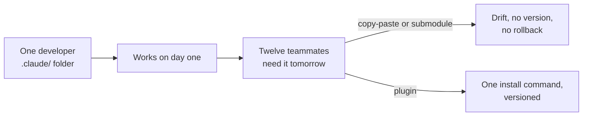

# Understand Why Plugins Exist

## The Distribution Problem

By now your team has built skills, hooks, MCP configs, and sub-agents in `.claude/`, and every one of those artifacts works beautifully for the developer who wrote it. The setup falls over the moment twelve teammates need the same environment tomorrow morning, because copy-paste and git submodules have no versioning, no install command, and no way to roll back when a hook starts misbehaving on someone else's machine. Plugins exist to solve that exact handoff, turning a directory of conventions into a single installable unit with a name and a version.

## Plugin vs Standalone: A Distribution Decision

The technical capabilities are close to identical: both forms support skills, hooks, MCP servers, and sub-agents. The real question is whether the configuration needs to be shared and versioned, because the moment the answer is yes the trade-offs shift in the plugin's favor.

| | `.claude/` standalone | Plugin |
|---|---|---|
| Iteration speed | Faster, edit in place | Slightly slower, reload step |
| Versioning | None, whatever is on disk | Semver via manifest |
| Sharing | Copy-paste or git submodule | One install command |
| Skill namespace | `/hello` | `/my-plugin:hello` |
| Marketplace distribution | No | Yes |

The rule of thumb is to prototype in `.claude/` while the design is still moving, then convert to a plugin the day you need versioning or sharing. Treat the conversion as a packaging step, not a rewrite, since every file you already authored slots into the plugin layout almost unchanged.

## Namespacing as the Only Real Cost

Plugins add one user-visible change: a skill named `hello` inside `quality-review-plugin` becomes `/quality-review-plugin:hello`. That prefix is what lets two teams ship a `code-review` skill without colliding, and it is the only functional trade-off you accept when you move out of `.claude/`. Most teams find the prefix worth its weight the first time a colleague installs the wrong version of a skill from the wrong source.

## Helpful Claude Slash Commands

| Command | Usage |
|---|---|
| `/plugin` | Browse marketplaces and inspect installed plugins, their versions, and the namespaces they own before adding another to the session |
| `/context` | Compare what an installed plugin costs in always-on tokens against the same components sitting loose in `.claude/` |
| `/help` | List the commands available in the session, including the namespaced ones a plugin contributes |

## Key Topics covered in this module

- [Plugins Overview](https://code.claude.com/docs/en/plugins): when to choose a plugin over a standalone `.claude/` config, with the full lifecycle map
- [Skills](https://code.claude.com/docs/en/skills): how a skill is discovered and why the `plugin:skill` prefix prevents collisions
- [Settings Hierarchy](https://code.claude.com/docs/en/settings): how user, project, and local settings compose, and where plugin-shipped defaults fit
