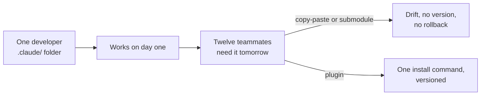
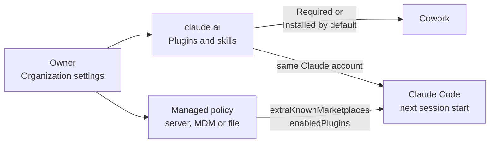

# Understand Why Plugins Exist

## The Distribution Problem

By now your team has built skills, hooks, MCP configs, and sub-agents in `.claude/`, and every one of those artifacts works beautifully for the developer who wrote it. The setup falls over the moment twelve teammates need the same environment tomorrow morning, because copy-paste and git submodules have no versioning, no install command, and no way to roll back when a hook starts misbehaving on someone else's machine. Plugins exist to solve that exact handoff, turning a directory of conventions into a single installable unit with a name and a version.

## Plugin vs Standalone: A Distribution Decision

The technical capabilities are close to identical: both forms support skills, hooks, MCP servers, and sub-agents. The real question is whether the configuration needs to be shared and versioned, because the moment the answer is yes the trade-offs shift in the plugin's favor.

| | `.claude/` standalone | Plugin |
|---|---|---|
| Iteration speed | Faster, edit in place | Slightly slower, reload step |
| Versioning | None, whatever is on disk | Semver via manifest |
| Sharing | Copy-paste or git submodule | One install command |
| Skill namespace | `/hello` | `/my-plugin:hello` |
| Marketplace distribution | No | Yes |

The rule of thumb is to prototype in `.claude/` while the design is still moving, then convert to a plugin the day you need versioning or sharing. Treat the conversion as a packaging step: every file you already authored slots into the plugin layout almost unchanged.

## Namespacing as the Only Real Cost

Plugins add one user-visible change: a skill named `hello` inside `quality-review-plugin` becomes `/quality-review-plugin:hello`. That prefix is what lets two teams ship a `code-review` skill without colliding, and it is the only functional trade-off you accept when you move out of `.claude/`. Most teams find the prefix worth its weight the first time a colleague installs the wrong version of a skill from the wrong source.

## Plugins in a Claude Team Environment

On a Claude Team or Enterprise plan the twelve-teammates handoff gets an owner. An organization Owner decides once which plugins the members receive, and each member gets them at their next session start, signed in with their Claude account.

The Owner has two routes. Under **Organization settings > Plugins & skills** on claude.ai every plugin gets one of four states, and a plugin marked *Required* or *Installed by default* also installs in Claude Code for every member who signs in with the same Claude account. **Managed policy**, delivered from the server, through MDM or as a `managed-settings.json` file, adds the marketplace with `extraKnownMarketplaces` and switches the plugin on with `enabledPlugins`. Managed policy sits above user and project settings, so a plugin enabled there still loads after a member disables it in their own scope.

| Admin state | What a member gets |
|---|---|
| Required | Installed and locked, the member cannot remove it |
| Installed by default | Installed, the member can turn it off |
| Available to install | Listed in the Discover tab, installed on demand |
| Not available | Hidden |

A few behaviours to know before you rely on it:

- The claude.ai sync runs at every Claude Code start and needs a claude.ai sign-in, so a session started with an API key skips the synced plugins.
- A synced repository ships an update when a pull request with a version bump merges into the default branch; until then members stay on the last synced version.
- A plugin the Owner removes moves to `.trash/` at the member's next start.
- Team and Enterprise both offer this; group-level plugin access is Enterprise only, so on Team every rule applies to the whole organization.

## Helpful Claude Slash Commands

| Command | Usage |
|---|---|
| `/plugin` | Browse marketplaces and inspect installed plugins, their versions, and the namespaces they own before adding another to the session |
| `/context` | Compare what an installed plugin costs in always-on tokens against the same components sitting loose in `.claude/` |
| `/help` | List the commands available in the session, including the namespaced ones a plugin contributes |

## Key Topics covered in this module

- [Plugins Overview](https://code.claude.com/docs/en/plugins): when to choose a plugin over a standalone `.claude/` config, with the full lifecycle map
- [Skills](https://code.claude.com/docs/en/skills): how a skill is discovered and why the `plugin:skill` prefix prevents collisions
- [Settings Hierarchy](https://code.claude.com/docs/en/settings): how user, project, and local settings compose, and where plugin-shipped defaults fit
