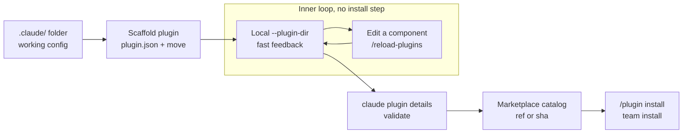

# Convert a .claude/ Config to a Plugin

## Why a Working Config Has to Change Shape

A `.claude/` directory is already the right shape for the work: skills, hooks, sub-agents, and MCP configs sit in named folders and the harness finds them. What it has no shape for is identity. There is no name, no version, and no address a second developer can install from, so the only distribution mechanism left is copy-paste or a git submodule, and neither survives the first divergent edit.

Converting is therefore a packaging change, not a rewrite. The components keep their filenames and their contents; what gets added is a manifest that gives the bundle a name and a version, and what gets removed is the assumption that the files live at a fixed path in one repository. Everything hard about the conversion sits in those two facts.

## What Moves and What Stays

Most of the tree is a one-to-one lift, which is the point worth making before anyone starts renaming things.

| In `.claude/` | In the plugin | Changes on the way |
|---|---|---|
| `skills/<name>/SKILL.md` | `skills/<name>/SKILL.md` | Nothing, unless the body hard-codes a repository path |
| `agents/<name>.md` | `agents/<name>.md` | Nothing |
| `commands/<name>.md` | `commands/<name>.md` | Invocation gains the plugin namespace, `/<plugin>:<name>` |
| Hook entries in `settings.json` | `hooks/hooks.json` | The command path moves from `$CLAUDE_PROJECT_DIR` to `${CLAUDE_PLUGIN_ROOT}` |
| `.mcp.json` | `.mcp.json` | Nothing, but server paths need the same variable treatment |
| Model, permission, and env keys in `settings.json` | Stays behind | A plugin-root `settings.json` honours only `agent` and `subagentStatusLine` |

A hook addressed through `$CLAUDE_PROJECT_DIR` finds its script because the project owns the path; once the script ships inside a plugin, the install directory is the only thing that knows where it landed, so `${CLAUDE_PLUGIN_ROOT}` is the substitution that has to happen. Anything the plugin writes at runtime belongs under `${CLAUDE_PLUGIN_DATA}` instead, which persists across sessions and is the plugin's own rather than the installer's.

## The Conversion Lifecycle

The loop that matters is the short one between scaffold and local load. Loading a plugin from disk needs no install step and no catalog, and an edit to any component is picked up in place, so authoring a plugin is no slower than authoring `.claude/` directly. Publishing is what feels slow, and publishing is not part of the inner loop; a plugin should reach a marketplace once it works, not once per iteration.

Validation sits between the two. It catches manifest errors, unparseable `SKILL.md` frontmatter, and invalid hook event names, with the classic case being a description containing an unquoted colon, which drops the whole frontmatter and loads the skill with empty metadata. It does not catch unknown frontmatter keys, so an unsupported key passes validation and is then ignored at runtime, which means a human still reads the frontmatter before shipping.

## Versioning and Release Identity

The release tag is derived from `plugin.json` alone, in the form `{name}--v{version}`. Nothing cross-checks the catalog, so a `version` in `marketplace.json` that drifts from the manifest still tags successfully and the two quietly disagree about what `1.0.0` contains. Keeping them in step is a discipline the tooling will not enforce for you.

Tagging also acts on the git repository that contains the plugin path, whatever the current working directory is, and refuses while anything under that path is uncommitted. That is why a real release runs from the plugin's own repository, which is the only place the tag belongs. Catalog pinning then decides how much of that discipline reaches installers: a branch `ref` tracks whatever lands next, a tag `ref` is a stable upgrade target, and a full 40-character `sha` is the production-safe choice.

## Starter and Solution Folders

Work in [`demo-quality-plugin/`](demo-quality-plugin/readme.md); the finished, validated result including the marketplace catalog is in [`demo-quality-plugin-solution/`](demo-quality-plugin-solution/readme.md).

## Hands-On Demo

[Package, Validate, and Publish a Plugin](demo-config-to-plugin.md): wrap the existing config in a manifest, rewire the hook to `${CLAUDE_PLUGIN_ROOT}`, load it with `--plugin-dir`, validate it, and publish it through a team catalog and a release tag.

[Present: Package, Validate, and Publish a Plugin](demo-presenter-config-to-plugin.md) delivers the same teaching in four timed beats, for running the topic without the live demo.

## Helpful Claude Slash Commands

| Command | Usage |
|---|---|
| `/reload-plugins` | Pick up an edit to a component you just moved without restarting the session, the inner loop that keeps conversion as fast as editing `.claude/` directly |
| `/hooks` | Confirm the `PostToolUse` entry now comes from the plugin's own `hooks/hooks.json` and no longer from `.claude/settings.json`, the one part of the move that changes form |
| `/skills` | Check that the moved skill lists under the plugin namespace rather than as a project skill, which is how you prove the lift actually took |

## Key Topics covered in this module

- [Plugins Reference](https://code.claude.com/docs/en/plugins-reference): `plugin.json` schema, component locations, `${CLAUDE_PLUGIN_ROOT}` and `${CLAUDE_PLUGIN_DATA}`, and the `claude plugin` commands
- [Plugin Marketplaces](https://code.claude.com/docs/en/plugin-marketplaces): `marketplace.json` schema, `ref` versus `sha` pinning, and source types
- [Plugins](https://code.claude.com/docs/en/plugins): the `--plugin-dir` flag and the `/reload-plugins` dev loop
