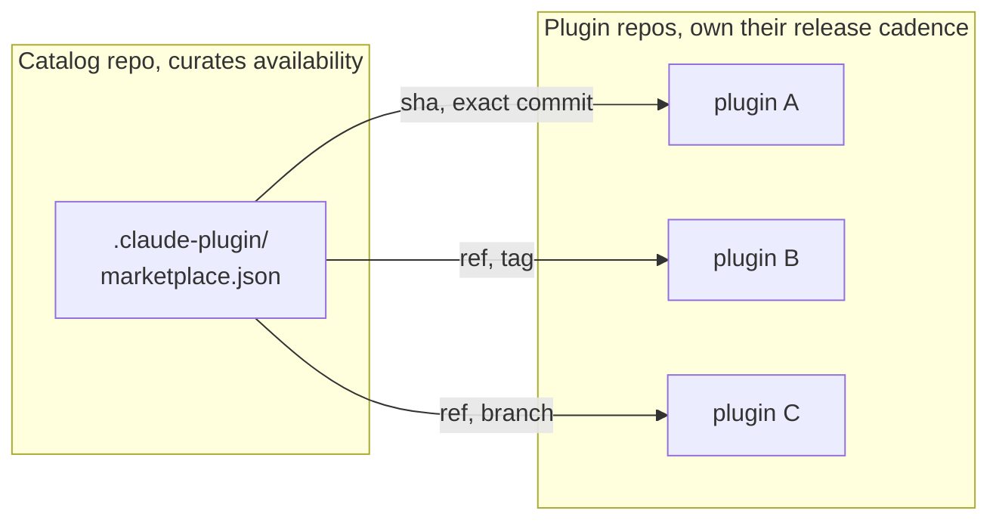

# Publish Plugins to Marketplaces

## Catalog and Plugin Are Different Repos

Marketplace source is not the same thing as plugin source, and treating them separately is what makes the model scale. A single `marketplace.json` catalog can reference plugins from a dozen different repos, each pinned to a different ref or sha, with the catalog owner curating availability without owning the code. That separation lets the plugin teams ship on their own cadence while the catalog evolves on a different one, which is the same split most package managers landed on for good reason. The catalog manifest lives at `<catalog>/.claude-plugin/marketplace.json`, the same folder convention a plugin uses for `plugin.json`.



## Pinning Plugins from a Catalog

Two pinning modes cover the realistic deployment shapes, and the choice between them is mostly a question of how much surprise you can tolerate in production.

| Pin type | When to use | Trade-off |
|---|---|---|
| `ref` | Branch or tag, follows updates as the upstream moves | Flexible, but a forced push or retag changes what installers get |
| `sha` | Exact commit, byte-identical install across machines | Reproducible and recommended for production, costs a catalog update per upgrade |

Catalogs can pull from GitHub, generic git URLs, local paths for internal-only catalogs, and npm for plugins that already live in a JS ecosystem. A local source is resolved from the catalog root and may not contain `..`, so `./my-plugin` validates and `../my-plugin` is rejected. The official marketplace is `claude-plugins-official`, which is the curated set Anthropic ships, and most teams will want a private team catalog alongside it rather than instead of it.

Getting a plugin into the official directory is a submission, not a pull request. Developers on a paid Claude plan submit at `claude.ai/directory/manage/new`, where the portal auto-validates the plugin, runs a safety scan, and tracks review status and install analytics per product surface. Where a listed plugin runs depends on what it bundles: MCP servers and skills work in Claude.ai as well as Claude Code, while LSP servers, commands, hooks, and agents load only in Claude Code.

## Plugins by Anthropic

Claude Code registers the official Anthropic marketplace (`claude-plugins-official`) automatically the first time you start it interactively. If that fails because the network blocked the download or a marketplace policy denied an earlier attempt, add it yourself:

```shell
/plugin marketplace add anthropics/claude-plugins-official
```

Everything in it installs the same way, and `/plugin` shows the catalog with a context-cost estimate per plugin in the Discover tab:

```shell
/plugin install <name>@claude-plugins-official
```

These are the Anthropic-authored plugins that package the same component types [Module 2](../../02-harness/readme.md) builds:

| Plugin | What it contributes |
|--------|---------------------|
| `claude-code-setup` | Analyzes a codebase and recommends the hooks, skills, MCP servers, and sub-agents worth adding to it |
| `plugin-dev` | Toolkit for authoring your own plugins, with skills for hooks, commands, agents, and MCP integration |
| `hookify` | Turns an observed unwanted behavior into a hook, defined as a Markdown rule file |
| `skill-creator` | Creates and improves skills, and runs evals to measure whether a skill actually fires |
| `mcp-server-dev` | Skills for designing MCP servers: deployment models, tool design, and auth |
| `claude-md-management` | Audits `CLAUDE.md` quality and folds session learnings back into project memory |
| `commit-commands` | Git commit, push, and PR creation workflows |
| `pr-review-toolkit` | Review agents specialized by lens: tests, error handling, type design, simplification |
| `security-guidance` | Reviews each change Claude makes for injection, XSS, SSRF, hardcoded secrets, and related classes |
| `typescript-lsp` and siblings | Language server wiring so Claude sees type errors right after an edit; one plugin per language, binary installed separately |

Anthropic also publishes a community marketplace of screened third-party plugins, added manually and installed under the `claude-community` name:

```shell
/plugin marketplace add anthropics/claude-plugins-community
```

## Enterprise Controls

For org-managed deployments, several knobs in managed policy let admins decide what teams can install without auditing every plugin one by one. `managed-mcp.json` controls which MCP servers are allowed across the org; `deniedPlugins` and `enabledPlugins` allowlist or blocklist specific plugin names; `extraKnownMarketplaces` adds trusted catalogs to the default set; and `strictKnownMarketplaces` rejects any catalog outside the known list. The pattern most enterprises adopt is strict-mode plus an internal catalog, with the official marketplace allowed but every third-party install gated through the catalog they own.

## Reserved Names

Plugin and marketplace names that impersonate first-party Anthropic distribution are blocked. The blocklist includes `claude-code-marketplace`, `claude-code-plugins`, `claude-plugins-official`, `anthropic-marketplace`, `anthropic-plugins`, and `agent-skills`, along with near-misses like `official-claude-plugins`. Pick a team-prefixed name early in development to avoid a forced rename right before publication.

## Security and Lifecycle Reminders

Plugins run code with your Claude Code environment's permissions, which means they inherit the same access to your filesystem, your shell, and any MCP servers you have authenticated. Treat them like any other code dependency: only install from sources you trust, read the manifest before approving an install, and pin to a sha when reproducibility matters more than convenience. The same review you would give a fresh `package.json` entry is the bar for a new plugin.

| Command | What it does |
|---|---|
| `claude plugin list` | Show all installed plugins, versions, and the marketplace each came from |
| `claude plugin enable / disable` | Toggle a plugin without uninstalling, useful when debugging a misbehaving hook |
| `claude plugin uninstall` | Remove the plugin and its settings from the local config |
| `claude plugin validate <path>` | Lint a plugin or marketplace manifest before publishing or after a manual edit, `--strict` for the full set of checks |
| `claude plugin details <name>` | Inspect the component inventory and projected token cost of a plugin, prefixed with `--plugin-dir <path>` while it is still uninstalled |
| `claude plugin tag [path]` | Cut the `{name}--v{version}` release tag in the git repo that contains the plugin path, with name and version read from `plugin.json` |

`claude plugin tag` refuses to run while anything under the plugin path is uncommitted, and it never reads the catalog, so a `version` in `marketplace.json` that drifts from `plugin.json` still tags: bump both in the same commit.

## Helpful Claude Slash Commands

| Command | Usage |
|---|---|
| `/plugin` | Manage marketplaces and installed plugins from inside a session, including `marketplace add` and `install` |
| `/permissions` | Review and tighten the session permission rules that an installed plugin's hooks and MCP servers will run under |
| `/mcp` | Confirm that MCP servers a plugin ships are the same ones the official manifest claims, before trusting the install |

## Key Topics covered in this module

- [Plugin Marketplaces](https://code.claude.com/docs/en/plugin-marketplaces): catalog schema, source types, and the pinning model
- [Settings and Managed Policy](https://code.claude.com/docs/en/settings): `deniedPlugins`, `enabledPlugins`, and the strict-known-marketplaces flag
- [Security](https://code.claude.com/docs/en/security): trust boundaries, review checklist, and rotation guidance for plugin-shipped secrets
