# Give a Marketplace Expert Your Repo's Details



## A Marketplace Plugin Brings Its Own Expert

A plugin from a team marketplace can ship its own expert: an agent with the skills it needs. The Copilot Studio plugin in the team marketplace `integrations-marketplace` is one. It brings the `copilot-studio-expert` agent together with the skills that agent works with.

The plugin installs once, globally, and the same expert then works in every repository; only the rule lives in the repository. The expert therefore knows what is true everywhere, such as Copilot Studio YAML, the VS Code extension and schema verification, and nothing about any one repository. No plugin component can carry those details either: the component list covers skills, agents, commands, hooks, MCP and LSP servers, monitors, output styles and settings, and a `CLAUDE.md` at the plugin root is not loaded as context.

## The Repo Hands the Expert Its Details in a Rule

Each repository that uses the expert keeps its details in one rule, `.claude/rules/copilot-studio.md`. The `paths:` frontmatter scopes it to the folders the expert works in, and the body lists what only this repository knows:

```markdown
---
paths:
  - "src/cs-schema/agents/**"
  - "src/cs-schema/cs-agents/**"
---

# Copilot Studio agents in this repo

## Where the agents live
## Cloning more agents
## Proven examples to copy from
## The CS- rebuilds
```

The sections hold the environment the agents were cloned from, the clone folders, the topic files proven to work, and the app registration that point tests use.

## The Expert Reads the Rule First

The expert's own definition makes the rule its first step:

```markdown
## Project Context

Before touching agent folders, read the repo's `.claude/rules/copilot-studio.md` when it exists:
environment, clone folders, proven example files, app registrations. Repo facts stay there;
generic findings go back into this plugin's skills.
```

A path-scoped rule loads only when Claude reads, writes or edits a matching file, so an expert that starts on a fresh task cannot count on it being in context. Reading the file explicitly makes the repository's details certain before the expert touches anything. The last sentence keeps the split clean over time: what one repository taught goes into its rule, and what holds everywhere goes back into the plugin, which every repository then receives with the next update.

| Lives in the plugin, from the marketplace | Lives in the repository's rule |
|---|---|
| The `copilot-studio-expert` agent and its four skills | The environment the agents were cloned from |
| Generic Copilot Studio rules and schema verification | The clone folders and the folder layout |
| The instruction to read `.claude/rules/copilot-studio.md` first | The proven example files and the app registrations |

## Helpful Claude Slash Commands

| Command | Usage |
|---|---|
| `/plugin` | Add the team marketplace, install the Copilot Studio plugin from it, and confirm the plugin brings the `copilot-studio-expert` agent |
| `/context` | Check whether `.claude/rules/copilot-studio.md` is in context, which happens once Claude touches a file under `src/cs-schema/agents/` |

## Key Topics covered in this module

- [Plugin Marketplaces](https://code.claude.com/docs/en/plugin-marketplaces): how a team catalog lists plugins and how a repository installs from it
- [Plugins Reference](https://code.claude.com/docs/en/plugins-reference): the component list and the plugin-root `CLAUDE.md` warning
- [Subagents](https://code.claude.com/docs/en/sub-agents): plugin agents, their namespaced names, and what a subagent loads at startup
- [Memory](https://code.claude.com/docs/en/memory): `.claude/rules/`, the `paths:` frontmatter, and when a path-scoped rule loads
