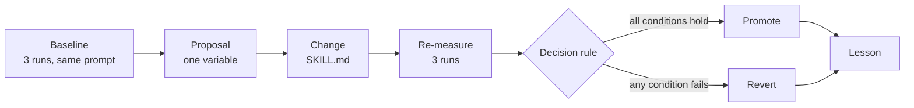

# Run a Propose-Evaluate-Promote Cycle on a Live Skill

A skill that answers slightly differently every time gets edited on a hunch, and nobody can tell afterwards whether the edit helped. You measure this repo's `class-dashboard` skill over three captured runs, change one sentence in it, re-measure under identical conditions, and let a rule decide. You end up with a promoted change and a lesson that transfers to the next skill.

------

Work in `autoresearch-loop/`; the finished result is beside it in `autoresearch-loop-solution/`.

```bash
cd demos/08-optimize/03-autoresearch-loop/autoresearch-loop
npm install
claude
```

The subject is `.claude/skills/class-dashboard/`. Step 3 edits it; Cleanup says what to keep.



---

## Step 1: Meet the Skill, Then Capture Three Runs

Overview: You cannot measure output you have not seen. Run the skill once yourself, then capture three runs of the identical prompt without reading them, because three runs of a non-deterministic process is the smallest thing that distinguishes a real change from a lucky sample.

Recipe:

```text
Use the class-dashboard skill to answer: What is the current status of the class?
Then tell me which scripts it ran and what it did with their output.

Now repeat that same request three times as three separate sub-agents. Each one follows
the skill exactly, starts no live server and opens no browser, and writes the answer it
would have given the user, verbatim and with no preamble, to runs/baseline/run-N.md.
Do not read their answers in between.

Score them:  npm run score -- baseline
```

Expected Outcome: The skill runs `dashboard/evaluate.py` then `dashboard/render-dashboard.py` and reports from the refreshed `dashboard.json`. Then four numbers over the captured runs:

```text
baseline: 3 runs
  identical_outputs  0 of 3 pairs
  sections_present   3 of 3
  evaluator_evidence 0
  abort_rate         0
```

Every run agreed on the facts (13 modules, 43 of 52 components, 83%) and no two agreed on how to say it. Run 3 added an `Overall` column the others did not have, which alone puts `identical_outputs` at 0.

---

## Step 2: Let the Baseline Pick the Target

Overview: Two of these four metrics are already at their best possible value, so a proposal aimed at either can only stay flat or regress. Which two is not knowable before measuring.

Research / Planning / Discussion:

```text
Read baseline.json. For each metric give its value, its best possible value, and how
much room a proposal has. Then recommend exactly one as this cycle's target, and name
the change to .claude/skills/class-dashboard/SKILL.md you predict moves it.
Do not make the change yet.
```

Finding: A good response rules out `sections_present` (3 of 3) and `abort_rate` (already 0), then picks between the two at zero. It should prefer `evaluator_evidence`, since one sentence can plausibly move it while `identical_outputs` needs a whole output template. If it targets `identical_outputs` with a one-line change, ask how one line constrains twenty.

Recipe:

```text
Write proposal.md with three fields and nothing else: Target metric, Change (one
variable, naming the file and section), Prediction (what the target does and what every
other metric does). Then say why you did not target the other three.
```

Expected Outcome: `evaluator_evidence` at 0.00 as the target, one sentence for step 3 of the `evaluate` sub-verb, and a prediction that the other three do not move. The prediction is what makes Step 4 falsifiable.

---

## Step 3: Change One Sentence

Overview: The skill already says "never summarise from memory" and every baseline run complied in prose while proving nothing. The edit swaps that unverifiable behaviour for an artifact only a real run can produce.

Recipe:

```text
Apply the change from proposal.md to .claude/skills/class-dashboard/SKILL.md. Edit only
step 3 of the evaluate sub-verb, change nothing else, and show me the diff.

The answer must open by quoting the evaluator's own stdout line verbatim, so a reader
can tell a fresh evaluation from a recalled one.
```

Expected Outcome: One sentence, one line.

```diff
-3. Read the updated `dashboard/dashboard.json` and report the full status table: all modules, all fields. Never summarise from memory.
+3. Read the updated `dashboard/dashboard.json` and report the full status table: all modules, all fields. Never summarise from memory. Open the report by quoting the evaluator's own stdout line verbatim (`Evaluated 13 modules -> ...`), so a reader can tell a fresh evaluation from a recalled one.
```

---

## Step 4: Re-measure, Then Write What Transfers

Overview: Identical conditions means the same prompt and the same run count, with no reading until all three are captured. The decision is then arithmetic, and the lesson is written against the prediction rather than the outcome.

Recipe:

```text
Repeat Step 1's three sub-agents exactly, writing to runs/after/run-N.md.

Score against the baseline:  TARGET_METRIC=evaluatorEvidence npm run score -- after

Then append a cycle entry to lessons.md: the decision, the mechanism that generalises
stated so it applies to a skill with nothing to do with dashboards, and the one thing
the measurement showed that the proposal did not predict. No restating the numbers.
```

Expected Outcome: The prediction held on all four metrics and the harness decided:

```text
after: 3 runs
  identical_outputs  0 of 3 pairs
  sections_present   3 of 3
  evaluator_evidence 1
  abort_rate         0

target metric      evaluatorEvidence: 0 -> 1
regressed          none
DECISION           PROMOTE
```

All three runs now open with a line no run can fabricate:

```text
`Evaluated 13 modules -> D:\git-customers\claude-code-masterclass\dashboard\dashboard.json`
```

`identical_outputs` did not move, exactly as predicted: constraining one line does not constrain a document. That is the next cycle's proposal, not this one's failure, and it belongs in the lesson.

---

The promoted sentence stays in `.claude/skills/class-dashboard/SKILL.md`; that is what promotion means. The finished cycle, both run sets and the filled `proposal.md` and `lessons.md`, is in [`autoresearch-loop-solution/`](autoresearch-loop-solution/).
