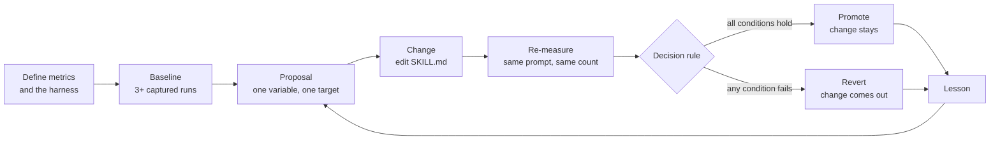

# Build an Autoresearch Loop

Skills are instructions, not code. When one produces inconsistent output there is no stack trace, no error, and no unit test that points at the cause, so the only signal is the output itself, measured repeatedly against fixed criteria.

A failing measurement maps to the layer of `SKILL.md` that owns the fix: the `description` for trigger defects, the instruction body for output defects, and `references/` for missing domain detail.

## The Skill Under Test

`class-dashboard` is this repo's own skill, in `.claude/skills/class-dashboard/`. Asked "what is the status of the class", it runs `dashboard/evaluate.py`, which walks the 13 module folders and scores each one's theory, demos, labs and slides against discovery rules; runs `dashboard/render-dashboard.py`, which injects the result into a static `index.html`; then reports the table.

That makes it a good subject for measurement. The work underneath is deterministic, so every run has the same facts available, and anything the runs disagree on comes from the skill's wording rather than the repo. Its characteristic failure is specific too: answering from a stale `dashboard.json` or from memory instead of evaluating. The skill forbids that in prose, and prose is not a measurement.

## What Is Not a Subject

Asking the loop to produce something is the common miss. "Create the slides for `demos/02-harness`" is a task, not a subject: it runs once, its output is a deliverable rather than a measurement, and nothing can be held fixed across three runs because the second run finds a deck already sitting there. The loop needs a process repeatable under identical conditions, which a one-off authoring job never is.

The fix is to move up one level. The slides are not the subject, `create-module-pptx` is, and it measures well because the build prints numbers no run can fake: `findings: 0` from the linter, `Total findings: 0` from the validator, the slide count against the skill's 2-to-4-slides-per-topic budget, and the mix of slide types. Two modules then give you two subjects to run the identical prompt against.

Three more fail the same test: work nobody can score without reading the whole output, work where one run changes the repo the next run reads, and work that calls a service whose answer moves on its own. Each breaks the one requirement the cycle rests on, that the only difference between the baseline and the re-measure is the sentence you changed.

## The Cycle

The order is not negotiable. A baseline taken after an edit is not a baseline, it is the first data point of the next experiment.

## Four Metrics, Three Portable and One Not

**Identical-output rate** counts how many of the three run pairs produced the exact same text. Below 3 means the skill is under-specified and the model is making interpretation choices the body should have constrained.

**Sections present** counts, per run, how many required sections appeared: here a status table, a completion percentage, and a named list of gaps. A section that shows up in some runs and not others is a suggestion, not a format constraint.

**Abort rate** is the fraction of runs that did not complete. Aborted runs still count as runs, but they are excluded from the identical-output comparison, or two empty transcripts score as a matching pair and a broken skill looks perfectly consistent.

The fourth is written per skill and carries that skill's own risk. For `class-dashboard`, `evaluator_evidence` asks whether the answer quotes the evaluator's stdout line, `Evaluated 13 modules -> ...`, which no run can produce without executing the script. That is the difference between a required behaviour and a required artifact: "always run the evaluator first" cannot be checked from the output because a claim is free, while "open with the evaluator's own line" is a regular expression.

## The Baseline Picks the Target

LLM output is not deterministic at normal session settings, so one run measures a sample rather than a distribution. Three is the floor. Measure before proposing, because which metric is worth targeting is not knowable in advance:

| Metric | Baseline over 3 runs | Best possible | Usable as this cycle's target |
|---|---|---|---|
| `identical_outputs` | 0 of 3 pairs | 3 of 3 pairs | yes, sitting at the floor |
| `sections_present` | 3.00 of 3 | 3.00 of 3 | no, already at the ceiling |
| `evaluator_evidence` | 0.00 | 1.00 | yes, sitting at the floor |
| `abort_rate` | 0.00 | 0.00 | no, already clean |

`sections_present` is the obvious-looking target for a skill with a required output structure, and it is already maxed: a proposal aimed there could only stay flat or regress.

## One Variable, One Target

Change two things and attribution is gone: if a metric moves you cannot say which edit moved it, and you cannot revert one without losing the other. One proposal per cycle, one targeted metric per proposal. "Add a section instruction and reword the example" is two proposals.

Write the proposal before touching the skill, with a prediction in it. The prediction is what makes the result falsifiable and what the lesson is later written against.

## The Promote/Revert Rule

Three conditions, all of them, or revert: the targeted metric improved, no other metric regressed by more than one unit, and the abort rate stayed at zero. Ambiguity in the decision becomes ambiguity in the lesson, which is why the rule is arithmetic rather than judgement.

This topic's cycle added one sentence to the skill and changed nothing else:

| Metric | Baseline | After | Change |
|---|---|---|---|
| `evaluator_evidence` (target) | 0.00 | 1.00 | +1.00 |
| `sections_present` | 3.00 | 3.00 | none |
| `identical_outputs` | 0 of 3 pairs | 0 of 3 pairs | none |
| `abort_rate` | 0.00 | 0.00 | none |

A revert is not a wasted cycle. It removes a direction from the search space, which is worth more than promoting a marginal gain.

## The Lesson Is the Asset

"Proposal 1 improved `evaluator_evidence`" is worth nothing next month. "An instruction to report an action scores nothing because a claim is free; an instruction to quote a value only that action produces is checkable from the output alone" applies to the next skill and the one after it.

## Helpful Claude Slash Commands

| Command | Usage |
|---|---|
| `/usage` | Track whether a skill refinement reduced token consumption vs. the pre-patch baseline |
| `/find-skills` | Search for an existing evaluation skill before writing your own experiment harness |
| `/model` | Switch to a higher-capacity model for evaluating skill output quality |

## Key Topics

- [Claude Code skills documentation](https://code.claude.com/docs/en/skills): official reference for SKILL.md frontmatter and instruction body structure
- [Node.js fs/promises API](https://nodejs.org/api/fs.html#promises-api): file system operations used in the experiment runner
