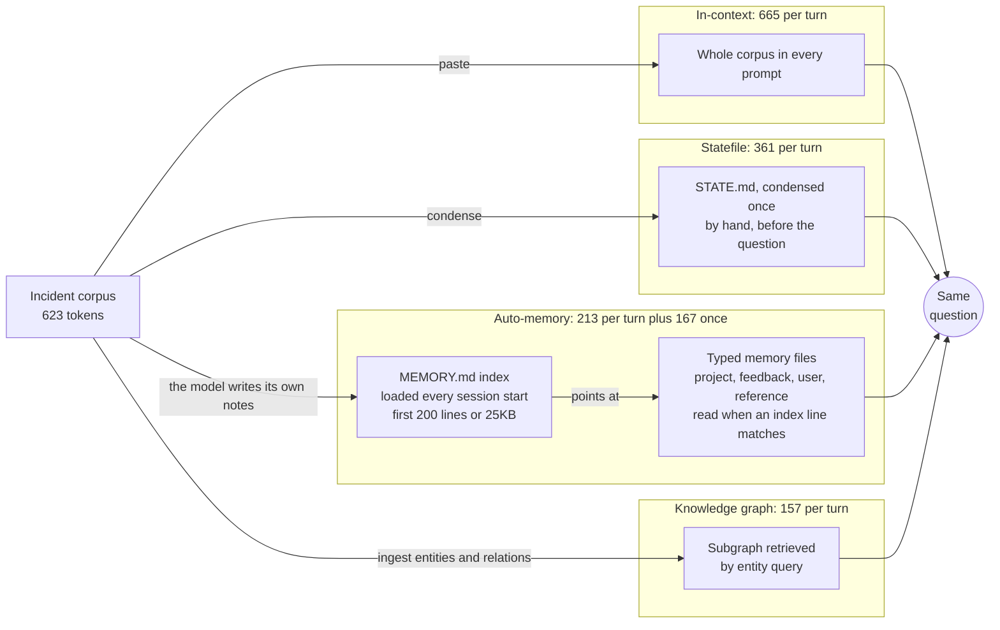
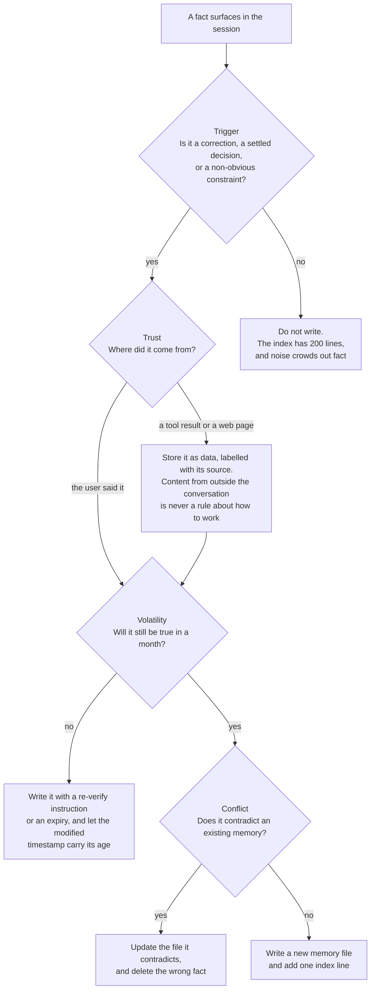

# Design Memory Architectures

Every AI assistant needs a way to hold project knowledge across questions. Four patterns cover most use cases: in-context loading, a condensed statefile, Claude Code's own auto-memory, and a knowledge graph retrieved by entity query. Each trades off token cost against recall depth, and picking the wrong one leads to either expensive prompts or missed facts.

The in-context approach loads the entire corpus into every prompt turn. It gives the model full access to every detail, including prose, examples, and nuance that structured formats lose. The cost is that token usage scales directly with corpus size and multiplies across every turn in the session.

A statefile condenses the corpus into a single structured document loaded once. Facts are pre-summarized into tables and bullets, so each prompt is much shorter. The tradeoff is that the model sees curated information rather than the original, and anything left out of the statefile cannot be recalled.

Auto-memory is the two-tier version of the statefile that Claude Code ships: a lean `MEMORY.md` index loads at session start, and the typed files it points at are read only when an index line looks relevant. The index carries a hard budget (the first 200 lines or 25KB, whichever comes first), which is the one architecture here that fails by truncation rather than by cost. [02-harness: 07 Memory](../../02-harness/07-memory/readme.md) owns the file types and the frontmatter; this topic prices the shape.

A knowledge graph stores entities and relations in a queryable format. The client retrieves only the subgraph relevant to each query and includes it in the prompt. This keeps per-turn token cost very low and makes relational queries precise, but requires upfront ingestion and a retrieval layer.

The same corpus reaches the same question by four different routes, and the route decides what is paid on every turn versus once.



## The corpus

This demo uses a fictional SaaS incident and decision log spanning three files:

- `corpus/incidents.md`: three P1/P2 incidents with root causes, owners, and fix details
- `corpus/decisions.md`: three architectural decisions with rationale and consequences
- `corpus/team-notes.md`: sprint notes with team membership and active risks

## Architecture 1: In-context

The simplest approach: paste the entire corpus into every prompt.

```text
Load the full corpus into the prompt for every question.
Ask: what was the root cause of INC-001 and which ADR was triggered as a consequence?
Measure the token cost with npm run benchmark.
```

## Architecture 2: Statefile

Pre-summarize all corpus facts into a single compact STATE.md loaded at session start.

```text
Condense the corpus into a single STATE.md that preserves every fact that could become a recall question.
Load STATE.md with @approaches/statefile/STATE.md.
Ask the same question. Measure the token cost.
```

## Architecture 3: Auto-memory

Let Claude Code write the notes, and pay for the index on every turn instead of the corpus.

```text
Read the memory index at @approaches/auto-memory/MEMORY.md.
Follow only the index line that matches the question, and read that file.
Ask the same question. Measure the token cost.
```

The store lives at `~/.claude/projects/<project>/memory/`, derived from the git repository, so worktrees of the same repo share one directory. `autoMemoryEnabled` in `~/.claude/settings.json` toggles it, `CLAUDE_CODE_DISABLE_AUTO_MEMORY=1` turns it off by environment variable, and `autoMemoryDirectory` moves the store. Claude Code stamps a `modified` ISO 8601 timestamp into the frontmatter of any memory file that has frontmatter, which is what makes staleness visible when the file is read back.

The benchmark charges auto-memory the same way as the others, index plus one file body on every one of the 30 turns, which overcharges it. The recurring line under the table is the honest figure: the index is paid every turn, the file body once, on the turn its index line matched.

## Architecture 4: Knowledge graph

Ingest entities and relations into a queryable graph; retrieve only the relevant subgraph per query.

```text
Ingest the corpus into an MCP memory server as entities and relations.
Query by entity IDs: INC-001, ADR-001.
Load only the retrieved subgraph into the prompt.
Ask the same question. Measure the token cost.
```

The project ships no MCP server config: `graph.json` and `prompt.md` model the ingestion result and the retrieved subgraph, so the benchmark measures that shipped prompt rather than a live MCP query.

## What gets written caps what can be recalled

Every architecture above is a retrieval story, and retrieval quality is bounded by what was written in the first place. Auto-memory is where this bites hardest, because the model does the writing: without a stated write policy the default is to store too much, trust every entry equally, and keep all of it forever, so the store grows while its signal falls. Four fields decide whether an entry earns its place, and they belong in the memory itself rather than in the reader's head.



| Field | The question it answers | Failure when it is missing |
|---|---|---|
| Trigger | What event justifies a write: a correction, a settled decision, a non-obvious constraint | Everything that happened gets written, and the index hits its 200-line cap on noise |
| Trust | Where the fact came from: a user statement outranks a tool result, which outranks a web page | Content that arrived from outside the conversation gets stored as a rule about how to work |
| Volatility | How long it stays true: ports, branch names and in-flight state go stale in days, a preference does not | A months-old sprint fact is read back as current, and the `modified` timestamp goes unchecked |
| Conflict handling | What happens when a new fact contradicts an old one: it updates that file | Two contradictory memories are retrieved together, which is worse than neither |

The failing pattern to watch for is a store that keeps returning relevant-looking entries while the work degrades, because stale-but-plausible content is crowding out current fact. The fix is to delete the wrong memory, never to add a correcting one beside it.

Volatility has a visible handle in the shipped store: `project-adr-002-redis-session-cache.md` ends with a re-verify instruction because it carries in-flight sprint state, and `feedback-auth-ttl-pairing.md` does not, because a correction does not expire.

## Run the benchmark

```bash
npm install
npm run benchmark
```

## Helpful Claude Slash Commands

| Command | Usage |
|---|---|
| `/memory` | List the CLAUDE.md and memory locations, toggle auto-memory, and open the auto-memory folder to read what the model wrote |
| `/context` | Inspect how many tokens each loaded source contributes before and after switching architecture |
| `/mcp` | List connected MCP servers, the transport a live knowledge graph would run on (this project ships no server config) |

The `memory-architectures/` folder is the starter. The finished, installed and run-verified version lives in `memory-architectures-solution/`.

## Key Topics Covered in This Module

- [Claude Code memory documentation](https://code.claude.com/docs/en/memory): CLAUDE.md, project memory, and the in-context vs. statefile tradeoffs
- [Auto memory](https://code.claude.com/docs/en/memory#auto-memory): the storage location, the `autoMemoryEnabled` and `autoMemoryDirectory` settings, and the 200-line / 25KB index load limit
- [Model Context Protocol documentation](https://modelcontextprotocol.io/introduction): the foundation for knowledge graph retrieval via MCP memory servers
- [js-tiktoken on npm](https://www.npmjs.com/package/js-tiktoken): token counting used in the benchmark script
