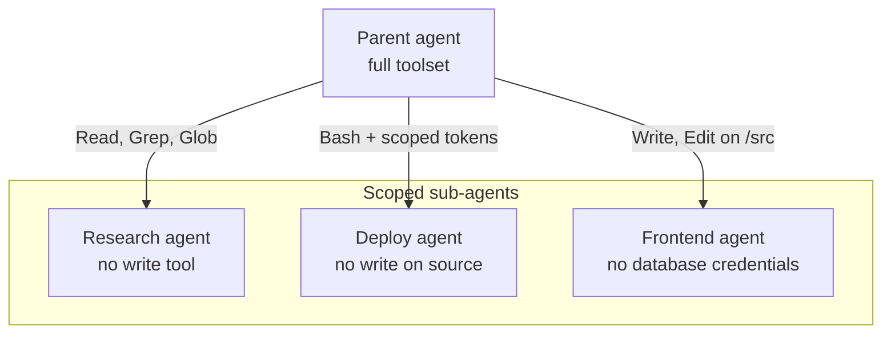

# Apply Guardrails and Least Privilege

## Two Layers, Two Jobs

Guardrails and scoping solve different problems and need to coexist. The combination is what bounds blast radius when something does go wrong.

| Layer | Mechanism | Stops |
|---|---|---|
| Guardrails | Pre/post tool hooks, denied tool list, command allowlist | Specific dangerous actions even when the model thinks they are needed |
| Scope | Per-agent tool subset, per-sub-agent `tools` allowlist and `disallowedTools` denylist, working directory limits | The model from ever considering tools outside its job |

## Hard Stops and Scope Constraints

Hard stops live in `hooks` and policy files; they intercept tool calls and either reject them outright or transform the arguments. Classic uses: deny `rm -rf` regardless of phrasing, block `git push --force` on protected branches, require human confirmation before any network call from a sub-agent. The hook is authoritative because it runs in the harness, not in the model's reasoning, so an injected instruction cannot talk its way past it.

```json
{
  "hooks": {
    "PreToolUse": [
      {
        "matcher": "Bash",
        "hooks": [
          {
            "type": "command",
            "command": "bash",
            "args": ["${CLAUDE_PROJECT_DIR}/hooks/deny-destructive.sh"]
          }
        ]
      }
    ]
  }
}
```

A matcher is only as wide as the tool names in it. On Windows, Claude Code exposes a `PowerShell` tool alongside `Bash`, so a guardrail matched on `Bash` alone lets an equivalent destructive command through untouched. Enumerate every tool that can reach a shell, or the guardrail is decorative on half your machines.

A hook signals its verdict one of two ways, never both. Exit `0` and print `{"hookSpecificOutput":{"hookEventName":"PreToolUse","permissionDecision":"deny","permissionDecisionReason":"..."}}` to stdout, and the model receives that reason. Exit `2` instead, and Claude Code ignores stdout entirely and feeds stderr back as the reason, so a hook that prints JSON and exits 2 blocks the call with no explanation at all.

Scope constraints in a sub-agent's `tools` and `disallowedTools` reduce surface before any model decision. A documentation agent that only has Read and Grep cannot exfiltrate via Write, cannot wander into Bash, cannot call a network MCP, regardless of how cleverly someone phrases the prompt. Narrow the scope until the agent can still do its job and not one capability more.

An allow rule only skips the prompt, it never restricts. Restriction comes from `deny` rules and from a sub-agent's `tools` allowlist. Bash deny rules match the command string, so a compound or reordered command can slip past a narrow pattern like `Bash(git push --force:*)`. Deny the command family and let the `PreToolUse` hook carry the precise patterns.

## Least Privilege Per Sub-Agent

Different sub-agents have different jobs and should have different toolsets. The frontend agent does not need database credentials; the deployment agent does not need write access to source files; the research agent does not need any write tool at all. Encode these splits in the agent's frontmatter so they are versioned alongside the agent definition.

```yaml
---
name: research-agent
description: Read-only research sub-agent for surveying the repository without write or shell access.
model: sonnet
tools: Read, Grep, Glob
---
```

Absence is the stronger of the two defenses on this page: interception inspects a call that was made, while a tool the agent never received leaves no call to inspect and no argument to reason about.

A sub-agent inherits the parent's environment but not the parent's intent, which is the safety property to lean on. Treat each sub-agent as a freshly minted contractor: it gets exactly what it needs for the task, signs a non-disclosure on the way out (the context is dropped), and returns a summary.



## Demo: Hook Guardrails and Least Privilege

See [demo-hook-guardrails.md](demo-hook-guardrails.md).

The `research-agent` under `demo-hook-guardrails/.claude/agents/` is demo content, not part of this repository's agent roster.

## Helpful Claude Slash Commands

| Command | Usage |
|---|---|
| `/permissions` | Review the current allow and deny lists before kicking off a session that will touch shared infrastructure |
| `/doctor` | Run a setup checkup that flags slow hooks and unused MCP servers before you trust the guardrails |
| `/hooks` | Inspect active hooks to confirm the guardrails that should be wired up actually are |

## Key Topics covered in this module

- [Hooks Reference](https://code.claude.com/docs/en/hooks): pre and post tool hooks, including deny patterns and argument transformations
- [Sub-Agent Definitions](https://code.claude.com/docs/en/sub-agents): frontmatter, tool scoping, and permission inheritance
- [Settings and Permissions](https://code.claude.com/docs/en/settings): allow lists, deny lists, and managed policy
