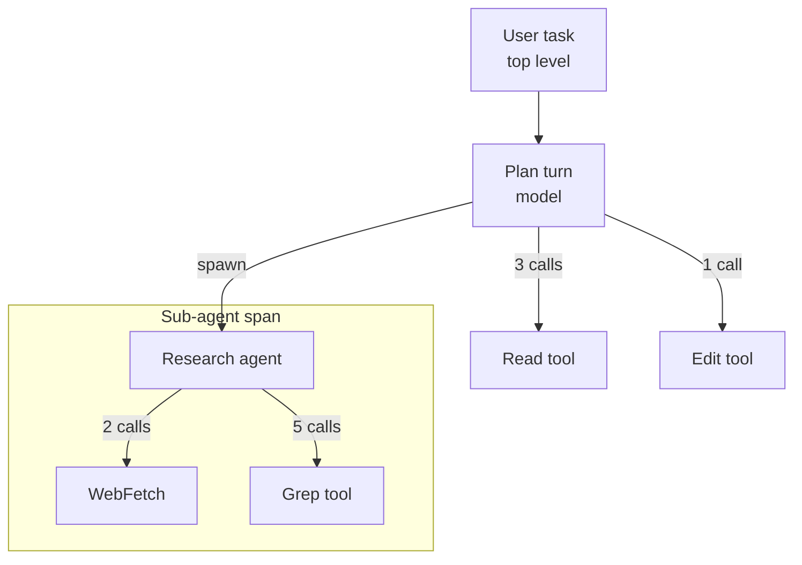

# Trace Agents and Diagnose Failures

## Why Agents Need Their Own Telemetry

A traditional service has one main concern: request comes in, response goes out, measure latency and error rate. An agent has a tree of tool calls, sub-agent spawns, model turns, and retries inside a single user-visible task, and any one of those can stall, loop, or hallucinate without the outer request signaling failure. Observability has to follow the work, not the request boundary.



## Tracing Tool Chains and Cost Attribution

Each tool call, each sub-agent spawn, and each model turn is a span in a trace. Tag the span with the agent name, the tool, the token count, and the dollar cost, then attribute up to the parent task. The result is two views you actually use: which task cost the most, and which tool inside that task was the expensive one.

The mechanics: turn on OpenTelemetry export, pipe the metrics into a sink you already run (an OpenTelemetry collector, Datadog, a Postgres table), and group by session plus agent. Telemetry is configured through environment variables, not a `telemetry` settings block, and `env` in `settings.json` is a flat map of variable names to string values, which is how you ship the same configuration to a whole team:

```json
{
  "env": {
    "CLAUDE_CODE_ENABLE_TELEMETRY": "1",
    "OTEL_METRICS_EXPORTER": "otlp",
    "OTEL_EXPORTER_OTLP_PROTOCOL": "grpc",
    "OTEL_EXPORTER_OTLP_ENDPOINT": "http://localhost:4317"
  }
}
```

For the hosted view, the Claude Console usage page and the Claude Code Analytics API report per-user spend and daily metrics for API organizations. Locally, `/usage` surfaces the numbers for the current session.

## Diagnosing Stuck, Runaway, and Hallucinating Agents

Three failure modes show up often enough to name. Stuck: the agent is waiting on a tool that will never return, usually a hung MCP server or a permission prompt the user never saw. Runaway: the agent is in a self-correcting loop, calling the same tool with slightly different arguments and burning tokens without progress. Hallucinating: the agent is confidently making up filenames, function signatures, or API endpoints that do not exist.

| Symptom | Likely cause | First move |
|---|---|---|
| Stuck | Tool waiting on input, hung MCP, missed approval prompt | Check session state with `/context`, kill the stuck tool, restart with the prior plan |
| Runaway | Bad feedback signal, the agent cannot tell its last attempt failed | Cap with a budget hook (max tool calls per task), add an explicit success criterion to the prompt |
| Hallucinating | Insufficient grounding, missing file in context, model picked from training data | Force grounding by reading the actual file first, narrow the model's claim to what is in context |

The diagnostic loop is always the same: pull the trace, find the last tool call that succeeded, look at what the model did with that result, decide whether the prompt or the harness needs to change.

## Is the Agent Still Right?

Traces and cost dashboards say nothing about it, because a pipeline that silently started extracting the wrong field looks perfectly healthy from the outside.

This matters most where the agent's input is controlled by someone else. A supplier changes a catalog format without notice, a foreign bank alters a letter of credit layout, an upstream API adds a field: nothing errors, confidence stays high, and the extracted values quietly drift.

### Stratified Sampling as the Early Warning

The technique that catches this is ongoing stratified random sampling with human review against the source document. Not aggregate accuracy against a fixed benchmark set, because a benchmark only contains formats you already knew about. Not confidence-score anomaly detection alone, because the failure mode is confidently wrong.

Stratify by the dimensions along which a novel error would appear:

| Stratify by | Catches |
|---|---|
| Document type | A format change confined to one document class |
| Extracted field | A single field breaking while the rest stay correct |
| Confidence band, including the high band | Errors hiding inside output that bypasses review |
| Known edge cases | Regression on the cases you already fixed once |

Sample proportionally across the strata so every subgroup stays monitored. The failure of a simple random sample is that it concentrates on whatever is most common and can go months without drawing from the segment that broke.

The high-confidence tier is the one people skip and the one that matters. If 80% of extractions bypass human review on a confidence threshold, that 80% is exactly where an undetected error pattern lives longest.

### Precision Is a Trust Budget

A related failure is measurable before any human notices. When one category of an automated review runs at a 65% false positive rate, developers do not learn to ignore that category; they learn to ignore the whole review, including the 98%-accurate security findings underneath it.

The immediate fix is to remove the noisy category and restore the signal, then refine its criteria out of band. Adding a disclaimer, or instructing the model to "be accurate", changes nothing measurable. Precision in an automated review is a budget: spend it on noise and you have none left for the findings that matter.

Two prompt-level levers reliably raise precision:

- Replace vague quality words with explicit rules. "Be conservative about claims" makes the model flag greetings; "flag statements that guarantee a return or promise zero risk" makes it flag violations.
- State negative constraints as clearly as positive ones. "Report logic bugs and security vulnerabilities, skip style, formatting, and local naming conventions" outperforms any instruction to rank by severity.

### Provenance Survives Only If You Enforce It

In multi-stage synthesis, the claim usually survives and its source quietly does not. The robust safeguard is structural rather than prompted: require each stage to emit claims paired with `source_ids`, then run a deterministic post-processing check that every input source id appears in the output, and retry automatically when one is missing.

A system prompt warning the model that it will be penalized for dropping a citation is not a control. A script that counts ids is.

## Governing Published Artifacts

[Artifacts](../../01-fundamentals/08-artifacts/readme.md): a page published to Anthropic-operated infrastructure, visible to authenticated members of the publishing organization unless it was shared publicly. That makes them an inventory to govern rather than a feature to enable and forget.

Owners on Team and Enterprise plans control four separate things, and conflating them is the usual source of confusion. The artifacts toggle under Settings > Claude Code > Capabilities turns publishing on or off, and Enterprise plans can additionally scope it per role. External sharing sits under that same toggle, is off by default, and blocks access through existing public links the moment it is turned back off, without changing any artifact's audience. Connector calls from artifacts have their own toggle under Settings > Capabilities, because it also governs artifacts created in claude.ai conversations.

| Control | Where | What it decides |
|---|---|---|
| Artifacts | Settings > Claude Code > Capabilities | Whether members can publish at all, optionally scoped per role |
| External sharing | Under the same toggle | Whether a public link may be created, and whether existing ones still resolve |
| Enable artifact connectors | Settings > Capabilities | Whether a published page may call MCP connectors at view time |
| Retention | Settings > Data & privacy controls | How long artifacts are kept before automatic deletion, set separately for private and shared |

Publishing, sharing, and deleting each land in the organization audit log under the `claude_artifact_*` event types, the same family used by claude.ai conversations. For anything the console cannot express, the Compliance API covers the inventory programmatically:

```text
GET    /v1/compliance/code/artifacts
GET    /v1/compliance/code/artifacts/{artifact_id}/versions/{version_id}
DELETE /v1/compliance/code/artifacts/{artifact_id}
```

One network detail catches locked-down environments. The viewer loads each artifact from a sandboxed `*.claudeusercontent.com` origin, so an organization that restricts outbound access has to allowlist that domain alongside `claude.ai` or every artifact renders blank.

## Helpful Claude Slash Commands

| Command | Usage |
|---|---|
| `/usage` | See the session token and dollar totals with a usage-by-model breakdown, plus attribution to skills, sub-agents, plugins, and MCP servers (`/cost` is an alias) |
| `/context` | Inspect what is loaded and how much of the window each section consumes when an agent feels stuck or off-track |
| `/tasks` | List the background work of this session, including sub-agents that have already finished |

## Key Topics covered in this module

- [Cost Tracking](https://code.claude.com/docs/en/costs): the `/usage` command, token accounting, the Console dashboard, and the Claude Code Analytics API
- [OpenTelemetry Integration](https://code.claude.com/docs/en/monitoring-usage): the environment variables that wire Claude Code metrics into your own pipeline
- [Managed Agents](https://platform.claude.com/docs/en/managed-agents/overview): the hosted runtime, where Anthropic runs the agent, the sandbox, and the session event log
- [Managing Artifacts for an Organization](https://code.claude.com/docs/en/artifacts#manage-artifacts-for-your-organization): the admin toggles, retention policy, `claude_artifact_*` audit events, and the Compliance API endpoints
- [Network Access Requirements](https://code.claude.com/docs/en/network-config#network-access-requirements): the domains to allowlist, including the sandboxed artifact viewer origin
