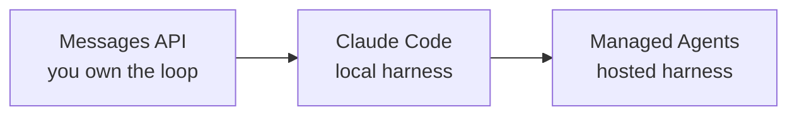
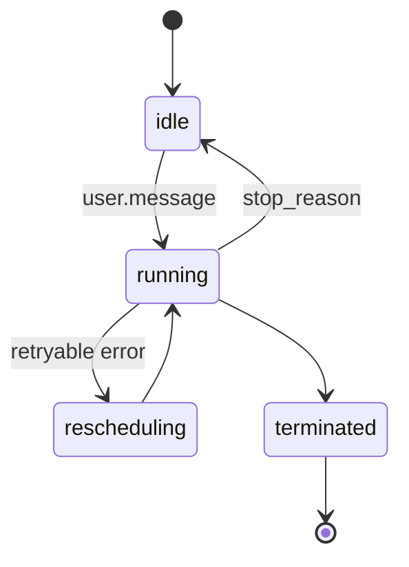

# Understand the Managed Agents Mental Model

## From the Loop You Own to the Loop They Run

Anthropic now ships three layers of the same agent loop, each one absorbing more infrastructure. The Messages API gives you raw turns and expects you to own the harness; Claude Code provides a local harness wrapped around your filesystem; Managed Agents host the harness in Anthropic's cloud so the container, the tools, and the state machine live behind a single API. The same prompts, tools, and skills run across all three layers, which is the point: the meta-harness stays stable even as the implementation moves further from your laptop.



The pitch is not that Managed Agents replace the Messages API; the pitch is that long-running, stateful, or async work outgrows a homegrown loop very fast, and the hosted version solves the problems you would otherwise build yourself.

## When to Reach for Managed Agents

The hosted runtime pays off when at least one of the following is true:

- Tasks run for minutes or hours, not seconds
- State must persist across multiple user interactions
- You have no appetite to run, patch, and isolate a sandbox container
- Work is async, scheduled, or triggered by webhooks instead of an open HTTP connection

The hosted runtime is the wrong choice for single-turn chat, latency-critical UX, or any scenario where you need bytes-level control of the agent loop. In those cases the Messages API stays the right tool and Claude Code stays the right local harness.

Managed Agents is not currently eligible for Zero Data Retention or HIPAA Business Associate Agreement coverage, because sessions keep their history, sandbox state, and outputs server-side. You can delete Sessions and uploaded files through the API at any time.

## The Three Resources

Every Managed Agents workflow is composed from exactly three primitives.

| Resource | What it is | Lifecycle |
|---|---|---|
| Agent | Configuration object: model, system prompt, tools, MCP servers, skills. Versioned as a deployable unit. | Long-lived, immutable per version |
| Environment | The cloud container definition: installed packages, network rules, mounted files, secret bindings. | Long-lived, reusable across sessions |
| Session | A running instance that binds one agent version to one environment, plus optional file mounts and vaults. | Short to medium lived, checkpointed on idle |

The Agent and Environment are templates; the Session is the running thing. You version Agents the way you version container images, you reuse Environments across many Sessions, and you spin Sessions up and down as work arrives.

The lifecycle asymmetry catches people out. Sessions and Environments can be deleted; Agents cannot. An Agent can only be archived, archiving is permanent, and an archived Agent can never back a new Session. Create Agents once, store the ID, and reference it from every run.

```python
agent = client.beta.agents.create(
    name="csv-analyst",
    model="claude-sonnet-5",
    system="You are a senior data analyst.",
    tools=[{"type": "agent_toolset_20260401"}],
)

session = client.beta.sessions.create(
    agent=agent.id,
    environment_id=environment.id,
)
```

Note what is absent from the Session call. `model`, `system`, and `tools` are fields on the Agent, never on the Session; the Session holds only a pointer.

## Session as a State Machine

A Session is not a long HTTP request, it is a state machine that the platform drives on your behalf. Understanding the four states is enough to reason about every later feature in the module.



A new Session starts at `idle` because nothing has been asked of it yet. It reaches `idle` again for one of three stop reasons: `end_turn` (the agent finished), `requires_action` (the agent is blocked on a tool confirmation or a custom tool result), or `retries_exhausted` (terminal failure). A Session with a [budget](https://platform.claude.com/docs/en/managed-agents/budgets) also idles with `budget_reached` when it reaches the cap. `rescheduling` appears only while the platform retries after a recoverable error, and `terminated` is irreversible.

The distinction that matters in client code is that `end_turn` and `retries_exhausted` mean the turn is over, while `budget_reached` means it paused until you change or remove the budget. Breaking a stream loop on `session.status_idle` alone is the most common bug in Managed Agents clients, because a Session idles every time it needs something from you.

## Why a Spectrum, Not a Replacement

Frame Managed Agents alongside the Messages API and Claude Code instead of as a successor. Teams typically prototype an idea against the Messages API to validate the prompt and tool design, then graduate to Managed Agents once the work clearly needs persistence, long duration, or vault-managed credentials. The decision rule is simple: if you would otherwise be rebuilding sandboxes, session checkpointing, or webhook-driven approval flows yourself, you are paying for infrastructure that Anthropic already operates.

## Get a Key and Know What It Costs

In the [Claude Console](https://platform.claude.com/dashboard), pick the workspace in the sidebar switcher, open API keys, press Create key, and copy the value the one time it is shown.

```bash
export ANTHROPIC_API_KEY="sk-ant-api03-..."
```

> Note: a Pro or Max subscription grants no API credits, so buy credits in the Console before the first Session.

Keys belong to workspaces and the API only returns that workspace's resources, which is why a missing agent or session is usually a key scoped elsewhere. Every Managed Agents request needs the beta header `managed-agents-2026-04-01`, which the SDK sets for you. Billing has two parts: tokens at the standard model rates, plus $0.08 per session-hour while a Session is `running`. Time spent `idle` or waiting on a tool confirmation does not count toward runtime, and `session.usage` reports what a run actually spent.

## Hands-On Demo

[Walk a Session Through Its Lifecycle](demo-session-lifecycle.md) creates all three resources, drives one Session from `running` to `idle` by polling, prints the persisted event log, and cleans up the two resources that are safe to delete.

## Helpful Claude Slash Commands

| Command | Usage |
|---|---|
| `/model` | Pick the model used during local prototyping before pinning a version on the hosted Agent resource |
| `/mcp` | Inspect the MCP servers wired into a local session so you can mirror the same configuration in an Agent definition |
| `/context` | Confirm a workflow truly needs long state before committing to the hosted runtime instead of a local harness |

## Key Topics covered in this module

- [Managed Agents Overview](https://platform.claude.com/docs/en/managed-agents/overview): official reference for the hosted harness and the three core resources
- [Sessions](https://platform.claude.com/docs/en/managed-agents/sessions): status transitions, stop reasons, and resume semantics
- [Messages API Reference](https://platform.claude.com/docs/en/api/messages): the lower layer of the spectrum, useful for prototyping before graduating
