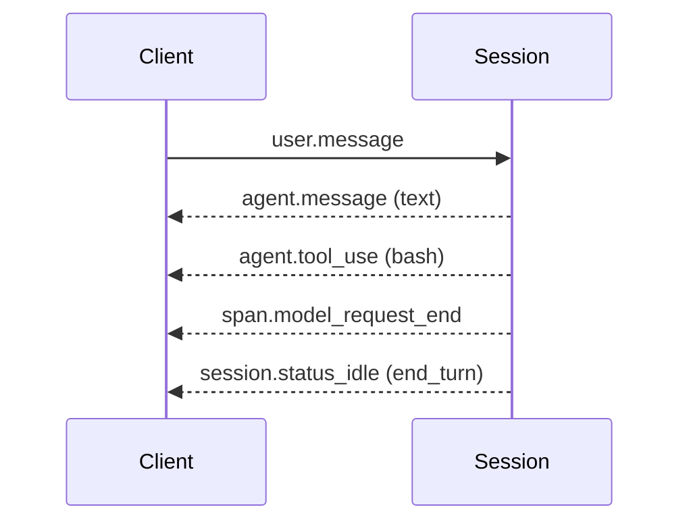

# Build Your First Managed Agent

## Cloud Containers with Network and Files

Every Session runs inside an Environment, and an Environment is a cloud container that Anthropic provisions, isolates, and tears down for you. The container ships with a configurable package set, a networking policy (`limited` or `unrestricted`), and a mount point at `/mnt/session/` that backs uploaded files. You define the container once as a resource, then bind it to as many Sessions as you need without paying the cold-start cost on every run.

```python
environment = client.beta.environments.create(
    name="analysis-env",
    config={"type": "cloud", "networking": {"type": "unrestricted"}},
)
```

The file-mount feature is the cleanest difference from the Messages API. Instead of streaming a base64 blob on every turn, you upload once, reference the file ID, and let the agent open it from disk inside the container.

Mounts belong to the Session, not the Environment. The Environment is the reusable template, so the same one can back many Sessions that each mount something different:

```python
session = client.beta.sessions.create(
    agent=agent.id,
    environment_id=environment.id,
    resources=[{
        "type": "file",
        "file_id": upload.id,
        "mount_path": "/mnt/session/uploads/sales.csv",
    }],
)
```

Traffic flows the other way too. Anything the agent writes under `/mnt/session/outputs/` is captured by the Files API, and `files.list(scope_id=session.id)` pulls the artifacts back out after the turn.

## Event-Based Communication Over SSE

You do not call the agent and wait for a JSON response. You open a Server-Sent Events stream and push `user.*` events in while the platform streams `agent.*`, `session.*`, and `span.*` events back. The stream is the steering wheel, not a notification channel.



The three event families map cleanly to the three things you care about: what the agent said, what the platform did to run it, and how individual model requests performed. A client only has to subscribe to the families it actually renders.

Two ordering rules save hours of debugging. Open the stream before sending the first event, because the stream carries only what happens after it opens and has no replay. And on reconnect, list the persisted events first and dedupe by event ID, because anything emitted while you were disconnected is gone from the stream but still queryable.

You can also send the first events inside the create call. The `initial_events` field takes up to 50 `user.message` or `user.define_outcome` events, processed in order, and a non-empty list starts the agent loop in that same call. Those events are persisted before the create response returns, so list the Session's events to read them back.

## Steering an Agent Mid-Execution

Because the stream is bidirectional in event terms, you can correct the agent without canceling the Session. Send another `user.message` while the agent is still running and it lands as the next instruction, the same way a teammate would interrupt a pairing session. Events are queued server-side and processed in order, so you never have to wait for a reply before sending the next one. A `user.interrupt` event jumps that queue and forces the Session to idle.

## Hands-On Demo

[Build a Managed Agent End to End](demo-first-agent.md) uploads a CSV, mounts it on a Session, streams the analysis, downloads the artifact the agent wrote, and cleans up.

For resuming a Session and forking one for comparison, see [Resume, Continue or Fork a Session](../01-sdk-basics/readme.md#resume-continue-or-fork-a-session).

## Subagents and Session Threads

The agent can hand work to subagents, or start a dynamic workflow, through [multiagent orchestration](https://platform.claude.com/docs/en/managed-agents/multiagent-orchestration). Each subagent works in its own **session thread**: a context-isolated event stream with its own conversation history. Thread lifecycle appears as `session.thread_created` and `session.thread_status_*` events, such as `session.thread_status_idle`.

All agents in a session share the sandbox, filesystem, and vault credentials, while each keeps its own context. For depth, see [Multiagent, Outcomes & Memory](../08-agent-multiagent/readme.md).

## Helpful Claude Slash Commands

| Command | Usage |
|---|---|
| `/mcp` | Mirror the MCP servers from a working local Claude Code session into the hosted Agent definition |
| `/cost` | Measure what a local prototype run costs before committing the same workload to a hosted Session |
| `/context` | Measure the actual context size of a local prototype to size the hosted Session's expected token usage |

## Key Topics covered in this module

- [Events and Streaming](https://platform.claude.com/docs/en/managed-agents/events-and-streaming): event types, SSE format, and reconnect semantics
- [Environments](https://platform.claude.com/docs/en/managed-agents/environments): networking policies and container configuration
- [Files](https://platform.claude.com/docs/en/managed-agents/files): upload, mount paths, session resources, and downloading session outputs
- [Multiagent orchestration](https://platform.claude.com/docs/en/managed-agents/multiagent-orchestration): subagents, session threads, and thread events
