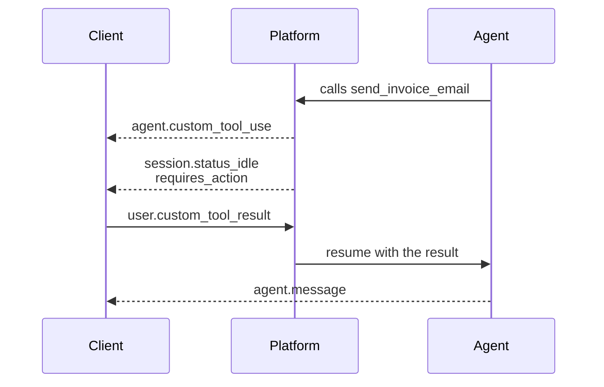

# Add Human-in-the-Loop Controls

## Why HITL Sells the Module

Approval gates and webhook-driven review flows are exactly what teams build clumsily on top of the Messages API. They spin up Redis queues, hold open SSE proxies, and write reconciliation jobs to catch dropped confirmations. Managed Agents collapse all of that into a Session that parks at `requires_action` and waits, indefinitely and for free, until your client answers. Seeing it work natively is the cleanest reason to pick the hosted runtime over a homegrown loop.

## Two Gates, Not One

The platform offers two distinct handoffs, and conflating them is the most common source of 400s in HITL code.

| Mechanism | Who executes the tool | Agent emits | You reply with |
|---|---|---|---|
| Permission policy | Anthropic, in the container | `agent.tool_use` with `evaluated_permission` of `ask` | `user.tool_confirmation` carrying `tool_use_id` |
| Custom tool | Your application | `agent.custom_tool_use` | `user.custom_tool_result` carrying `custom_tool_use_id` |

A permission policy gates a tool the platform already knows how to run, so the verdict is a simple allow or deny. A custom tool has no implementation on Anthropic's side at all, so your reply carries the actual result.

Both paths share the same blocking mechanic. The Session goes idle with a `requires_action` stop reason whose `event_ids` name exactly what it is waiting on, and resolving fewer than all of them re-emits the idle event with the remainder.

A deny verdict is not a failure; it is feedback. Return the result with `is_error` set and a sentence explaining what to do instead, and the agent adapts rather than retrying blindly, which is what makes the gate feel collaborative rather than punitive.

## Hands-On Demo

[Add an Approval Gate to a Managed Agent](demo-approval-gate.md) declares a custom tool, runs the Session to the gate, prints the pending call, and resumes it with both an allow and a deny verdict.

## Deciding When the Gate Should Fire

Five triggers cover most production systems.

| Trigger | Example | Why the agent must not decide |
|---|---|---|
| The user explicitly asks for a human | "Get me a manager" during a charge dispute | Honour it immediately, without investigating first or filing the dispute anyway |
| Policy is silent and the stakes are material | SLA covers a 10% credit; customer claims a regulatory fine | Extending policy into unwritten liability is not the agent's call |
| Repeated clarification has failed | Three attempts to obtain gross annual income yield savings, then a credit score | No progress is being made, and a fourth rephrase will not change that |
| An action is ambiguous between real entities | `lookup_customer` returns four profiles for one name | Ask for a distinguishing identifier, never guess by recency or proximity |
| The required information is absent from the source | A field mentioned only in the covering email, not the document | Retrying harder cannot invent it; log, halt, and flag |

### The Anti-Pattern: Self-Reported Confidence

A tempting design asks the model to score its own confidence from 0 to 100 and escalates below a threshold. It does not work. Self-reported confidence is poorly calibrated: models are routinely confident about wrong answers, and the number they emit reflects the shape of the prompt more than the difficulty of the case.

Use triggers you can observe from outside the model instead:

- Rule-based conditions on the input (transaction above a limit, account flagged, regulated document type)
- Structural facts about the run (retry count exceeded, required field extracted as null, tool returned a permission error)
- A separate classifier or rubric evaluating the case, scored independently of the agent handling it

The same objection applies to a model self-reporting confidence in a verification pass. If the check runs on the same reasoning it is checking, it inherits that reasoning's blind spots.

## Optional Swap: Vault-Backed MCP

Pick the demo that matches your audience. If the room is governance-leaning, run the HITL demo above. If the room is integration-leaning, swap in a vault-backed MCP demo: store a GitHub token in a vault, run a Session that operates on a real repository through the GitHub MCP server, and show Anthropic handling refresh transparently.

| Audience | Demo |
|---|---|
| Governance / risk | HITL approval gate |
| Integrations / platform | Vault-backed MCP |

## Migration Path from the Messages API

The migration story is incremental, not a rewrite. Prototype against the Messages API to validate the prompt, the tool list, and the success criteria, then graduate to Managed Agents when the workload picks up state, duration, or compliance requirements. The Agent definition reuses the same system prompt and tools, so the port is hours of work, not days.

Three signals point to graduation:

- A Session needs to survive an idle period longer than your HTTP timeouts allow
- A tool call needs human approval before it runs
- A credential needs to be refreshed automatically for an end user

Any one of these is a strong reason to migrate; two of them together is the obvious tipping point.

### From the Claude Agent SDK

Teams that built on the Claude Agent SDK map their configuration in the same way. `ClaudeAgentOptions` becomes an Agent that you create once with `client.beta.agents.create`, and `query()` or `ClaudeSDKClient` becomes a Session plus the events you send and receive. The SDK side of that comparison is in [Core API Surface](../01-api-surface/readme.md), and the [migration guide](https://platform.claude.com/docs/en/managed-agents/migration) lists every mapping.

## Helpful Claude Slash Commands

| Command | Usage |
|---|---|
| `/permissions` | Prototype the require-confirmation list locally before promoting it into the hosted Agent's permission policy |
| `/mcp` | Validate the vault-backed MCP server config against a local Claude Code session before binding it to a Session |
| `/cost` | Compare what a local session costs while it waits on a human against a hosted Session, which idles for free |

## Key Topics covered in this module

- [Tools](https://platform.claude.com/docs/en/managed-agents/tools): custom tool definitions, the result wire format, and permission policies
- [Events and Streaming](https://platform.claude.com/docs/en/managed-agents/events-and-streaming): `requires_action`, stop reasons, and resumption semantics
- [Webhooks](https://platform.claude.com/docs/en/managed-agents/webhooks): registering an endpoint and verifying the HMAC signature for async approval
- [MCP Connector](https://platform.claude.com/docs/en/managed-agents/mcp-connector): wiring an MCP server to vault-managed credentials
