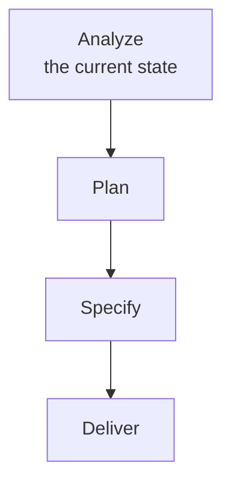
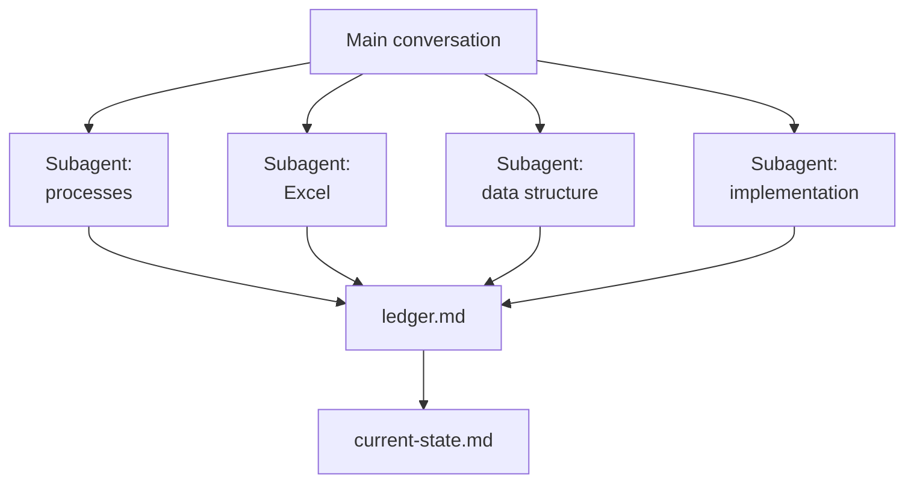

# Brownfield Analysis: Harvest the Current State

Most features are not built on an empty page. They land in a business that already runs: a process people follow every day, an Excel workbook that quietly holds half the rules, a database somebody designed years ago, and an application that works well enough that nobody wants to replace it. A plan written without that picture fills the gaps with guesses, and a spec built on those guesses is a checked contract about the wrong system.

This topic is the step before planning. Claude reads what runs today, how it gets used, and where it hits its limits, and writes it down as one current-state document. Planning, specifying and delivering then start from facts.



## Build on what runs

The analysis has one guiding question: what already exists, and where does a gap remain? The answer decides what to build. Work that only pays off after a migration cannot start this quarter, so the useful result is a list of additions that layer on top of the systems, the data and the hosting already in place.

That reframes brownfield work. Legacy is the specification nobody wrote down, and the analysis writes it down.

## The four sources

A current state lives in four places, and each one needs a different way of reading. People describe the process, files hold the numbers, the database holds the structure, and the code holds the behaviour.

| Source | What Claude reads | What it yields |
| --- | --- | --- |
| Processes | Task notes, tickets, runbooks, the steps people record while they work | Who does what, how often, and which steps are repetitive typing between systems |
| Excel files | Workbooks, CSV exports, scheduled imports | Sheets, columns, formulas and the business rules hidden inside them |
| Data structure | Database schema, ORM model, migrations, API contracts | Entities, keys, relationships, and fields that exist but are never filled |
| Current implementation | Source code, configuration, tests | What the system does today, where each capability lives, and what is tested |

The process source is the one teams skip, and the most valuable. The people doing the work record what they actually do for a week, spreadsheets and system-jumping included, and that record ranks which processes cost the most time.

## Agentic data harvesting

Each source is independent of the others, which makes harvesting a natural fit for parallel subagents. You ask for them in the prompt: name one subagent per source and say they run in parallel, and Claude starts them side by side. Each subagent runs in its own context window and returns only a summary, so the hundreds of lines it reads never reach the main conversation.

The subagent type matters, because a harvester writes. The built-in `Explore` and `Plan` subagents are read-only: Write and Edit are denied. The built-in `general-purpose` subagent has every tool available to subagents, so it can write; a custom subagent in `.claude/agents/` can too, as long as its `tools` field does not take write access away.

Subagents share nothing with each other, so they share their findings through a file: every subagent appends a section under its own heading in one ledger file and writes nothing else. Four writers on one file can overwrite each other, so each one writes its whole section in a single append at the end of its run. The ledger is the raw harvest, with a file path, a sheet cell or a code symbol behind every line.



Claude reads each source with the tools the source already has. An Entity Framework model is read from its `DbContext` and entity classes, and when the database is created at startup with `EnsureCreated` and no migrations, that code is the only schema definition there is. A SQLite file, where one exists, answers `sqlite3 hr-data.db ".schema"`. A workbook is read by a short script Claude writes and runs:

```python
from openpyxl import load_workbook

wb = load_workbook("hr-sources/vacancies-tracker.xlsx", data_only=False)
for ws in wb.worksheets:
    print(ws.title, ws.max_row, ws.max_column)
    for row in ws.iter_rows(min_row=1, max_row=2):
        print([c.value for c in row])
```

`data_only=False` returns each cell's formula, and the formulas are where a workbook keeps its rules. With `data_only=True` the same cell returns only the value Excel cached at the last save.

## The current-state document

The harvest ends in one file the team reviews before any plan is written. It separates what was observed from what was concluded, so a reviewer can challenge a conclusion without re-reading the whole system.

| Section | Content |
| --- | --- |
| Inventory | Every process, file, table and component found, each with its path or source |
| How it is used | The observed process steps, their frequency and the manual hand-offs between systems |
| Limits | Where the current state breaks down: duplicated entry, missing fields, untested paths |
| Gap list | For each requested capability: already exists, partly exists, or missing |

The gap list is what the next topic plans against. A capability marked as existing needs wiring; a capability marked as missing is a candidate for a spec.

The document is written from the ledger, so it inherits the ledger's mistakes. Check it once more against the sources themselves before anyone plans from it: open the file each Limits line and each Gap list row cites, and correct what does not hold.

## Helpful Claude Slash Commands

| Command | Usage |
| --- | --- |
| `/tasks` | List the harvesting subagents while they run, and open a finished one's transcript to see what it read |
| `/context` | Check how much of the main conversation the harvest used; the subagents' file reads stay in their own context windows |
| `/add-dir <path>` | Give the session access to a source outside the project folder, such as an export share or a second repository |
| `/agents` | Print where custom subagents live (`.claude/agents/`, `~/.claude/agents/`), for a harvester with its own instructions and tools |

## Hands-On

- Demo: [Harvest the Current State of Vacancy Tracking](demo-harvest-current-state.md) runs four `general-purpose` subagents over a restaurant's process notes, its vacancies workbook, the HR MCP server's data model and its code, writes `current-state.md` with a gap list, and checks it against the sources.

## Links & Resources

- [Create custom subagents](https://code.claude.com/docs/en/sub-agents) - the built-in subagent types, which of them can write, and parallel research
- [Commands reference](https://code.claude.com/docs/en/commands) - `/tasks`, `/context` and `/add-dir`
- [How Anthropic runs large-scale code migrations with Claude Code](https://claude.com/blog/ai-code-migration) - a dependency map and a gap inventory before any code moves
- [openpyxl documentation](https://openpyxl.readthedocs.io/en/stable/) - reading workbooks, sheets and formulas from Python
- [SQLite command line shell](https://sqlite.org/cli.html) - the `.schema` and `.tables` dot commands

[Back to Planning & Spec-Driven Development](../readme.md) | [Next: Planning with Claude Code →](../02-planning/readme.md)
