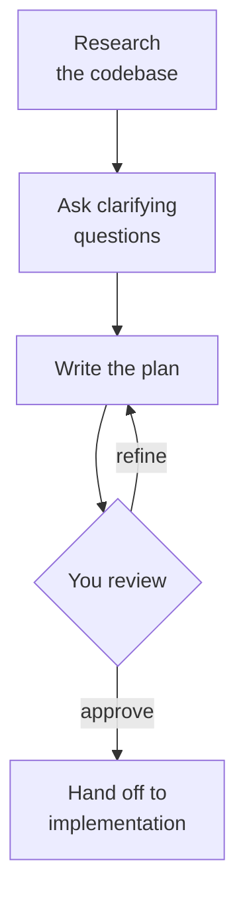
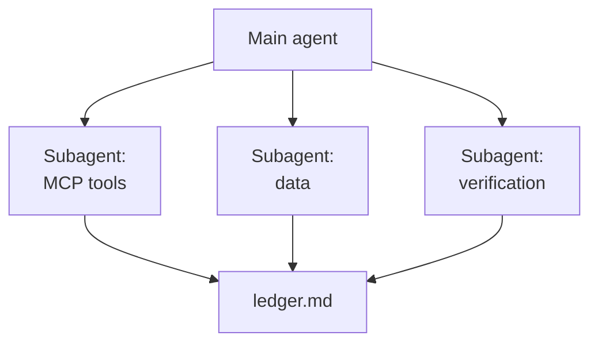

# Planning with Claude Code

An agent that starts coding the moment you press Enter makes its design decisions inside the diff, where they are expensive to review and hard to reverse. Planning moves those decisions in front of the code: Claude researches the codebase, asks what it cannot infer, and writes down what it intends to do before it changes a single file. You review a page of Markdown, and the pull request comes later.

Planning is also the lightest form of the discipline this module builds up to. A plan is a spec-driven artifact without the ceremony: no constitution, no templates, one file. The later topics add those layers when a feature needs a checked contract; this topic covers the plan itself, how to research it in parallel, how to hand it to someone else, and how to turn it into tracked work.

## The planning loop

Every planning mechanism in Claude Code runs the same four moves. It researches the relevant code, asks clarifying questions where the request is ambiguous, writes a structured plan, and waits for you to approve, reject, or refine it before anything is implemented.



The review step is the reason to plan at all. A plan that nobody reads before approving is a slower way to start coding.

## Where plans live in Claude Code

Claude Code offers four places for a plan, and each one stores it somewhere you can open and edit.

| Mechanism | How you start it | Where the plan lives | How it hands off |
| --- | --- | --- | --- |
| Plan mode | `Shift+Tab` until the status bar shows `⏸ plan mode on`, `/plan <task>` from the prompt, or `claude --permission-mode plan` | A plan file in `~/.claude/plans/`, or in the folder the `plansDirectory` setting names | You pick **Yes, and use auto mode**, **Yes, manually approve edits**, or **No, keep planning** |
| Plan subagent | Claude delegates to it during plan mode when it needs to understand the codebase | Its own context window; the main conversation receives only its summary | Its findings feed the plan file |
| Interview into a spec | A prompt asking Claude to interview you with the `AskUserQuestion` tool, then write `SPEC.md` | `SPEC.md` in the project | A fresh session executes the spec with clean context |
| Your own plan files | A prompt naming the file, such as `plan.md` or `STATE.md` | The project folder, under version control | Any session or teammate reads the file |

Plan mode tells Claude to research and propose changes without making them: it reads files, runs shell commands to explore, and writes a plan, but it does not edit your source. Press `Ctrl+G` to open the proposed plan in your editor and change it before Claude proceeds. Approving the plan exits plan mode and switches the session to the permission mode the option names, so Claude starts editing.

To make plan mode the default for a project, set `defaultMode` to `plan` in `.claude/settings.json`. Plan mode keeps its blocks in non-interactive runs with `-p` and in the VS Code chat panel. In an interactive terminal session started with bypass permissions available, Claude is still told to plan without editing, but an edit it attempts during planning runs without a prompt.

The interview pattern comes from the Claude Code best practices. For a larger feature, start with a minimal prompt and let Claude ask about implementation, edge cases and tradeoffs until it can write a self-contained spec:

```text
I want to build [brief description]. Interview me in detail using the AskUserQuestion tool.

Ask about technical implementation, UI/UX, edge cases, concerns, and tradeoffs. Don't ask obvious questions, dig into the hard parts I might not have considered.

Keep interviewing until we've covered everything, then write a complete spec to SPEC.md.
```

## Why plan mode changes the output

Without a planning constraint, Claude resolves ambiguity silently: it picks the most likely interpretation and starts producing code. That guess is free to make and expensive to undo.

With plan mode active, Claude cannot edit, so its behaviour shifts. It asks the clarifying questions it would otherwise skip, proposes structure before filling it in, and surfaces assumptions as explicit flags in the plan. Plan mode makes Claude's assumptions visible before they become code.

## The vague-brief failure mode

Submitting an under-specified request in plan mode produces a question list, and that is the intended outcome.

```text
I want to add vacancies to the HR MCP server.
```

In the recorded run against the [hr-mcp-server/](hr-mcp-server) starter, Claude wrote a provisional plan and came back with four questions: which fields a vacancy holds, which tools to add, how a vacancy is identified, and whether to seed sample data. That question list is the planning session's first deliverable. Sent outside plan mode, the same prompt gets a schema, a tool set and an identifier chosen for you, and you find out which ones were wrong in review.

## The constraint-first pattern

Constraints submitted after Claude has proposed a plan arrive as negotiation. Constraints submitted before the ask arrive as specification, so the order changes what Claude plans against.

```text
Constraints (non-negotiable):
  1. A vacancy has a title, required skills, required languages and a status of open or filled.
  2. Four new MCP tools: add_vacancy, list_vacancies, close_vacancy, match_candidates.
  3. Store vacancies in the existing SQLite database through EmployeeDbContext. No new NuGet packages.
  4. Existing employee rows in hr-data.db must survive. No destructive migration.
  5. match_candidates returns employees ranked by how many required skills they have.

Revise the plan. Tell me what is still ambiguous.
```

A constraint ratchet does two things: it locks decisions that are already made and it exposes what is still open. The last sentence matters, because "tell me what is still ambiguous" invites Claude to name its own gaps.

## Iterating the plan

A single plan mode turn rarely produces a complete plan, and two or three turns is the expected pattern. Turn 1 submits the feature request and gets a provisional plan with open questions. Turn 2 answers the questions with a constraint ratchet, and Claude revises the plan and narrows the ambiguity. Turn 3, if needed, closes the remaining questions with one final constraint batch.

If the planning session needs more than five turns, the brief is fundamentally unclear. Stop, write down what you actually know, and restart with that written brief.

## When to plan and when to skip it

Plan when you are uncertain about the approach, when the change touches several files, or when you are unfamiliar with the code being modified. Skip it for a typo, a log line, a rename or a bug with a clear reproduction. The best practices put the test in one sentence: if you could describe the diff in one sentence, skip the plan.

The cost of entering plan mode on a simple task is one extra turn. The cost of skipping it on a complex task is often hours of reversal.

## Your own planner agent

The built-in Plan subagent is general. A custom subagent in `.claude/agents/` lets a team fix how plans are produced: which tools research may use, which model plans, and what every plan must end with. Only `name` and `description` are required; `tools` restricts the agent, and leaving out Write and Edit keeps it from touching code.

```markdown
---
name: planner
description: Researches the codebase and returns an implementation plan with numbered tasks, the files each task touches, its dependencies and acceptance criteria. Never edits code.
tools: Read, Grep, Glob
model: opus
---
You plan and never edit. Check every library API against the code or its documentation before the plan relies on it.
End every plan with edge cases and open questions.
```

Save it as `.claude/agents/planner.md` in your project and call it by name: "Use the planner subagent to plan the vacancies feature." Its plan comes back to the main conversation as one result, where you review it like any other.

## Parallel research with subagents

Research is the slow part of planning, and most of it is independent: the tool layer, the data layer and the verification path can be read at the same time. Ask Claude to run subagents in parallel and each one works in its own context window, so the main conversation stays small. The built-in Explore and Plan subagents are read-only, with Write and Edit denied; a subagent that has to write findings to a file needs the `general-purpose` type or a custom agent with an edit tool.

The catch is isolation. A subagent does not see your conversation history or the files Claude already read; Claude writes it a delegation message, and the main conversation receives only its final result. Three subagents researching one feature cannot see each other's findings, and the main agent sees each one only as a summary.

## The shared ledger

The fix is a file. Give every subagent the same ledger path and one rule: append your findings under your own heading, write nothing else. The ledger becomes the shared state the subagents lack, and it outlives the session.



The main agent then writes the plan from the ledger. You get two artifacts for review: `ledger.md` shows what was found and where, and `plan.md` shows what will be done about it. A plan claim you doubt can be traced to the ledger line it came from.

## A plan someone else can execute

A plan is ready when a person or an agent who never saw the conversation could carry it out. That means numbered tasks, and for each one the files it touches, the tasks it depends on, and acceptance criteria that can be checked without asking you.

The file list does double duty. Tasks whose files do not overlap can run in parallel, and tasks that share a file must run in order.

## STATE.md: the rolling handoff document

A spec describes the desired end state and is written once. `STATE.md` describes the current state: what has been decided, what is done, what comes next, and what is still open. It is written before work begins and updated after every meaningful session, so any later Claude session that reads it first resumes where the last one stopped.

```markdown
# <Project> Project State

## Goal
[one sentence: the thing being built]

## Decisions
[bullet list of every locked-in choice: schema, tool surface, constraints]

## Status
- [x] Step completed
- [ ] Step remaining

## Next Action
[the single next concrete thing to do, specific enough for Claude to act on without asking]

## Done Criteria
[verifiable bullet list: commands you can run and outputs you can read]

## Open Questions
[anything still ambiguous, empty when the plan is locked]
```

Add one rule to `CLAUDE.md` and enforce it without exceptions:

```text
Read STATE.md before any non-trivial change. Update STATE.md after any non-trivial change.
```

The update is minimal: flip a status checkbox, rewrite the Next Action line. Done consistently, the file stays accurate, and one skipped update starts the drift that makes it useless.

## Work packages with contracts

A work package is a unit of work that one Claude session can complete without further clarification. It has four required fields.

| Field | Description |
| --- | --- |
| Name | Short, lowercase, hyphenated (`vacancy-schema`) |
| Input | Files it may read and the `STATE.md` section governing it |
| Output | Files it creates or modifies and the contract it must satisfy |
| Depends on | Which other package must finish first, if any |

The contract is the critical part: a runnable command and its expected output. It is what you check mechanically after execution.

Each package targets one concern, which is rarely one file. Packages that can run in parallel declare no dependency on each other, and each contract must be checkable without reading the source code. Aim for three to five packages; more than seven means the decomposition is too fine-grained.

## Done criteria and the self-critique loop

Done criteria are mechanically verifiable statements about what must be true when a package finishes. Acceptance criteria describe user-visible outcomes: "HR can match employees to a vacancy." Done criteria are specific enough for Claude to run and report: "`match_candidates` for a vacancy requiring Menu Planning and Food Safety returns Carlos Gomez first." If Claude has to interpret whether a criterion is met, it is not specific enough.

After execution, and before declaring done, ask Claude to walk through each Done Criteria bullet and produce evidence:

```text
Execute the four packages from STATE.md in dependency order. After each package finishes:
  1. Update STATE.md: flip the matching Status checkbox to [x] and update Next Action.
  2. Run the package's contract command and paste the output below.

When all four are done, self-critique:
  - Walk through every bullet in the Done Criteria section.
  - For each, run the check and report PASS or FAIL with the actual command output.
  - If anything fails, fix it, re-run, and update STATE.md.

Do not declare the feature complete until every Done Criteria bullet is PASS.
```

The PASS and FAIL lines are what you audit. When Claude produces evidence that all criteria pass, you verify a sample; when something fails, the loop catches it before you call the feature done.

## From plan to tracked work

A plan in a session folder is invisible to the team. Filing it as GitHub issues makes it durable, assignable and visible: one parent issue for the feature, one sub-issue per work package, all carrying a `planning` label so planned work is easy to find. Claude drives this through the `gh` CLI, which it already knows.

`gh` has no sub-issue command, so the link goes through the sub-issues REST endpoint:

```bash
child_id=$(gh api repos/{owner}/{repo}/issues/<child-number> --jq .id)
gh api -X POST repos/{owner}/{repo}/issues/<parent-number>/sub_issues -F sub_issue_id=$child_id
```

```powershell
$childId = gh api repos/{owner}/{repo}/issues/<child-number> --jq .id
gh api -X POST repos/{owner}/{repo}/issues/<parent-number>/sub_issues -F sub_issue_id=$childId
```

The endpoint takes the child's database id, which differs from its issue number, and that one detail is what makes a hand-rolled link fail. Ask Claude for the draft and the commands first, read them, and run them against your own repository.

## Helpful Claude Slash Commands

| Command | Usage |
| --- | --- |
| `/plan [description]` | Enter plan mode from the prompt, optionally starting straight on a task, for example `/plan add vacancies to the HR server` |
| `/memory` | Open `CLAUDE.md` to add the `STATE.md` read and update rule once, so every session inherits it |
| `/goal [condition]` | Keep Claude working across turns until a Done Criteria condition holds |
| `/clear` | Drop a planning session that passed five turns and restart from a written brief |

## Hands-On

- Demo: [Lock Design Decisions Incrementally with Plan Mode](demo-plan-mode-constraint-ratchet.md) sends a vague brief and then a constraint ratchet to the HR MCP server in plan mode.
- Demo: [Plan the Vacancies Feature Through a Shared Ledger](demo-plan-vacancies.md) researches the server with three parallel subagents, writes the plan from their ledger, and checks it against the constraints.
- Demo: [Capture a Planning Session in STATE.md](demo-authoring-state.md) dictates the statefile sections and closes the last open question.
- Demo: [Decompose a Plan into Work Packages and Draft the Issues](demo-work-package-decomposition.md) splits `STATE.md` into four packages with contracts and drafts the parent issue with its sub-issues.

Work in [hr-mcp-server/](hr-mcp-server); the finished planning record is beside it in [hr-mcp-server-solution/](hr-mcp-server-solution), indexed in [planning-record.md](hr-mcp-server-solution/planning-record.md).

## Links & Resources

- [Analyze before you edit with plan mode](https://code.claude.com/docs/en/permission-modes#analyze-before-you-edit-with-plan-mode): entering plan mode, approving a plan, `Ctrl+G` and `defaultMode`
- [Explore first, then plan, then code](https://code.claude.com/docs/en/best-practices#explore-first-then-plan-then-code): the four-phase workflow and when to skip the plan
- [Let Claude interview you](https://code.claude.com/docs/en/best-practices#let-claude-interview-you): the `AskUserQuestion` interview that ends in `SPEC.md`
- [Subagents](https://code.claude.com/docs/en/sub-agents): the built-in Explore and Plan agents, custom agent frontmatter, and why each subagent starts with its own context
- [plansDirectory](https://code.claude.com/docs/en/settings-reference#plansdirectory): where plan mode writes its plan files
- [Sub-issues REST API](https://docs.github.com/en/rest/issues/sub-issues): adding and listing sub-issues, and the `sub_issue_id` field
