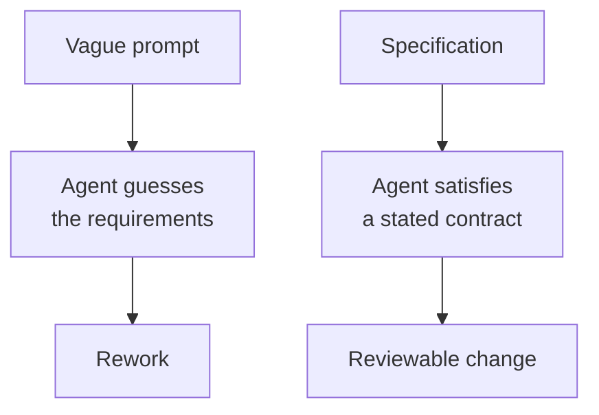
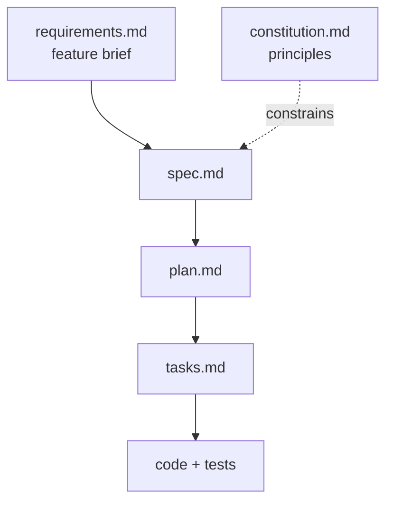
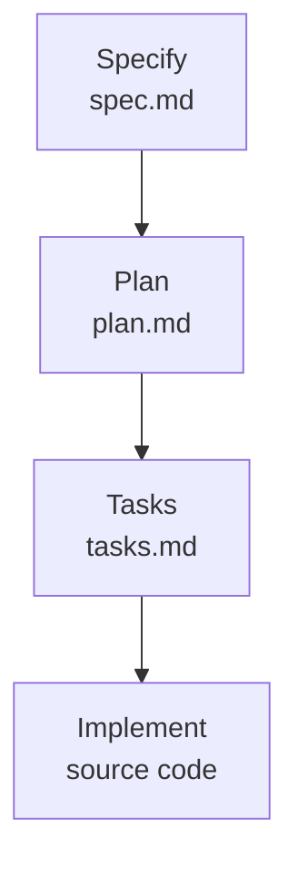

# Why Spec-Driven Development

Spec-driven development (SDD) starts with a specification that acts as an executable contract between your intent and the implementation. You hand Claude Code a document that states what must be built, and that document becomes the source of truth for what gets built, tested and validated.

This matters because coding agents are good at generating new functionality and bad at leaving working code alone. A specification gives Claude a boundary: it states what must be true when the work is done, so the change improves the codebase and leaves the stable parts stable.



## When the code becomes the spec

Den Delimarsky, who introduced Spec Kit on the Microsoft developer blog, puts the underlying problem plainly: "If you don't decide what you're building and why you're building it ahead of time, the codebase becomes the de-facto specification." Decisions then live in chat history, email threads or one person's head, and the code is the only place they are written down. Code is also binding: once an implementation exists, it is hard to decouple a decision from it.

Spec Kit's own definition is the inverse: define the what and the why before deciding how to build it, turn the requirements into a specification, a technical plan and tasks, then guide the implementation against those artifacts. The goal is to make decisions explicit, reviewable and evolvable. The specification stays a living document you change as easily as you refactor code, and Claude regenerates what depends on it.

## The example: a meeting cost calculator

Every example in this topic and the next comes from one feature, run through Spec Kit in Claude Code for the [Spec Kit pipeline demo](../04-spec-driven-workflow/demo-spec-kit-pipeline.md). An organizer enters a meeting duration and the hourly rate of each attendee, and a small Python library with a command line wrapper returns the total salary cost plus a per attendee breakdown: `python -m meeting_cost 60 100 80 60` must report 240.

The feature is deliberately small. A feature you can hold in your head is the only kind where you can see what the process added, without the size of the problem hiding it.

You start from two files in the demo's starter, [meeting-cost/](../04-spec-driven-workflow/meeting-cost/): [requirements.md](../04-spec-driven-workflow/meeting-cost/requirements.md), a feature brief written the way a product owner writes one, and [constitution.md](../04-spec-driven-workflow/meeting-cost/constitution.md), six project principles. Neither names a class, a file layout or a data type; Claude generates everything downstream and you review it.



The brief carries three user stories, five acceptance criteria, three constraints and four edge cases (zero attendees, zero minutes, a negative value, a non-numeric rate). It also leaves two things out on purpose: how the result is rounded, and what currency the numbers are in.

## Why an agent guesses

Every feature request is incomplete. A product owner writes down the intent and the obvious cases, and leaves out the details that feel self-evident: how a number is rounded, which currency it is in, whether an empty list is an error or a zero. A human developer asks about those details; an agent is built to keep moving, so it picks an answer and carries on.

The meeting cost brief is built to trigger exactly that. Its two unstated details both change the implementation, and in a code-first run the agent settles them silently inside a function; you find out later from a rounding bug or a currency symbol nobody asked for.

Spec Kit's instructions to Claude say this out loud. The `/speckit-specify` skill tells it to "Make informed guesses based on context and industry standards", to document them in an Assumptions section, and to raise at most three `[NEEDS CLARIFICATION]` markers for the decisions with the biggest impact. The guesses are fine; guesses nobody reads are the problem.

In a code-first workflow those guesses are made during generation, inside a function body, and you find them later as a bug. In a spec-driven workflow they are made in a document you read before any code exists, where overruling one costs a sentence.

## What a specification contains

A specification describes what the software must do and why, from the user's side: user stories, functional requirements, acceptance criteria, edge cases and measurable success criteria. It is written so a reviewer who never sees the code can still say whether the result is right.

It is deliberately free of design. A spec that names a class, a file, a library or a database has started to make the plan's decisions, and those decisions then hide in a document nobody reviews as architecture. Keeping the two apart lets you change the stack without touching the requirements, and review each against the right question.

| A spec says | A plan says |
| --- | --- |
| A 30-minute meeting with one attendee at 90 per hour costs 45 | Amounts are `decimal.Decimal`; the total is quantized with `ROUND_HALF_UP` |
| Invalid input names the offending field | `calculate_cost` raises `InvalidInputError` carrying `field` and `position` |
| The calculation is usable without the command line | Two modules, `calculator` and `cli`, and `cli` imports `calculator` |

The rows are taken from the demo's [reference solution](../04-spec-driven-workflow/meeting-cost-solution/readme.md). The left column survives a switch from Python to Node unchanged; the right column is rewritten entirely.

## The four phases

| Phase | Question it answers | Artifact |
| --- | --- | --- |
| Specify | What should the software do, and why? | `spec.md` |
| Plan | How will we build it? | `plan.md` |
| Tasks | What are the concrete work items, in what order? | `tasks.md` |
| Implement | Does the code match the spec? | source code |



Each phase ends at a checkpoint where you read the artifact before moving on. Catching a wrong assumption in `spec.md` costs a sentence; catching it after implementation costs a rewrite.

## The constitution sits above the phases

A fifth document, the constitution, is written once per project and applies to every feature. It holds the non-negotiables: the dependency policy, how failures are reported, which numeric types money may use. Every principle is phrased so it can be checked, because the plan phase has to verify itself against each one and say so.

The constitution is what turns review from taste into a checklist. "Money is never a float" is a rule you can hold a plan against in seconds; "write clean code" is unverifiable, which is why a good constitution is short and every line in it is testable.

The demo's constitution has six principles, and each one is aimed at a later checkpoint:

| Principle | What it forbids | Where you check it |
| --- | --- | --- |
| 1. Separation of concerns | Calculation logic importing the command line layer | Plan: module boundary |
| 2. No hidden dependencies | Any package beyond the standard library and the test framework without a written rationale | Plan: technology choices |
| 3. Explicit failure | Invalid input silently coerced, defaulted or clamped | Spec: edge cases |
| 4. Money is never a float | Binary floating point for a monetary amount | Plan: the type named for the total |
| 5. Every acceptance criterion has a test | A criterion with no task and no test behind it | Tasks: coverage |
| 6. Offline by default | Network calls and writes outside the project | Plan: constitution check |

Principle 4 is the planted trap. Every figure in the brief is exact in binary, so a `float` implementation prints 240 and 45 correctly and passes its tests; the violation is visible only where a type is named, in `plan.md`.

## Checkpoints are where you work

Claude writes every artifact; you read them. That division is the whole method. Your job at a checkpoint is to ask one question of the artifact: did anything get dropped, softened, or decided without you?

Those three failures have different shapes. A dropped item is an acceptance criterion or edge case from the brief that is missing from the spec. A softened item is a principle that arrives as "should" where you wrote "must", and a decided item is a gap Claude closed on your behalf.

The recorded run behind this module shows where to look. The constitution kept all six principles as MUST rules, and Claude reported that the template has five principle slots and that it added a sixth. The specify step raised both of the brief's gaps as `[NEEDS CLARIFICATION]` markers for rounding and currency, plus a third on whether the tool computes the yearly cost. Nothing was dropped or softened; the decided item sat under Assumptions, where Claude gave every attendee an optional label the brief never asked for.

## When SDD is worth it

The method has a cost: four documents and four reviews before the feature is done. For a one-line fix or a throwaway script that cost buys nothing, and a direct prompt is the right tool. The recorded run behind this module took 17 prompts to take a 69-line calculator module from brief to a converged implementation with 45 tests.

It pays off when a feature has acceptance criteria someone will hold you to, when the request comes from someone other than the person implementing it, or when the code will be changed later by an agent that needs to know what it must not break. Practitioners who tried the tools on real features report the same boundary: Birgitta Böckeler found the markdown overhead of Spec Kit and its peers out of proportion for a small feature ([Understanding Spec-Driven-Development](https://martinfowler.com/articles/exploring-gen-ai/sdd-3-tools.html)).

The Spec Kit catalog draws the line by the job as well. SDD is its process for building a feature or application, while diagnosing a bug and deciding whether an idea deserves investment ship as opt-in extensions (`specify extension add bug`, `specify extension add assess`).

## Getting started with GitHub Spec Kit

Spec Kit ships as a CLI called `specify`. Install it once, then scaffold a project with the Claude Code integration; both commands are the same in Bash and PowerShell:

```bash
uv tool install specify-cli --reinstall
specify init <PROJECT_NAME> --integration claude
```

Initialization writes the Spec Kit templates and scripts into `.specify/` and the commands into `.claude/skills/speckit-<command>/SKILL.md`. Start `claude` inside the generated folder: the commands are project skills, so Claude Code offers them only when that folder is the project root. Type `/speckit-` to see them, or open `/skills`.

> Note: Always pass `--integration claude`. In a script or with `--non-interactive`, `specify init` picks a default integration without asking, and that default is GitHub Copilot: you get a `.github/` folder and no skills Claude Code can see.

> Note: Keep `--reinstall` on the install command. Without it, a machine that already carries an older `specify-cli` installs nothing and leaves you on the older generation of command names, with a dot (`/speckit.specify`) where the current skills use a hyphen.

These are the commands that drive the loop:

| Command | Use it to |
| --- | --- |
| `/speckit-constitution` | State the project principles every later phase is checked against |
| `/speckit-specify` | Describe what you are building and why, from the user perspective |
| `/speckit-plan` | Give technical direction, stack choices and constraints |
| `/speckit-tasks` | Break the specification into actionable work items |
| `/speckit-implement` | Let Claude work through the tasks with reviewable changes |

A 10-minute first run: specify one small feature, plan it, generate tasks, then let Claude implement one or two of them and compare the result against the spec.

Every command on this page was executed against Spec Kit 1.2.1 and Claude Code 2.1.302, and the output is recorded in [spec-kit-cli-solution/](./spec-kit-cli-solution/readme.md).

## Helpful Claude Slash Commands

| Command | Usage |
| --- | --- |
| `/skills` | Confirm the ten `speckit-*` skills that `specify init` wrote under `.claude/skills/` are visible to the session |
| `/speckit-constitution` | Turn your principles into `.specify/memory/constitution.md`, versioned and dated |
| `/speckit-specify` | Turn a feature brief into `spec.md`, with at most three `[NEEDS CLARIFICATION]` markers |
| `/clear` | Start the next phase with an empty context; every phase reads its input from the artifacts on disk |

## Hands-On

- Demo: [spec-kit-cli-solution/](./spec-kit-cli-solution/readme.md) records the install, `specify init --integration claude`, the command names it registers and the default integration a script gets, so you can tell a broken install from a changed tool.

## Links & Resources

- [GitHub Spec Kit](https://github.com/github/spec-kit) - the toolkit repository and the agents it supports
- [Spec Kit installation guide](https://github.github.io/spec-kit/installation.html) - every install route, the `--integration` keys and the script flavours
- [Spec Kit documentation](https://github.github.io/spec-kit/) - the method and what each artifact must contain
- [Diving into Spec-Driven Development with GitHub Spec Kit](https://developer.microsoft.com/blog/spec-driven-development-spec-kit/) - why the codebase should not be the specification, and how the constitution, spec, plan and tasks fit together
- [Understanding Spec-Driven-Development: Kiro, spec-kit, and Tessl](https://martinfowler.com/articles/exploring-gen-ai/sdd-3-tools.html) - a practitioner's trial of three SDD tools and where their overhead stops paying off

[← Previous: Planning with Claude Code](../02-planning/readme.md) | [Back to Planning & Spec-Driven Development](../readme.md) | [Next: The Spec-Driven Workflow →](../04-spec-driven-workflow/readme.md)
