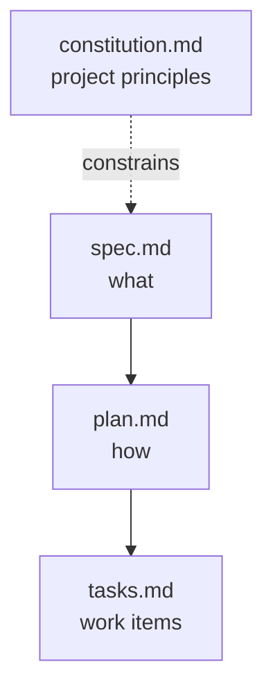
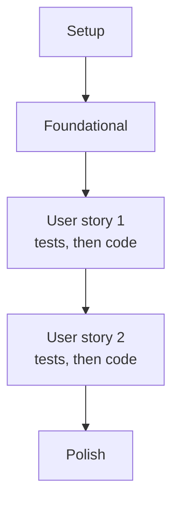
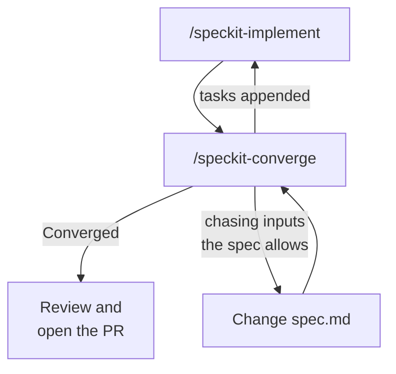

# The Spec-Driven Workflow

GitHub Spec Kit is an open-source toolkit that wires spec-driven development into coding agents, Claude Code among them, as ten project skills. Everything it produces is plain Markdown stored next to your code, so specifications, plans and tasks live in Git with the same review and history as the implementation.

Because the artifacts are versioned files, a feature branch carries both the requirements and the code that satisfies them. Include `spec.md`, `plan.md` and `tasks.md` in the pull request so a reviewer sees what was built and why.

## The four artifacts

| File | Role | Changes |
| --- | --- | --- |
| `constitution.md` | Non-negotiable project principles: technology standards, security requirements, coding standards. Claude checks proposals against it. | Rarely, once established |
| `spec.md` | What the software must do: user stories, acceptance criteria, functional requirements, edge cases, success criteria. Requirements only, no implementation. | Per feature |
| `plan.md` | How it will be built: architecture, stack decisions with rationale, project structure, constitution compliance. | Per feature |
| `tasks.md` | Discrete work items derived from the plan, sequenced so each is independently implementable and verifiable. | Throughout implementation |



Each artifact is generated from a template in `.specify/templates/`, and the templates are what make the output predictable. Reading them once tells you what a finished artifact must contain, which is exactly what you check at a checkpoint.

## Inside the constitution

`specify init` copies a constitution template with placeholder principles into `.specify/memory/constitution.md`. `/speckit-constitution` fills it from the principles you give it, stamps a semantic version and a ratification date, and prepends a sync impact report listing what changed.

The template has five principle slots, so six principles are the case to watch. On the recorded run Claude kept all six and said so in its summary: "The template only has five principle slots, so I added a sixth." Count the principles in the generated file against the ones you supplied anyway, and check that each still says MUST.

The same summary names a section you did not ask for in the prompt. Claude turned the starter's "How the agent uses this" paragraph into a `Plan Verification` section and reported where it came from, which is the behavior to expect from a good run: an addition you can trace and delete.

## Inside the spec

`/speckit-specify` creates the numbered feature folder under `specs/` and writes `spec.md` from the spec template. The mandatory sections are User Scenarios & Testing (prioritized user stories, each independently testable, plus edge cases), Requirements (numbered functional requirements such as `FR-001`) and Success Criteria (measurable and technology-agnostic); an Assumptions section records what Claude decided for you.

Unclear points are handled two ways. Claude fills most gaps with a reasonable default and lists it under Assumptions, and it raises at most three `[NEEDS CLARIFICATION: ...]` markers for decisions that change scope, security or user experience, then asks you to choose from a table of options. The command also writes `checklists/requirements.md`, a quality checklist it validates the spec against before it hands control back.

The Assumptions section is the one to read first. It is where a silently resolved gap lives, and a gap resolved there is still a decision you did not make. On the recorded run it held an optional label per attendee, used to name attendees in the breakdown, which the brief never asked for.

Hold the generated `specs/001-*/spec.md` against the brief with these checks:

| Check | What a good `spec.md` shows | Failure to catch |
| --- | --- | --- |
| Coverage | All three user stories and all five acceptance criteria | A criterion silently dropped |
| Edge cases | A stated outcome for each of the four edge cases | "Handled gracefully" with no defined behavior |
| The two gaps | A written rounding rule and a currency decision | Claude picked one and never told you |
| No implementation | No class names, file layout or library choices | The spec has quietly become a plan |
| No invented input | Attendees are a list of hourly rates, nothing more | A label per attendee that the brief never asked for |

You close the gaps by answering Claude's questions in the same session, and by correcting what the table caught. The recorded run ended with this section in [spec.md](./meeting-cost-solution/specs/001-meeting-cost-calculator/spec.md):

```markdown
## Resolved Gaps

- **Recurring meetings**: out of scope. The tool has no occurrences input; the team lead multiplies the printed total by hand.
- **Rounding**: the total is rounded half up to two decimal places. Breakdown values stay unrounded. "The breakdown sums to the total" means the breakdown sums to the total before rounding.
- **Currency**: amounts are currency-agnostic decimals with no symbol.
- **Attendees**: attendees are a list of hourly rates and nothing more. There is no label; an attendee is identified by their position in the list.
```

## Inside the plan

`/speckit-plan` takes your technical direction (language, framework, constraints) and produces more than one file. It runs in two phases: research first, then design.

| File | Phase | What it holds |
| --- | --- | --- |
| `research.md` | 0 | Each technology decision, the alternatives considered, and the reason for the choice |
| `plan.md` | 0 and 1 | Summary, technical context, project structure, and the Constitution Check |
| `data-model.md` | 1 | Entities, fields, validation rules and relationships from the spec |
| `contracts/` | 1 | The interfaces the feature exposes, here `cli.md` and `library.md`, with inputs, outputs and errors |
| `quickstart.md` | 1 | How to run and verify the feature, including a table mapping every acceptance scenario and edge case to a test |

The Constitution Check in `plan.md` is a gate: it must pass before research and is re-checked after design. Each principle gets an explicit verification, and a violation must either be fixed or justified in a Complexity Tracking table. Principle 4 is the row to read twice, because the money type is named only here:

```markdown
| IV. Money Is Never a Float | Inputs are parsed straight from strings into `Decimal`; breakdown, unrounded total and rounded total are all `Decimal`. No `float()` call anywhere in the package. | PASS |
```

Read `contracts/` next to `spec.md`. A contract is derived from the spec, but it is what the tests and code are written against, so a contract that contradicts an edge case in the spec produces code that contradicts it too, with tests that pass. You pass the stack as the command's argument:

```text
/speckit-plan Use Python 3.11 with pytest, standard library only. A flat package meeting_cost with two modules, the calculation logic and a CLI wrapper using argparse, plus a __main__.py so it runs as python -m meeting_cost <minutes> <rate> [<rate> ...].
```

That usage line requires at least one rate, and the spec says zero attendees is valid. On the recorded run Claude raised the conflict itself, at the top of its summary:

```text
**One conflict to decide:** your usage line `<minutes> <rate> [<rate> ...]` requires at least one rate, so I used `nargs="+"`. But the spec says zero attendees is valid input (FR-011). As planned, that case only works through the library (`calculate_cost(60, [])`), not the command line.
```

The generated `contracts/cli.md` listed `rate` as "positional, 1 or more" at that point. The spec wins: one sentence in the same session switched the plan to `nargs="*"`, and the contract now reads "0 or more", so `python -m meeting_cost 60` prints `total: 0.00`.

## Inside the task list

`/speckit-tasks` turns the plan into numbered tasks (`T001`, `T002`, ...) grouped in phases: setup, foundational work, then one phase per user story in priority order, then polish. Each task names the file it touches, `[P]` marks a task that can run in parallel because it touches a different file with no pending dependency, and `[US1]` ties a task to its user story.

Test tasks appear only when the spec or constitution asks for tests. When they do, they come first inside each story phase and must fail before the implementation task that makes them pass.



A task list is judged by two properties, and its wording is neither. Its order must let each task build on finished ones, and every acceptance criterion in the spec must have at least one task behind it.

The recorded run produced 34 tasks across six phases. The plan had already written the coverage map into `quickstart.md`, and the tasks carry it over row by row, which is principle 5 made checkable:

| Spec item | Test layer | Expected |
| --- | --- | --- |
| Story 1, scenario 1 | library | 60 min, 100/80/60: total 240.00 |
| Edge: zero attendees | library and CLI | breakdown empty, total 0.00; `python -m meeting_cost 60` prints `total: 0.00`, exit 0 |

Delete or merge any task too vague to verify, such as "handle errors", because a task nobody can check off is a criterion nobody tested.

## Project structure

Spec Kit keeps specification artifacts separate from implementation code:

```text
my-project/
├── .claude/
│   └── skills/                  speckit-<cmd>/SKILL.md
├── .specify/
│   ├── memory/
│   │   └── constitution.md
│   ├── scripts/
│   │   └── powershell/          bash/, powershell/, or powershell/ plus python/, chosen at init
│   └── templates/
├── meeting_cost/
│   └── ...
└── specs/
    ├── 001-meeting-cost-calculator/
    │   ├── plan.md
    │   ├── spec.md
    │   └── tasks.md
    └── 002-next-feature/
        ├── plan.md
        ├── spec.md
        └── tasks.md
```

`specify init` creates everything except `specs/` and the source package. The first `/speckit-specify` run creates `specs/` and the numbered feature folder inside it. Features are numbered sequentially and each gets its own directory, so two people can work on separate features without their artifacts colliding.

The tree shows the three core files per feature. After a full run the feature folder holds the plan's supporting files as well; this is the recorded run's folder:

```text
specs/001-meeting-cost-calculator/
├── checklists/
│   └── requirements.md
├── contracts/
│   ├── cli.md
│   └── library.md
├── data-model.md
├── plan.md
├── quickstart.md
├── research.md
├── spec.md
└── tasks.md
```

## Core commands

| Command | Purpose |
| --- | --- |
| `/speckit-constitution` | Establish project principles and constraints |
| `/speckit-specify` | Turn a feature description into a complete `spec.md` |
| `/speckit-plan` | Turn the specification into an architectural approach |
| `/speckit-tasks` | Break plan elements into actionable, sequenced work items |
| `/speckit-implement` | Generate code task by task, guided by spec and plan |
| `/speckit-converge` | Assess the codebase against the artifacts and append the remaining work as tasks |

`/speckit-implement` checks the feature's checklists before it starts and asks before proceeding if items are open. It marks each task done in `tasks.md` as it finishes, which is why re-running it after an interruption resumes at the first unchecked task.

While it runs, watch which files it touches: anything outside `meeting_cost/` and `tests/` means it has drifted from `plan.md`. Each phase reads its input from the artifacts on disk, so every `/speckit-*` command in the recorded run started in a fresh session; only the answers to Claude's questions continued one.

## Verify against the spec

Run the suite, then the acceptance criteria by hand. The commands are the same in Bash and PowerShell:

```bash
python -m pytest
python -m meeting_cost 60 100 80 60
python -m meeting_cost 30 90
python -m meeting_cost 60
python -m meeting_cost -30 90
```

The recorded run printed:

| Input | Output | Exit code |
| --- | --- | --- |
| 60 minutes, rates 100 / 80 / 60 | `attendee 1: 100`, `attendee 2: 80`, `attendee 3: 60`, `total: 240.00` | 0 |
| 30 minutes, rate 90 | `attendee 1: 45`, `total: 45.00` | 0 |
| 0 attendees | `total: 0.00` | 0 |
| -30 minutes | `meeting_cost: error: duration: must be a non-negative number, got '-30'` | 2 |

The two decimal places on the total and the unrounded breakdown lines are the rounding rule you wrote into `spec.md`, arriving in the output. The suite ends at `45 passed`.

The check that matters more than a green run is `spec.md` and `tasks.md` side by side. A suite that covers only the happy path passes just as green, and it means the task list was incomplete; that failure mode is what the whole demo is built around. Compare your run with [meeting-cost-solution/](./meeting-cost-solution/readme.md): the wording will differ because Claude generated it, but the structure and the coverage should match.

## Commands that check the artifacts

Four more commands produce no code. They exist to find problems in the documents while fixing them is still cheap.

| Command | When to run it | What it does |
| --- | --- | --- |
| `/speckit-clarify` | After specify, before plan | Scans the spec for underspecified areas, asks up to five targeted questions, and writes each answer back into the spec |
| `/speckit-checklist` | Any time after specify | Generates a custom checklist that tests the requirements themselves for completeness, clarity and consistency |
| `/speckit-analyze` | After tasks, before implement | Read-only report across spec, plan and tasks: duplicates, ambiguity, coverage gaps; a constitution conflict is always CRITICAL |
| `/speckit-taskstoissues` | After tasks | Turns the task list into GitHub issues; deprecated in 1.2.1 in favor of the `github` extension and `/speckit-github-taskstoissues` |

`/speckit-analyze` never edits a file; it proposes remediation and waits for you. On the recorded run it changed nothing on disk and still found a CRITICAL conflict that every earlier checkpoint had missed:

```text
| C1 | Constitution III / FR-009 | CRITICAL | plan.md:13, research.md R5, tasks.md T018 | argparse only accepts a plain negative number like `-5` or `-.5` as a positional. Inputs such as `-1e3`, `-abc` or `-inf` fail with `unrecognized arguments: ...`, which doesn't name the field. Reproduced. |
```

Approving the remediation in the same session changed the plan, the contract and the task list before a line of code existed. The finished CLI now passes every argument to the calculator, and `python -m meeting_cost 60 100 -abc` fails with `hourly rate (attendee 2)`.

## When requirements change

The workflow runs forward, and it also runs back. When a requirement changes, edit `spec.md`, regenerate what depends on it, and let the change propagate, so every line of code still traces back to a requirement.

`/speckit-converge` covers the other direction: code that exists before its tasks do, or an implementation that stopped short. It compares the codebase against spec, plan and tasks, and appends whatever is still unbuilt to `tasks.md` so `/speckit-implement` can finish it. The rhythm is constitution once per project, then specify, plan, tasks, implement and converge per feature, repeating implement and converge until converge reports "Converged".



The recorded run needed the fourth edge. The first converge found that `python -m meeting_cost 60 1e30` crashed, the second found the same crash at `1e999999`, and each fix invited the next, because the spec's Assumptions said there was no upper limit on duration or rate. The loop ended when the requirement changed: FR-014 now rejects a duration above 1440 minutes or a rate above 100000, converge appended three tasks for it, and the run after the next implement reported:

```text
✅ **Converged: the code does everything the spec, plan and tasks ask for.**
```

The artifacts are also yours to shape. The templates in `.specify/templates/` are a starting point, and adjusting them to your organization's conventions changes every spec, plan and task list generated after.

The tree above is drawn from a real `specify init`. The full file listing, the ten skill names and the script flavour matrix are in [project-structure-solution/](./project-structure-solution/readme.md).

## Helpful Claude Slash Commands

| Command | Usage |
| --- | --- |
| `/speckit-clarify` | Ask up to five targeted questions about the spec and write the answers back into it, before planning |
| `/speckit-analyze` | Read-only consistency report across spec, plan and tasks; approve its remediation in the same session |
| `/speckit-converge` | Compare the code against the artifacts and append the unbuilt work to `tasks.md` |
| `/rewind` | Restore the code and the conversation to the prompt before an implement step that drifted from `plan.md` |

## Hands-On

- Demo: [Run a Feature Through the Four-Step Spec Kit Pipeline](./demo-spec-kit-pipeline.md) takes the meeting cost calculator from brief to a converged implementation, stopping at every checkpoint on this page.
- Solution: [meeting-cost-solution/](./meeting-cost-solution/readme.md) holds the finished artifacts, code and tests of the recorded run.
- Solution: [project-structure-solution/](./project-structure-solution/readme.md) lists every file `specify init --integration claude` writes, the ten skills, and what each `--script` value generates.

## Links & Resources

- [Spec Kit documentation](https://github.github.io/spec-kit/) - reference for every `/speckit-*` command and the artifact templates
- [GitHub Spec Kit](https://github.com/github/spec-kit) - the toolkit repository, the implement and converge loop, and its `.specify/` directory conventions
- [Claude Code skills](https://code.claude.com/docs/en/skills) - how project skills under `.claude/skills/` are discovered, invoked and controlled with front matter
- [Diving into Spec-Driven Development with GitHub Spec Kit](https://developer.microsoft.com/blog/spec-driven-development-spec-kit/) - the specify, plan and tasks split, the constitution, and customizing the templates

[← Previous: Why Spec-Driven Development](../03-introduction/readme.md) | [Back to Planning & Spec-Driven Development](../readme.md) | [Next: Sample Case: Implement a Product Feature →](../05-sample-case/readme.md)
