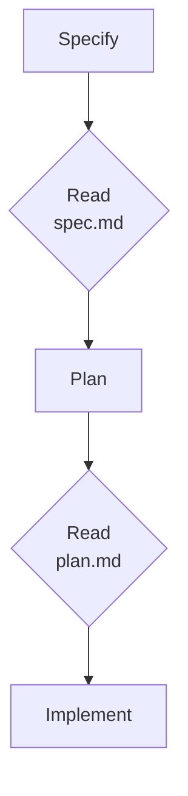

# Planning & Spec-Driven Development (Optional)

Coding agents generate new functionality well, but left unconstrained they fill every gap in a request with a guess and refactor code that already worked. Spec-driven development (SDD) answers that with executable contracts: a written specification Claude must satisfy, checked at each phase before the next one starts. The intent that usually lives in a chat scrollback becomes versioned Markdown next to the code, reviewed in the same pull request.

The module opens with the current state: parallel subagents harvest the processes, Excel files, data structure and implementation of a brownfield HR system into one document that says what already exists and where the gaps are. Planning follows, the lightest form of the discipline: Plan Mode and the constraint ratchet, parallel research through a shared ledger, a `STATE.md` handoff, and work packages drafted as GitHub issues with sub-issues. The method then runs in full through GitHub Spec Kit 1.2.1 inside Claude Code: why a specification beats a longer prompt, what the four artifacts (constitution, spec, plan, tasks) contain, and which `/speckit-*` skill produces and checks each one. A meeting cost calculator with two gaps is the running example, and the last topic takes a second feature, a leave days preview for an HR portal, through the same four checkpoints.

## Topics

| Topic | Description |
|-------|-------------|
| [01: Brownfield Analysis: Harvest the Current State](01-analysis/readme.md) | Reading what runs today from four sources (processes, Excel files, data structure, implementation) with parallel subagents that write to a shared ledger, and turning it into a current-state document with a gap list. |
| [02: Planning with Claude Code](02-planning/readme.md) | Plan Mode and the constraint ratchet, the Plan subagent and plan files, an `AskUserQuestion` interview into `SPEC.md`, parallel research through a shared ledger, the `STATE.md` handoff, work packages with done criteria, and a plan filed as GitHub issues with sub-issues. |
| [03: Why Spec-Driven Development](03-introduction/readme.md) | Why agents guess, what a specification is, the four phases with their checkpoints, when SDD pays for its overhead, and installing Spec Kit with `specify init --integration claude`. |
| [04: The Spec-Driven Workflow](04-spec-driven-workflow/readme.md) | What each artifact contains, the generated project structure, the core `/speckit-*` skills, and the skills that check the artifacts before and after implementation. |
| [05: Sample Case: Implement a Product Feature](05-sample-case/readme.md) | A real HR portal feature, a leave days preview, taken through all four checkpoints with its artifacts, code and executed tests. |

## Helpful Claude Slash Commands

Spec Kit installs its commands as skills under `.claude/skills/` in the project it initializes. The first group plans inside Claude Code; the Spec Kit group produces the four artifacts and then checks them.

| Command | Usage |
| --- | --- |
| `/plan [description]` | Enter plan mode from the prompt: Claude researches and writes a plan without editing source |
| `/agents` | Create or edit a planner or research subagent with its own tools |
| `/speckit-constitution` | Write the project principles every later phase is checked against |
| `/speckit-specify` | Turn a feature brief into `spec.md`: user stories, requirements, edge cases, success criteria |
| `/speckit-clarify` | Ask targeted questions about the spec and write the answers back into it |
| `/speckit-plan` | Turn the spec plus your stack choice into `plan.md`, with an explicit constitution check |
| `/speckit-tasks` | Break the plan into ordered, verifiable work items in `tasks.md` |
| `/speckit-analyze` | Read-only consistency report across spec, plan and tasks; a constitution conflict is always critical |
| `/speckit-implement` | Work through `tasks.md` task by task, resuming at the first unfinished one |
| `/speckit-converge` | Compare the code against the artifacts and append the unbuilt work to `tasks.md` |

## Demos

| Topic | Description |
|-------|-------------|
| [Brownfield Analysis](01-analysis/demo-harvest-current-state.md) | Four parallel subagents read the process notes, the vacancies spreadsheet, the database schema and the HR MCP server into a cited `ledger.md`; Claude then writes `current-state.md` with a gap list and checks it against the sources. |
| [Planning with Claude Code](02-planning/demo-plan-mode-constraint-ratchet.md) | A vague brief for the vacancies feature returns a question list in plan mode; a constraint block rewrites the plan and surfaces the ambiguities that remain. |
| [Planning with Claude Code](02-planning/demo-plan-vacancies.md) | Three subagents research the HR MCP server in parallel through a shared ledger, Claude writes `plan.md`, and a review against the ledger and the constraints finds and fixes three contradictions. |
| [Planning with Claude Code](02-planning/demo-authoring-state.md) | Claude writes `STATE.md` from the locked decisions, and the session closes only when the Open Questions section is empty. |
| [Planning with Claude Code](02-planning/demo-work-package-decomposition.md) | Optional. The plan becomes work packages with explicit contracts, drafted as a parent issue with sub-issues and the `gh` commands to file them against your own repository. |
| [The Spec-Driven Workflow](04-spec-driven-workflow/demo-spec-kit-pipeline.md) | Optional. The meeting cost calculator goes from brief to a converged implementation through the `/speckit-*` skills: both gaps surface as clarification markers, and `/speckit-analyze` flags a critical constitution conflict before any code is written. |

Every demo has a presenter guide beside it (`demo-presenter-<slug>.md`) holding the same
teaching in timed beats, for delivery without running the demo live.

## Starter and Solution Folders

Each demo starts in its topic's starter and finishes beside it in a `-solution/` folder holding the output of a real Claude Code run: `hr-system` (01), `hr-mcp-server` (02) and `meeting-cost` (04). Topics 03 and 04 also record the Spec Kit install and the generated tree in `spec-kit-cli-solution/` and `project-structure-solution/`, and topic 05 ships the finished `leave-days-solution/`.

## Labs

| Lab | Description |
|-----|-------------|
| [Drive a Feature Spec-First with Plan Mode](../../labs/11-planning/lab-01-spec-driven-from-scratch.md) | Take a notes CLI feature through Plan Mode end to end: clarification, constraint iteration, Extended Thinking, statefile authoring, sub-agent decomposition, and verified execution. |
| [Run the Same Feature Through Spec Kit and BMAD-METHOD](../../labs/11-planning/lab-02-spec-kit-and-bmad.md) | Repeat the feature with the `speckit-*` skills, then compare the artifacts against BMAD-METHOD's PRD, architecture and story files. |

## Knowledge Check

### CQ-01: When Plan Mode Earns Its Cost

Which task most justifies entering Plan Mode before any edit?

- A) Renaming a variable that appears in four files in one module.
- B) Extracting an authentication module that touches 50+ files, where two competing integration approaches must be compared first.
- C) Adding a missing null check that a failing test already points at.
- D) Regenerating a lockfile after a dependency bump.

**Answer: B**

Plan Mode pays off where the cost of a wrong assumption is high and the shape of the change is not yet settled. Fifty files and an unresolved architectural choice is exactly that: the plan is reviewable before anything is committed. The other three have one obvious implementation and a cheap undo, so planning ceremony would cost more than it saves.

### CQ-02: Grouping Follow-Up Prompts

Claude generates a component with three defects: an infinite re-render loop, an API call inside an effect that depends on the looping state, and a misspelled CSS class on an unrelated button. How should the fixes be requested?

- A) Report all three in one message so the model sees the full picture.
- B) Report the re-render loop and the API call together, since they are causally linked, then the CSS typo separately.
- C) Report them one at a time in three prompts, verifying each fix before the next.
- D) Ask for a full rewrite of the component with all three corrected.

**Answer: B**

Group what is coupled and separate what is not. The loop and the API call share a lifecycle dependency, so fixing them together produces one coherent change instead of two that fight each other. The CSS typo is independent, and folding it into the logic fix only muddies the diff. A rewrite, option D, discards working code to fix three known defects.

### CQ-03: Prompting Around a Coupled Constraint

Three issues are found in a serverless workload: the function timeout is too short, the queue visibility timeout must be a multiple of the function timeout, and the execution role is missing a tracing permission. What prompt structure fits the dependency shape?

- A) One prompt covering all three, asking for a single corrected infrastructure template.
- B) Two prompts: one for the two coupled timeouts, one for the independent permission.
- C) Three sequential prompts, one per issue, in the order discovered.
- D) One prompt for the highest-severity issue, deferring the rest to a later session.

**Answer: B**

The two timeouts are mathematically coupled, so they must be reasoned about together or the relationship between them is set wrong. The permission is entirely independent and gains nothing from being bundled. Prompt structure should mirror the dependency structure of the problem: neither one prompt for everything nor one prompt per item.

### CQ-04: Writing a Review Prompt That Cuts Noise

A code review prompt reading "Find all issues in the code" returns mostly formatting and naming nitpicks, burying the logic bugs. Which rewrite fixes it?

- A) "Report only logic bugs and security vulnerabilities. Explicitly skip minor style issues, formatting, and local naming conventions."
- B) "Only report high-confidence findings, and be conservative with style issues."
- C) "Categorize findings by severity and output only the top three per file."
- D) Keep the prompt and filter the output with a script that drops findings mentioning style or formatting.

**Answer: A**

Explicit inclusion criteria plus explicit negative constraints beat any instruction phrased as a quality adjective. "Be conservative" and "high-confidence" are not measurable by the model, so option B changes little. Option C caps volume without improving precision, and option D fixes the symptom downstream while the model keeps spending tokens generating noise.

### CCA-F Q20 (Domain 1: Agentic Architecture and Orchestration)

An architect is designing an agentic system to add comprehensive unit tests to a massive, undocumented legacy codebase. The task is highly open-ended, and the dependencies between modules are unknown. What is the optimal decomposition strategy for this workflow?

- A) Use a single prompt with the maximum context window to read all files and output all tests in one pass.
- B) Deploy parallel agents to write tests for all files simultaneously, then use a map-reduce chain to merge them.
- C) First map the codebase structure, identify high-impact areas, and create a prioritized plan that adapts as dependencies are discovered.
- D) Implement a fixed prompt chain that iterates through the repository alphabetically, writing tests for each file.

**Answer: C**

This strategy aligns with Anthropic's recommended practices for large, undocumented codebases. Mapping, prioritizing high-impact areas, and adapting as dependencies are discovered mirrors the iterative, context-aware workflows advocated in Anthropic's harness engineering and agentic system design.

### CCA-F Q48 (Domain 3: Claude Code Configuration and Workflow)

Your team is migrating a legacy monolithic application to a microservices architecture. The first phase requires extracting the authentication module, which currently touches over 50 files across the repository. You need Claude to evaluate two different OAuth2 integration approaches and determine the necessary infrastructure changes before any code is modified. Which Claude Code workflow is most appropriate for this scenario?

- A) Use direct execution to iteratively update the 50+ files, allowing Claude to resolve integration errors as they appear during the build process.
- B) Use the Explore subagent to rewrite the authentication module in an isolated context, then merge the changes without evaluating how the new integration interacts with the monolith.
- C) Use direct execution with a strict prompt instructing Claude to only modify one file at a time to prevent context window exhaustion.
- D) Use plan mode to safely explore the codebase, evaluate the architectural implications of both OAuth2 approaches, and design the migration strategy without committing to changes.

**Answer: D**

Plan mode is designed for safely exploring the codebase and evaluating architectural implications before committing changes. It enables the design of a migration strategy and the identification of infrastructure changes, producing a vetted plan that can be reviewed prior to any code modification.

### CCA-F Q52 (Domain 3: Claude Code Configuration and Workflow)

A frontend developer is tasked with setting up a Kubernetes cluster with an Istio service mesh. The developer has zero experience with infrastructure-as-code or Kubernetes networking. They want to use Claude to generate the necessary YAML configuration files. Which prompting strategy should the developer use to ensure a secure and appropriate architecture?

- A) Prompt Claude to act as a Kubernetes expert and ask the developer questions about their application's traffic patterns, security needs, and scale before generating any YAML.
- B) Provide Claude with the frontend source code and ask it to automatically infer the necessary Kubernetes configuration.
- C) Ask Claude to provide a comprehensive tutorial on Kubernetes and Istio, then manually write the YAML.
- D) Prompt Claude to generate standard, production-ready Kubernetes and Istio YAML files based on industry best practices.

**Answer: A**

This strategy leverages an interactive, iterative approach where Claude gathers essential context before generation. Asking targeted questions about traffic, security, and scale ensures the generated manifests are tailored to the application's actual needs, reducing misconfiguration risk.

### CCA-F Q54 (Domain 3: Claude Code Configuration and Workflow)

A data engineer used Claude to write a complex PySpark job. During execution, the engineer discovers two issues: 1) A window function is partitioning by the wrong key, causing severe data skew, and 2) A subsequent `.groupBy()` operation relies on the output of that skewed window function, resulting in out-of-memory (OOM) errors on the executor nodes. How should the engineer prompt Claude to resolve this?

- A) Ask Claude to fix the `.groupBy()` OOM error first by increasing executor memory configurations, then address the window function skew in a second prompt.
- B) Request Claude to split the PySpark job into two separate scripts so each can be debugged independently.
- C) Provide a single detailed message explaining how the incorrect window partitioning is causing the downstream `.groupBy()` to OOM, asking for a coordinated fix.
- D) Report the window function skew and wait for Claude to fix it, assuming the OOM error will automatically resolve.

**Answer: C**

Providing a single message that links the root cause to the observed symptom gives Claude the context to understand the logical dependency, allowing it to propose a holistic, coordinated fix for the entire data pipeline.

### CCA-F Q57 (Domain 3: Claude Code Configuration and Workflow)

After Claude generates a complex React component, a developer notices three distinct bugs: 1) A state update causes an infinite re-render loop, 2) The API call inside the `useEffect` hook relies on that looping state, causing network spam, and 3) A CSS class name on a footer button is misspelled. How should the developer structure their follow-up prompts to fix these issues efficiently?

- A) Report the state loop and API call issues in a single detailed message since they interact, then fix the CSS typo in a subsequent prompt.
- B) Report the CSS typo first, wait for the fix, then report the API call, and finally report the state loop.
- C) Ask Claude to rewrite the entire component from scratch with all three corrected.
- D) Report all three bugs in three separate, sequential prompts.

**Answer: A**

Grouping the state loop and API call issues allows Claude to address the interdependent logic and lifecycle dependencies simultaneously. Separating the trivial CSS typo ensures the primary logic fix remains clean and focused.

### CCA-F Q59 (Domain 3: Claude Code Configuration and Workflow)

An architect is building a distributed rate-limiting middleware using Claude. The middleware must handle specific race conditions and meet strict performance thresholds. The architect wants to ensure progressive improvement and correctness throughout the implementation process. Which workflow represents the best application of test-driven iteration with Claude?

- A) Ask Claude to write the middleware implementation first, manually deploy it to staging, and report observed bugs back for iterative fixes.
- B) Write a comprehensive test suite covering edge cases and performance requirements first, run it against Claude's initial implementation, and share the test failures to guide refinement.
- C) Ask Claude to generate both the middleware code and the test suite in a single prompt.
- D) Have Claude detail the token bucket algorithm's replenishment rate and per-request consumption, then confirm the logic before requesting the final implementation.

**Answer: B**

This aligns with the recommended TDD workflow with Claude Code, where tests are defined before implementation. Using test failures to guide refinement is a core principle, and the suite should include edge cases like race conditions and clock skew.

### CCA-F Q60 (Domain 3: Claude Code Configuration and Workflow)

A cloud architect is using an AI assistant to troubleshoot an event-driven microservice built with AWS Lambda and an SQS queue. Three issues are identified: the Lambda timeout is too short; the SQS visibility timeout is shorter than the function timeout, causing duplicate processing; and the IAM execution role lacks X-Ray permissions. Which prompting strategy resolves all three most effectively and cohesively?

- A) Send two prompts. In the first, resolve the timeout issues by combining the Lambda and SQS adjustments. In the second, add the X-Ray permissions.
- B) Send three separate, sequential prompts, one per issue.
- C) Use a single comprehensive prompt describing all three issues and asking for one corrected template.
- D) Prioritize the most critical issue first and address the others later.

**Answer: A**

The Lambda timeout and SQS visibility timeout are mathematically coupled, so they must be changed together to preserve the correct proportional relationship. The X-Ray IAM permissions are independent and can be handled in a separate, focused prompt. This two-prompt strategy matches the actual dependency structure of the problem.

### CCA-F Q61 (Domain 3: Claude Code Configuration and Workflow)

A junior engineer used Direct Execution to implement a new event-driven architecture using Kafka. After modifying 25 files, the application fails to compile due to mismatched event schemas, and the engineer is lost. As an architect, how should you advise them to handle this type of complex, multi-file task in the future?

- A) They should have used Direct execution but limited the context window to 5 files at a time.
- B) They should have used Plan mode to write the code, then the Explore subagent to test the event schemas.
- C) They should have used Plan mode to safely explore the codebase and design the multi-file modification strategy before committing to changes.
- D) They should have used the Explore subagent to automatically resolve schema mismatches during the build process.

**Answer: C**

Plan mode is specifically intended for complex, multi-file tasks. It allows the engineer to safely explore the codebase, reason about the impacts of changes, and design a comprehensive modification strategy before making any edits.

### CCA-F Q68 (Domain 4: Prompt Engineering and Structured Output)

A legacy codebase is being migrated, and Claude is tasked with reviewing the new code. The prompt asks Claude to 'Find all issues in the code.' The output is flooded with minor formatting inconsistencies and local naming pattern deviations, burying actual logic bugs. Which prompt update will best resolve this issue?

- A) Update the prompt to: 'Report only logic bugs and security vulnerabilities. Explicitly skip minor style issues, formatting, and local naming conventions.'
- B) Update the prompt to: 'Only report high-confidence findings. Be conservative with style issues.'
- C) Use a post-processing script that discards any reported issue containing the keywords 'style' or 'formatting'.
- D) Ask Claude to categorize findings by severity and output only the top three per reviewed file.

**Answer: A**

This provides clear, explicit criteria for inclusion and specific negative constraints for exclusion. By defining the narrow scope, it directly improves precision and ensures the model ignores low-value noise.

### CCA-F Q74 (Domain 4: Prompt Engineering and Structured Output)

During a migration from Python 2 to Python 3, Claude is used to identify incompatible code. The prompt asks Claude to 'Find all Python 2 code.' Claude is flagging code that is perfectly valid in both Python 2 and 3, causing unnecessary manual rework. Which prompt adjustment will best solve this?

- A) Add 'Be conservative when flagging Python 2 code' and instruct Claude to only flag `xrange` or `raw_input`.
- B) Ask Claude to assign a confidence score to each flagged line and discard findings below 90%.
- C) Update the prompt to: 'Only flag code that uses Python 2 specific syntax that has been removed or changed in Python 3, such as print statements without parentheses. Skip code valid in both versions.'
- D) Instruct Claude to 'Only flag code if you are 100% sure it will break in Python 3.'

**Answer: C**

This provides explicit criteria, actionable rules, and negative constraints. Focusing on specific syntax changes rather than broad labels lets Claude accurately distinguish version-specific from cross-compatible code.

### CCA-F Q82 (Domain 4: Prompt Engineering and Structured Output)

An architect has designed a system where Claude reviews marketing copy for compliance with financial regulations. The initial prompt is: 'Ensure the copy is compliant and be conservative about making claims.' This prompt causes Claude to flag almost every sentence, including standard greetings like 'Welcome to our platform.' How should the architect redesign the prompt to improve accuracy and reduce false positives?

- A) Change the prompt to: 'Only report compliance violations with a confidence score of 90% or higher, and include the exact quote for each issue.'
- B) Lower the `temperature` to 0 to make the output deterministic.
- C) Change the prompt to: 'Only flag statements that explicitly guarantee a specific return on investment or promise zero risk.'
- D) Instruct Claude to 'Ignore standard greetings and focus on the main financial content.'

**Answer: C**

This replaces the vague 'be conservative' instruction with a specific, rule-based directive that aligns with actual financial regulations. Clear, actionable criteria focus the model on genuine violations and stop the over-flagging of benign content.
