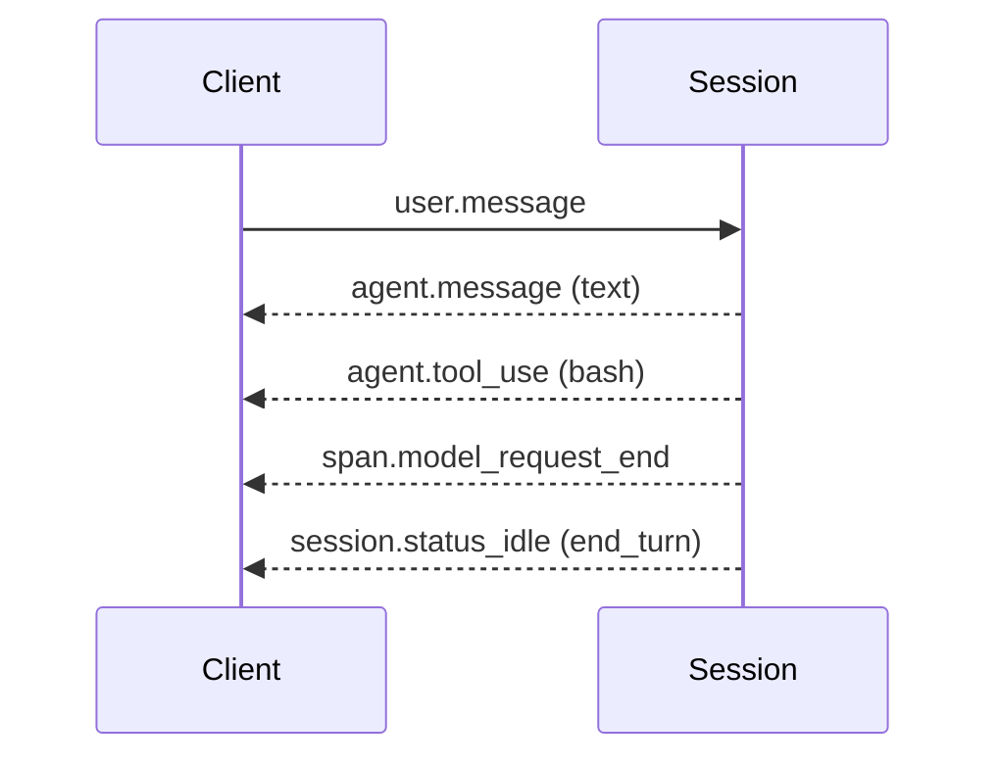

# Build Your First Managed Agent

## Cloud Containers with Network and Files

Every Session runs inside an Environment, and an Environment is a cloud container that Anthropic provisions, isolates, and tears down for you. The container ships with a configurable package set, a networking policy (unrestricted, allowlisted, or none), and a mount point at `/mnt/session/` that backs uploaded files. You define the container once as a resource, then bind it to as many Sessions as you need without paying the cold-start cost on every run.

```python
environment = client.beta.environments.create(
    name="analysis-env",
    config={"type": "cloud", "networking": {"type": "unrestricted"}},
)
```

The file-mount feature is the cleanest difference from the Messages API. Instead of streaming a base64 blob on every turn, you upload once, reference the file ID, and let the agent open it from disk inside the container.

Mounts belong to the Session, not the Environment. The Environment is the reusable template, so the same one can back many Sessions that each mount something different:

```python
session = client.beta.sessions.create(
    agent=agent.id,
    environment_id=environment.id,
    resources=[{
        "type": "file",
        "file_id": upload.id,
        "mount_path": "/mnt/session/uploads/sales.csv",
    }],
)
```

Traffic flows the other way too. Anything the agent writes under `/mnt/session/outputs/` is captured by the Files API, and `files.list(scope_id=session.id)` pulls the artifacts back out after the turn.

## Event-Based Communication Over SSE

You do not call the agent and wait for a JSON response. You open a Server-Sent Events stream and push `user.*` events in while the platform streams `agent.*`, `session.*`, and `span.*` events back. The stream is the steering wheel, not a notification channel.



The three event families map cleanly to the three things you care about: what the agent said, what the platform did to run it, and how individual model requests performed. A client only has to subscribe to the families it actually renders.

Two ordering rules save hours of debugging. Open the stream before sending the first event, because the stream carries only what happens after it opens and has no replay. And on reconnect, list the persisted events first and dedupe by event ID, because anything emitted while you were disconnected is gone from the stream but still queryable.

## Steering an Agent Mid-Execution

Because the stream is bidirectional in event terms, you can correct the agent without canceling the Session. Send another `user.message` while the agent is still running and it lands as the next instruction, the same way a teammate would interrupt a pairing session. Events are queued server-side and processed in order, so you never have to wait for a reply before sending the next one. A `user.interrupt` event jumps that queue and forces the Session to idle.

## Hands-On Demo

[Build a Managed Agent End to End](demo-first-agent.md) uploads a CSV, mounts it on a Session, streams the analysis, downloads the artifact the agent wrote, and cleans up.

## Resume for Continuity, Fork for Comparison

Two different questions get answered by two different operations, and picking the wrong one is how comparisons end up contaminated.

Resume continues one line of work. Yesterday's session holds valid context and no tool result has gone stale, so `--resume` (or `options.resume` in the SDK) replays the conversation and you carry on. It is always cheaper than re-uploading artifacts and re-explaining the task, and it preserves the reasoning path, not just the files.

Forking branches one line of work into several. After fifteen turns of profiling a slow ETL job, you want to try a broadcast join and a salting strategy and compare them fairly. Both need the profiling context; neither should see the other's attempts. `fork_session` copies the shared state into isolated branches, so each strategy develops from the same baseline without cross-contamination.

| Situation | Operation |
|---|---|
| Continuing yesterday's task, context still valid | Resume |
| Two candidate solutions to evaluate against one baseline | Fork |
| A new task that would only be polluted by the old history | New session |
| One session holds raw logs, another holds the reasoning; you need the reasoning | Resume the reasoning session, start a new one for the new task |

Reverting turns is not a substitute for forking. Undoing the broadcast-join attempt before trying salting leaves the model having seen the first attempt, which is exactly the contamination the comparison was meant to avoid.

## Subagents and Isolated Threads

A Session can delegate to other Agents through the multiagent coordinator pattern. The coordinator declares a roster of Agents it may call, and each delegate runs in its own **thread**: a context-isolated event stream with its own conversation history, model, and tools. All threads share the container and its filesystem, but not each other's context.

## Helpful Claude Slash Commands

| Command | Usage |
|---|---|
| `/mcp` | Mirror the MCP servers from a working local Claude Code session into the hosted Agent definition |
| `/cost` | Measure what a local prototype run costs before committing the same workload to a hosted Session |
| `/context` | Measure the actual context size of a local prototype to size the hosted Session's expected token usage |

## Key Topics covered in this module

- [Events and Streaming](https://platform.claude.com/docs/en/managed-agents/events-and-streaming): event types, SSE format, and reconnect semantics
- [Environments](https://platform.claude.com/docs/en/managed-agents/environments): networking policies and container configuration
- [Files](https://platform.claude.com/docs/en/managed-agents/files): upload, mount paths, session resources, and downloading session outputs
- [Multi-Agent](https://platform.claude.com/docs/en/managed-agents/multi-agent): coordinator rosters, threads, and cross-thread messages
