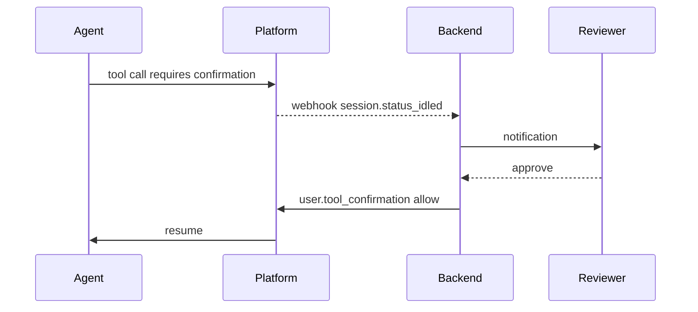

# Run Managed Agents in Production

## What the Platform Provides

A long-running agent needs four things around it: credential storage that refreshes tokens, an event channel for human handoffs, version pinning so a running Session survives a config change, and a trace view for when something stalls. Managed Agents ship all four as platform features, so each one below is configuration rather than infrastructure you build.

## OAuth Vaults and Token Refresh

A vault is a credential store that the platform reads on the agent's behalf. You create a vault, add credentials to it, and attach it to a Session through `vault_ids`. Credentials are matched to MCP servers by URL, and the secret fields are write-only: they are never returned in an API response.

```python
vault = client.beta.vaults.create(display_name="Alice")

client.beta.vaults.credentials.create(
    vault.id,
    display_name="Alice's Linear",
    auth={
        "type": "mcp_oauth",
        "mcp_server_url": "https://mcp.linear.app/mcp",
        "access_token": "...",
        "expires_at": "2026-08-15T00:00:00Z",
        "refresh": {
            "refresh_token": "...",
            "client_id": "...",
            "token_endpoint": "https://api.linear.app/oauth/token",
            "token_endpoint_auth": {"type": "none"},
        },
    },
)
```

Token refresh is the load-bearing part, and the `refresh` block is what enables it. A Session that idles overnight wakes up the next morning with a still-valid token, because Anthropic used the refresh grant in the background while the container was checkpointed.

The security boundary is worth stating plainly: a vaulted credential never enters the container. MCP calls are routed through an Anthropic-side proxy that injects the token after the request leaves the sandbox, so code running in the container cannot read or exfiltrate it even under prompt injection. The `environment_variable` credential type extends the same guarantee to plain CLIs and SDKs: the shell sees an opaque placeholder, and the real value is substituted at egress.

## Webhooks for Production Confirmation Flows

A long-lived agent cannot hold an HTTP connection open while a human reviews a draft email. Webhooks solve this by firing on `session.status_idled` and letting your backend resume the Session when a reviewer clicks approve. The pattern is the same one teams reach for with managed background workers, but the platform handles delivery, retries, and signing.



## Permission Policies and Tool Confirmation

Permission policies attach per tool inside the Agent's toolset and declare which calls require human confirmation before they execute. The platform pauses the Session at the protected call, emits `session.status_idle` with a `requires_action` stop reason, and waits for `user.tool_confirmation` with an explicit allow or deny.

```python
tools=[{
    "type": "agent_toolset_20260401",
    "default_config": {"permission_policy": {"type": "always_allow"}},
    "configs": [{"name": "bash", "permission_policy": {"type": "always_ask"}}],
}]
```

There are two policy types, `always_allow` and `always_ask`, and they apply to server-executed tools: the built-in toolset and MCP tools. Custom tools need no policy, because your own client executes them and can simply decline.

Pair this with vault-managed credentials and the agent operates with the least privilege it needs at every step. A leaked agent prompt cannot exfiltrate tokens or run a destructive command without a human in the loop.

## Versioning Agents as Deployable Units

An Agent is immutable per version, exactly like a container image tag. Each update publishes a new version; existing Sessions stay pinned to the version they started against. This makes staged rollouts trivial: route ten percent of new Sessions to the newest version, watch the traces, and either promote or roll back without touching the Sessions already running on the previous one.

```python
updated = client.beta.agents.update(agent.id, version=agent.version, system="...")

pinned = client.beta.sessions.create(
    agent={"type": "agent", "id": agent.id, "version": agent.version},
    environment_id=environment.id,
)
```

Version numbers count up per Agent, starting at `1`, so they are only meaningful next to the Agent ID they belong to. Passing the Agent ID as a bare string resolves to the latest version, and the `version` argument on `update` is an optimistic lock that makes two racing operators fail loudly instead of silently overwriting each other.

## Observability in the Console

The Console surfaces three views that map onto the three resources. A Session list with status filters, a tracing view that replays the SSE stream with span timing, and per-Session token usage broken down by tool call. None of this is custom work on your side, which is the point.

| View | What it answers |
|---|---|
| Session list | Which Sessions are running, idle, or archived right now |
| Tracing | What sequence of events led a Session to its current state |
| Token usage | Where the spend is going, per Session and per tool |

## The `ant` CLI and YAML Resources

The `ant` CLI lets you treat Agents and Environments as YAML files in a Git repository. The split is worth internalizing: the CLI owns the control plane (creating and updating Agents and Environments from checked-in YAML, applied from CI), and your application code owns the data plane (creating Sessions and streaming events). Beta resources live under an `ant beta:` prefix, and the CLI sets the beta header for you.

```bash
AGENT_ID=$(ant beta:agents create < agents/csv-analyst.yaml --transform id -r)
ant beta:agents update --agent-id "$AGENT_ID" --version 1 < agents/csv-analyst.yaml
ant beta:sessions:events stream --session-id "$SESSION_ID"
```

PowerShell treats `<` as a reserved token, so pipe the YAML in instead of redirecting it:

```powershell
$AGENT_ID = Get-Content agents/csv-analyst.yaml | ant beta:agents create --transform id -r
Get-Content agents/csv-analyst.yaml | ant beta:agents update --agent-id "$AGENT_ID" --version 1
ant beta:sessions:events stream --session-id "$SESSION_ID"
```

## Memory, Outcomes, Multiagent, and Schedules

Memory stores persist documents across Sessions and mount into the container as a filesystem directory. Outcomes turn a Session into a graded iterate-and-revise loop against a rubric you supply. Multiagent lets a coordinator delegate to a roster of other Agents, each in its own isolated thread.

Scheduled deployments round out the set: they fire Sessions on a cron cadence with no client-side scheduler.

Show the docs, note that Managed Agents is still in beta and the surface may move, and steer students to the stable primitives for production code.

## Required Beta Header

All Managed Agents API requests require a beta header, which the official SDKs set for you automatically on every `client.beta.agents`, `client.beta.environments`, and `client.beta.sessions` call:

```text
managed-agents-2026-04-01
```

If a raw curl test fails with a 404 on the agents endpoint, the missing header is almost always the cause. The one place you still pass it by hand is `files.list(scope_id=...)`, because that is a Files endpoint taking a Managed Agents parameter and the SDK only adds the Files header.

## Hands-On Demo

[Ship an Agent Version Behind a Permission Gate](demo-agent-versioning.md) publishes two Agent versions, pins one Session to each, and shows the same `bash` call running unattended on the first and pausing for `user.tool_confirmation` on the second.

## Helpful Claude Slash Commands

| Command | Usage |
|---|---|
| `/permissions` | Draft and review the local-harness permission rules that will become the hosted Agent's confirmation policy |
| `/mcp` | Verify which MCP servers a session relies on so the matching vault scopes can be provisioned in production |
| `/model` | Confirm the model used during prototyping before pinning it to a published Agent version |

## Key Topics covered in this module

- [Vaults](https://platform.claude.com/docs/en/managed-agents/vaults): credential creation, rotation, and OAuth refresh semantics
- [Webhooks](https://platform.claude.com/docs/en/managed-agents/webhooks): event types, HMAC signing, and delivery behavior
- [Permission Policies](https://platform.claude.com/docs/en/managed-agents/permission-policies): `always_allow`, `always_ask`, and per-tool configuration
- [Agent Setup](https://platform.claude.com/docs/en/managed-agents/agent-setup): create, update, list versions, and archive
- [Anthropic CLI](https://platform.claude.com/docs/en/api/sdks/cli): the `ant beta:` commands and version-controlled resource YAML
