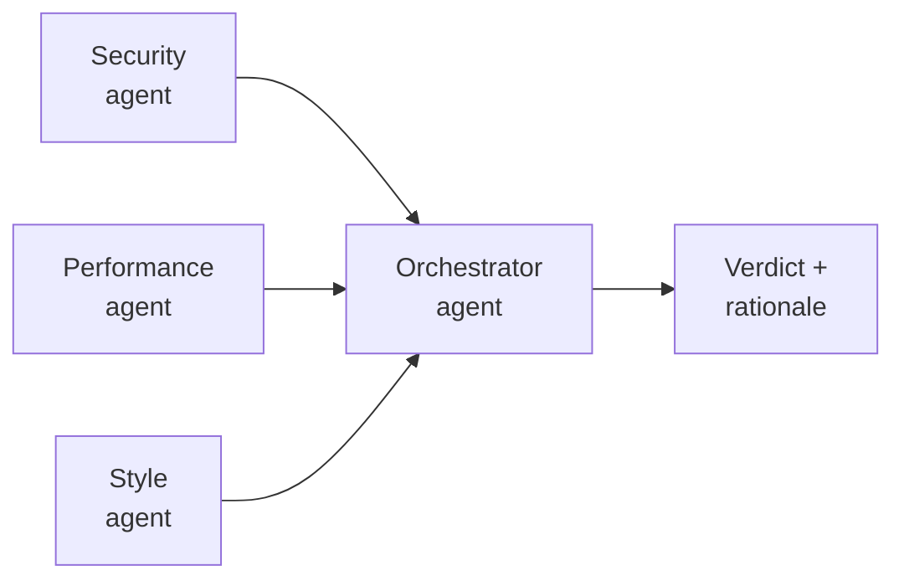

# Run Parallel Agents with the SDK

## The Parallel Pattern

`query()` returns a promise-backed async iterator. `Promise.all` over multiple `query()` calls gives true parallelism: wall-clock time equals the slowest session, not the sum. Three reviewers running in parallel take as long as the slowest one, not three times that.

```typescript
const [securityResult, perfResult, styleResult] = await Promise.all([
  runReviewer(fileContents, securityConfig),
  runReviewer(fileContents, perfConfig),
  runReviewer(fileContents, styleConfig),
]);
```

## Session Isolation

Each `query()` call is a fresh session with no shared context unless you explicitly resume one with the `resume` option. This is the property that makes parallel agents safe: no prompt leakage between sessions, each agent sees only its own conversation history, and you can run dozens in parallel without cross-contamination.

The canary test verifies isolation before you ship any new parallel pipeline:

```typescript
const CANARY = "XYZZY_CANARY_42";

const [, sessionBText] = await Promise.all([
  collectText(query({ prompt: `Review for security. Canary: ${CANARY}\n\n${file}` })),
  collectText(query({ prompt: `Review for performance.\n\n${file}` })),
]);

console.log(sessionBText.includes(CANARY) ? "FAIL" : "PASS");
```

Run this once per new pipeline. PASS means the sessions are genuinely isolated; FAIL means context leaked and you have a reliability problem.

## The Orchestrator Pattern



The orchestrator is a fourth Claude session that reads only the three reviewer outputs, never the source file. Its job is to deduplicate findings, resolve contradictions, and issue one verdict. This keeps specialist agents focused and reconciliation an explicit, auditable step.

## Typed Contracts Across Agents

Each reviewer returns the `ReviewSchema` that [Typed Output with Zod](../02-api-surface/readme.md#typed-output-with-zod) introduces, with `none` added to the severity enum so a clean pass has a value to report. What is new here is the second contract, one hop further along: the orchestrator consumes three of those objects and produces its own.

```text
Reviewer → ReviewSchema → Orchestrator → OrchestratorSchema → CI exit code
```

```typescript
const OrchestratorSchema = z.object({
  deduplicated_findings: z.array(z.string()),
  contradictions: z.array(z.string()),
  verdict: z.enum(["block", "comment", "approve"]),
  rationale: z.string(),
});
```

## Demo 2: Three Parallel Reviewers + Orchestrator

See [demo-parallel-reviewers.md](demo-parallel-reviewers.md).

## Discussion Prompt

```text
You have a parallel pipeline with three agents reviewing the same file.
How do you verify the sessions are isolated?
What does the orchestrator do that the three reviewers cannot?
When does a typed contract at the boundary matter more than free-form prose?
```

## Helpful Claude Slash Commands

| Command | Usage |
|---|---|
| `/cost` | Check what six agent sessions in one run actually cost before scaling the fan-out |
| `/model` | Switch the session model when a cheaper reviewer is good enough for a specialty pass |
| `/security-review` | Audit the parallel pipeline code before connecting it to a real CI system |

## Key Topics covered in this module

- [Claude Code SDK Documentation](https://code.claude.com/docs/en/agent-sdk/overview): Session isolation and the `resume` option in multi-agent pipelines
- [Zod](https://zod.dev): Typed output contracts between parallel agents and the orchestrator
- [GitHub Actions](https://docs.github.com/en/actions): Lab 02 packages this pipeline as a reusable workflow
