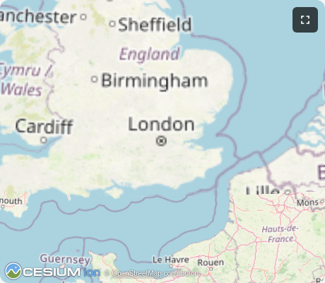

# Interactive Map MCP App



An MCP App that gives Claude Code two geographic tools: one to search for places by name, and one to display an interactive 3D globe zoomed to a location. The tools are designed to be chained — geocode a place, then pass its bounding box straight to `show-map`.

The globe is built on [CesiumJS](https://cesium.com/platform/cesiumjs/) loaded from CDN, with [OpenStreetMap](https://www.openstreetmap.org/) tiles. No API keys or accounts required.

## How it works

### Tools

**`geocode`**

Searches OpenStreetMap's geocoding API and returns up to 5 matches with coordinates and bounding boxes.

```
Input:  { "query": "Colosseum Rome" }

Output: 1. Colosseum, Rome, Lazio, 00184, Italy
           Coordinates: 41.890942, 12.491903
           Bounding box: W:12.4911, S:41.8894, E:12.4937, N:41.8910

        2. Colosseum, Piazza del Colosseum, Rome ...
           ...
```

Rate-limited to one request per second to comply with OpenStreetMap's usage policy.

**`show-map`**

Flies the 3D globe to a bounding box and optionally labels the location. Defaults to London if called with no coordinates.

```
Input:  { "west": 12.4911, "south": 41.8894,
          "east": 12.4937, "north": 41.8910,
          "label": "Colosseum, Rome" }

Output: { "viewUUID": "1f2fe687-...",
          "content": "Displaying globe at: W:12.4911, S:41.8894, ..." }
```

The `viewUUID` in the response identifies the rendered view state. The globe itself is served as an MCP App resource (`ui://cesium-map/mcp-app.html`) — it only renders visually inside an MCP App-aware host.

### Architecture

```
Claude Code
    │
    ├─ tools/call: geocode      ──▶  OpenStreetMap geocoding API
    │                                (rate-limited, no auth)
    │
    └─ tools/call: show-map     ──▶  CesiumJS globe UI
                                     (served as mcp-app.html resource)
```

The server runs as a stateless streaming HTTP server — each POST to `/mcp` creates a fresh server instance, handles the request, and closes. No session state is kept between calls.

## Prerequisites

- [Node.js](https://nodejs.org/) 20+
- [Bun](https://bun.sh/) — used by the build script to bundle the server files into `dist/`

## 1. Install dependencies

```bash
npm install
```

## 2. Build

```bash
npm run build
```

This runs three steps in sequence:

1. `tsc --noEmit` — type-checks the browser code in `src/`
2. `vite build` — bundles `mcp-app.html` + `src/mcp-app.ts` into a single self-contained HTML file at `dist/mcp-app.html`
3. `bun build` — bundles `server.ts` and `main.ts` into `dist/server.js` and `dist/index.js`

## 3. Start the server

```bash
PORT=3003 node dist/index.js
```

Or use the npm script (rebuilds first):

```bash
PORT=3003 npm run start:http
```

Expected output:

```
MCP server listening on http://localhost:3003/mcp
```

The default port is `3001`. This repo uses `3003` to avoid conflicts — set `PORT` to any free port.

## 4. Register in `.mcp.json`

The `.mcp.json` at the repo root already includes this entry:

```json
"labs-mcp-map": {
  "type": "http",
  "url": "http://localhost:3003/mcp"
}
```

Run `/mcp` in Claude Code to reload servers after the map server is running. The `geocode` and `show-map` tools will appear in the tool list.

## 5. Test it

With the server running, try any of these prompts in Claude Code:

> Find the Colosseum in Rome, then show it on the map.

> Show me where Mount Everest is on the map.

> Locate the Golden Gate Bridge and display it on the map.

> Show me the Great Wall of China.

> Find the Sydney Opera House and zoom in on it.

> Where is the Inca citadel in Peru? Show it on the map.

Each prompt follows the same two-step pattern: Claude calls `geocode` to resolve coordinates, then passes the bounding box to `show-map`. You can verify both tool calls succeeded by inspecting the outputs in the conversation — `geocode` returns a text list of matches, and `show-map` returns a `viewUUID` with a coordinate confirmation string.

### Why the globe does not render visually in Claude Code

The `show-map` tool response includes a `_meta.ui.resourceUri` field pointing to `ui://cesium-map/mcp-app.html`. This is a signal from the MCP App SDK to the host: *"there is an embeddable UI available at this URI, please render it."*

Claude Code is a CLI tool. It has no browser engine and no mechanism to fetch a `ui://` resource, load HTML, or execute JavaScript. It receives the JSON tool response and surfaces the text content — the `viewUUID` and coordinate string — but silently ignores the `ui://` hint because it has no way to act on it.

The rendering requires an **MCP App host**: a client that understands the `ui://` URI scheme, fetches the bundled `mcp-app.html` from the server's resource endpoint, and displays it in an isolated iframe or webview. The [`basic-host`](https://github.com/modelcontextprotocol/ext-apps/tree/main/examples/basic-host) example is the reference implementation of such a host.

### Would it be visible in the terminal?

No. CesiumJS renders a 3D globe using WebGL — a graphics API that requires a browser context. Terminals display text and ANSI escape sequences only. Even if the HTML were somehow piped to the terminal, there is no JavaScript engine, no DOM, and no GPU pipeline available to run it.

The full rendering chain requires: browser engine → JavaScript runtime → WebGL context → CesiumJS → OpenStreetMap tiles fetched over HTTP. None of those layers exist in a terminal.

## Key files

| File | Purpose |
|---|---|
| [`server.ts`](server.ts) | MCP server — registers `geocode` and `show-map` tools and the `ui://` resource |
| [`main.ts`](main.ts) | Entry point — starts streaming HTTP (port via `PORT`) or stdio transport |
| [`mcp-app.html`](mcp-app.html) | HTML shell for the CesiumJS globe |
| [`src/mcp-app.ts`](src/mcp-app.ts) | Browser app — loads CesiumJS from CDN, handles `navigate-to` inputs, persists camera state |
| [`vite.config.ts`](vite.config.ts) | Bundles `mcp-app.html` + `src/mcp-app.ts` into a single inlined file via `vite-plugin-singlefile` (single-file bundler) |
